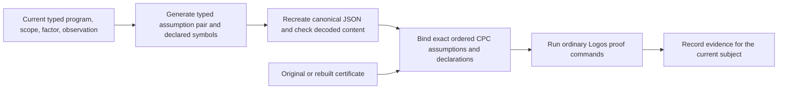

# Rechecking CPC evidence against changed typed source

## Binding under test

A CPC proof addresses ordered typed assumptions and declarations. A source-level claim also picks a typed program, initial scope, factor identity and observation contract. The actual LLMLang prototype regenerates its own canonical query from those inputs, checks byte equality against the relayed wire, checks the typed decoder result, and then checks the parsed CPC declarations, assumptions and proof verdict. The experiment replays that gate while varying source-side inputs independently. Its baseline is `research/all` commit `d0be069bc08e456dd3f173537245e42612ec7c6e`. [Typed JSON correspondence](RT-07-TYPED-JSON-CORRESPONDENCE.md) · [Scenario 34](RESEARCH-SCENARIO-34-SOURCE-TO-QUERY-SEMANTIC-CORRESPONDENCE.md#76-qf_lia-admissibility-and-external-wirechecker-boundary)



The runner rebuilds the source-wire dependency graph from an exact Git archive and uses the pinned Logos runtime package. The kernel reports `propext`, `Classical.choice` and `Quot.sound` for the two inspected gate theorems, one for exact admitted-decode content and the other for binding an accepted check to the ordinary Logos verdict. The runtime verdict is still subject to the separate Logos soundness and trust boundary. [Gate fixture](SOURCE-PROOF-REBINDING-01/Rebind.lean) · [Original proof](SOURCE-PROOF-REBINDING-01/proof.cpc) · [Verdict proof audit](RT-07-LOGOS-VERDICT-PROOF-2026-11-25.md)

## Results

The old proof applies after the full gate to the original program and to three source changes that regenerate identical wire bytes. Five admitted source edits change the wire. They fail with the old wire at the source gate and with freshly generated wire at the CPC assumptions gate. Three other revisions fail to form an admitted source query. [Evidence ledger](SOURCE-PROOF-REBINDING-01/evidence.json) · [Table generator](SOURCE-PROOF-REBINDING-01/chart.py)

| Source case | Reuse old wire | Reuse old proof with fresh wire | Check rebuilt proof |
| --- | --- | --- | --- |
| `base` | admitted | admitted | untried |
| `sequence_of_two_skips` | admitted | admitted | untried |
| `renamed_factor` | admitted | admitted | untried |
| `unused_hidden_declaration` | admitted | admitted | untried |
| `unused_visible_state` | source-or-wire | assumptions | admitted |
| `observed_state` | source-or-wire | assumptions | untried |
| `different_constant_return` | source-or-wire | assumptions | admitted |
| `dependent_return` | source-or-wire | assumptions | untried |
| `new_factor_identity` | source-or-wire | assumptions | admitted |
| `factor_role_changed` | source-or-wire | source-unavailable | untried |
| `factor_uninitialized` | source-or-wire | source-unavailable | untried |
| `ambiguous_duplicate_name` | source-or-wire | source-unavailable | untried |

The unused visible state changes only the declaration table. This distinguishes matching formula terms from matching the entire checker context. The regenerated variants for that declaration, the changed constant return and the changed factor identity pass with a freshly built candidate CPC file. Each candidate is an explicit fixture transform and is checked as a new proof artifact. The experiment exercises no general certificate rewrite or equivalence rules.

A source receipt can retain exact source subject identity even when different subjects derive the same wire digest. Identical wire lets the checker reapply the same CPC proof to each regenerated subject. The conclusion uses the source correspondence for that particular admitted subject. The checked fragment does not establish a production parser, a canonical source identity format, arbitrary equivalence of different formulas or an accepted Logos trust policy.

## Reproduction

Use CPython 3.12.14 and x86-64 Linux Lean 4.36.0 revision `611c117bfaf7b7ae1cfcf246ce6fba31e8f509e9`. Set `LOGOS_CHECKOUT` to a clean checkout of Logos `cf18742973861b3718d04c5f25775448098ff474` with the runtime Cpc Lean library built under the same Lean version. The ledger pins the runtime API module digest. Run from repository root with the historical LLMLang commit available.

```sh
set -eu
fixture=research/formal-verification/RT-07/SOURCE-PROOF-REBINDING-01
out=$(mktemp)
trap 'rm -f "$out"' EXIT
python3 -B "$fixture/run.py" --logos "$LOGOS_CHECKOUT" > "$out"
cmp "$fixture/evidence.json" "$out"
python3 -B "$fixture/chart.py"
```

[PLAN §2.2](../../../PLAN.md#22-proof-architecture-and-proof-boundary) · [Issue #294](https://github.com/aivibeflow/LLMLang/issues/294)
