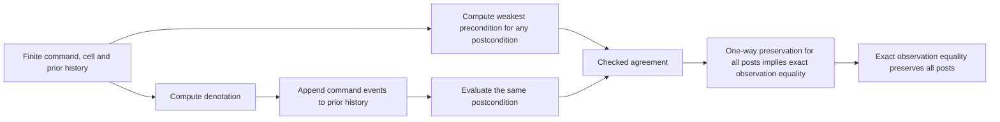

# RT-07 — Kernel-checked observation equivalence for state and Result

**Scope:** PLAN §2.1 and [#293](https://github.com/aivibeflow/LLMLang/issues/293), with the finite operational replay pinned to `d554c0fdbdbb6814db6e5faf5dae3853f306b2d7`. The proof uses the closed fragment of the [three-semantics pilot](RT-07-THREE-SEMANTICS-STATE-RESULT-2026-11-25.md).

When can LLMLang replace a deterministic computation while preserving every guarantee a client could state about its observation? The pilot compared selected postconditions and included a witness that hides writes when only the final value is checked. This study gives a Lean theorem for the precise correspondence between the denotation and predicate transformer, then checks how the modeled criterion applies to the pinned operational observations.

## Model and checked claims

A command is a no-op, planned Result failure, read, Boolean write, constant branch, strict sequence or Result sequence. Commands are finite trees. Each initial cell produces one total observation containing the tagged Result, final cell and ordered read/write events. The transformer also accepts prior logical history. Write-to-true, then restore-to-false makes the effect history visible even at an unchanged final cell.

The [Lean model](THREE-SEMANTICS-01/Observation.lean) defines two interpreters. `denote` computes the observation. `wp` computes whether a supplied postcondition holds, using composition from the desired result back to the initial cell and history. In the Lean trace the Boolean cell corresponds to numeric 0/1 in the existing Python fixture.



The checked `wp_agrees` theorem covers every well-formed command in this grammar, every Boolean initial cell, arbitrary prior history and every predicate on complete observations. It uses structural induction over the command. For the sequencing cases, trace concatenation and the failure branch determine which continuation receives the prior effects.

The stronger comparison uses **one-way preservation**. For every postcondition, cell and prior history, if the old command meets the postcondition then the replacement also meets it. In this total deterministic model, the one-way claim holds exactly when the two denotations agree at every initial cell. In the forward direction choose the postcondition “observation equals the old observation” and choose empty prior history. That predicate singles out the unique old observation. The reverse direction uses the `wp_agrees` theorem and equality. This criterion quantifies over arbitrary predicates on the full observation. A single public contract, a restricted observation projection, or nondeterministic outcome sets supply different comparison relations. [Finite contract relation study](../../language-design/RT-04/RT-04-CONTRACT-RELATIONS-FINITE-COMPARISON-2026-11-25.md)

| Kernel result | Scope |
| --- | --- |
| `wp_agrees` | All named command constructors, cells, histories and postconditions |
| `preserves_posts_iff_same_observation` | One-way postcondition preservation is exact complete-observation equality in the model |
| `same_final_cell_and_result` | No-op and restore agree in the projection at initial false |
| `restore_not_substitutable_for_all_posts` | The restore command writes twice, distinguishing it from no-op in the full observation |

Lean reports `propext` for the result-and-cell equality and `propext` plus `Quot.sound` for the other three theorems. The [replay ledger](THREE-SEMANTICS-01/lean-evidence.json) retains the actual axiom lines and generated proof source digests.

## Operational alignment and limit

The replay regenerates the 8,210 pinned comparison rows, assembles an exact Lean equality for each result, final cell and ordered event list, and checks them by reflexivity. The Lean replay has 32 batches of 256 plus an 18-row batch. A separate proof script that attempts to identify no-op and restore as complete observations is rejected. These checks connect the explicit Lean values to the archived Python corpus through a handwritten encoder. The theorem itself still applies to the Lean command model. A checked source-to-model encoder for general LLMLang, typed mutable regions, state aliasing, divergence, dynamically evaluated guards, native lowering and independent review remain open.

## Reproduce

Use CPython 3.12.14, Git 2.52.0 and Lean 4.36.0 at `611c117bfaf7b7ae1cfcf246ce6fba31e8f509e9`. The [replay wrapper](THREE-SEMANTICS-01/replay_lean.py) verifies the pinned runner and ledger, rebuilds the model, checks axiom names and records the batch digests. It writes generated proofs to a temporary directory. Mermaid syntax was inspected directly. This is a model theorem and an exact replay of the finite operational observations, with no timing measurement or adoption decision.

```sh
fixture=research/formal-verification/RT-07/THREE-SEMANTICS-01
LC_ALL=C PYTHONHASHSEED=1 python3 -B "$fixture/replay_lean.py" \
  --lean "$(command -v lean)" > /tmp/llmlang-state-result-proof.json
cmp "$fixture/lean-evidence.json" /tmp/llmlang-state-result-proof.json
```
