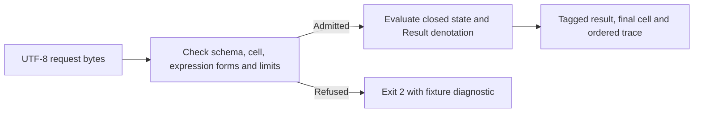

# RT-07 — Executable reference entry for the state and Result subset

## Scope

This entry point evaluates a deliberately small LLMLang research subset with one Boolean-valued cell, explicit read and write effects, and tagged Result values. It exposes the existing denotation from the [three-semantics pilot](RT-07-THREE-SEMANTICS-STATE-RESULT-2026-11-25.md) through an exact input grammar and process interface. The grammar is a fixture encoding. The observable result consists of the exact Result tag and payload, final cell, and ordered new read/write events. [PLAN §2.1](../../../PLAN.md#21-formal-semantics-of-the-language) · [#293](https://github.com/aivibeflow/LLMLang/issues/293)

## Input and evaluation

A request is a UTF-8 JSON array with a schema marker, an initial cell of integer zero or one, and one program. The accepted program forms are:

| Program | Meaning |
| --- | --- |
| `["skip"]` | Return successful unit without a new event. |
| `["read"]` | Return the current cell and append its read event. |
| `["write", n]` | Set the cell to zero or one and append the write event. |
| `["fail"]` | Return the fixture's planned error. |
| `["strict", P, Q]` | Evaluate both in order. The right receives the state produced by the left and its tagged result becomes the sequence result. |
| `["bind", P, Q]` | Evaluate the left first. A left error is final with its state and effects. On left success, run the right in the updated state. |
| `["then", P, Q]` / `["else", P, Q]` | Evaluate only the chosen child. The closed program admission still checks both children. |

When both children run, their newly observed effects concatenate in execution order. The fixture accepts at most 65,536 input bytes and 32 child edges of expression depth. An unsupported tag, bad arity, wrong request marker or noncanonical cell type is refused at admission. The process returns exit 2 for malformed or unsupported input and exit 0 for an evaluated observation, including an admitted program that produces a Result error.



For example, the following admitted program yields a planned error, cell zero and no write:

```sh
fixture=research/formal-verification/RT-07/STATE-RESULT-REFERENCE-01
printf '%s\n' '["llmlang-state-result-reference/1",0,["bind",["fail"],["write",1]]]' |
  python3 -B "$fixture/reference.py"
```

## Checked results

All 8,210 encoded requests from the existing finite corpus match both the recursive operational evaluator and the small-step machine. The corpus covers 4,105 expression trees at both initial cell values. A separate process-level check runs three positive controls for strict sequencing, Result propagation and state restoration. All 12 refusal controls return the expected diagnostic, including unsupported forms in an unselected branch, Boolean values substituted for integers, invalid UTF-8, malformed JSON, and byte and depth limits.

Independent agreement comes from the existing recursive and small-step evaluators. The new reference entry exposes the previously compared denotation and checks its wire admission and process output. It defines an executable reference for this closed subset while leaving the language's source syntax and general semantics open.

## Reproduce

The baseline was `f78a70a5bbb868dd496e8de303fe19431d2d6cde` on `research/all`. Replay used CPython 3.12.14 on Debian 13 Linux 6.18.57 x86-64:

```sh
fixture=research/formal-verification/RT-07/STATE-RESULT-REFERENCE-01
out=$(mktemp)
python3 -B "$fixture/validate.py" > "$out" &&
  cmp "$fixture/evidence.json" "$out"
```

The [validation record](STATE-RESULT-REFERENCE-01/evidence.json) pins exact interpreter sources, the ordered observation digest and all process-level controls. The [reference entry](STATE-RESULT-REFERENCE-01/reference.py) and [comparison runner](STATE-RESULT-REFERENCE-01/validate.py) regenerate the result. The fixture leaves loops, recursion, general types, resources, files, concurrency, dynamic environments and production source/SPG correspondence open.
