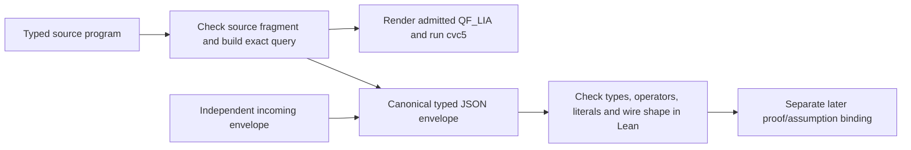

# Validate the strict QF_LIA profile before query execution

**Scope:** PLAN §2.3 and [#295](https://github.com/aivibeflow/LLMLang/issues/295). Exact source baseline `0ef40055665a73b82c6ac30c2ea88f71b8947331` on `research/all`.

## Question and method

[Scenario 31](RESEARCH-SCENARIO-31-STRICT-QF-LIA-PROFILE.md) proposes a conservative fragment for relational queries. A source program can use constructs the fragment excludes, and an external typed query can be supplied without using the source builder. This audit exercises both entry points on the exact archived code. It passes only source-emitted terms to cvc5 and calls the independent Lean decoder on valid and mutated JSON envelopes.



The fixed discipline is stricter than simplification-based admission. It accepts exact `Bool` and mathematical `Int` literals and permits multiplication with an integer literal operand. For example, multiplying by a literal −2 passes, while multiplying by an expression that computes 2 is outside the tested subset. Rejecting before any arithmetic normalization avoids making the correctness of simplification part of this boundary. Supporting a larger fragment could be a separate profile with explicit semantics and checked lowering.

## Results

The 30 existing Python tests passed from the pinned tree. Of 12 focused source inputs, four emitted QF_LIA queries and eight were rejected before invoking the solver. Among the admitted queries, cvc5 returned SAT for paired values that change the observed integer, Boolean or literal-multiplied return. It returned UNSAT for the constant-return observation. These engine results have no independent certificate in this audit.

The eight source rejections cover a string declaration, a string literal, variable-by-variable multiplication, a multiplier written as a constant expression, a pair of canceling nonlinear subexpressions, division, Boolean arithmetic and an emitted effect. The algebraically canceling example checks that unsupported syntax cannot become admissible simply because the result appears equivalent to a linear term.

The exact Lean tool check admitted the four Python-produced wire envelopes and rejected all ten independent mutations. Those mutations cover wrong sort, wrong literal representation, multiplication without a literal operand, unsupported division, mixed-sort equality, an unexpected atom attached to an operator, and unknown schema or envelope fields. The [machine-readable result](STRICT-QFLIA-ADMISSION-01/evidence.json) preserves each diagnostic, exact source hashes and the wire fixture digest.

Admission establishes that this entry point understands the declared syntax and term sorts. The broader proof path still needs declaration binding, exact ordered assumptions, source correspondence, and an independently checked witness or certificate. The [typed JSON correspondence study](RT-07-TYPED-JSON-CORRESPONDENCE.md) checks generated envelopes within its formal boundary. This audit does not exercise transport, hostile input-size limits, every raw JSON spelling, proof admission, or external parser compatibility.

## Reproduce

Use CPython 3.12.14, Git 2.56.1, Lean/Lake 4.36.0 at `611c117bfaf7b7ae1cfcf246ce6fba31e8f509e9`, and cvc5 1.4.2 at `282d5e0c84baf49c780704c532f87ba66d8b513d`. Put the exact Lean toolchain on PATH and set `CVC5`. Lake materializes Logos at `cf18742973861b3718d04c5f25775448098ff474`. The [runner](STRICT-QFLIA-ADMISSION-01/run.py) and [Lean driver](STRICT-QFLIA-ADMISSION-01/Decode.lean) use the pinned module via its normal decoder entry point.

```sh
set -eu
scratch=$(mktemp -d)
git archive 0ef40055665a73b82c6ac30c2ea88f71b8947331 research | tar -x -C "$scratch"
fixture=research/formal-verification/RT-07/STRICT-QFLIA-ADMISSION-01
cp -R "$fixture" "$(dirname "$scratch/$fixture")/"
prototype="$scratch/research/PROTOTYPES/DEPENDENCY-GRAPH-01"
(
  cd "$prototype"
  python3 -B -m unittest discover -s tests -p 'test_qf_lia_profile.py'
  cd logos_binding
  lake update
  lake build +LLMLangLogosBinding
)
python3 -B "$scratch/$fixture/run.py" --binding "$prototype/logos_binding" --cvc5 "$CVC5" \
  > "$scratch/evidence.json"
cmp "$scratch/evidence.json" "$fixture/evidence.json"
```

The counts cover the named cases and no population estimate. Mermaid source was inspected directly.
