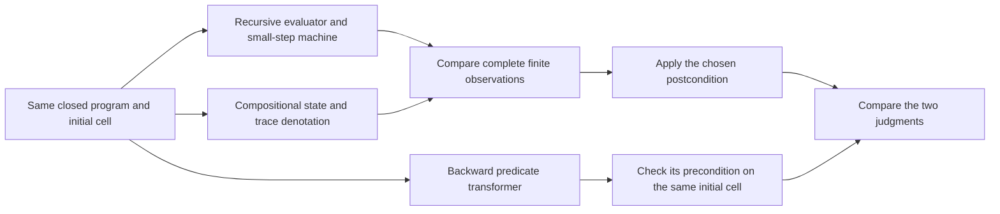

# RT-07 — Operational, denotational, and axiomatic views of a state and Result fragment

**Scope:** PLAN §2.1 and [#293](https://github.com/aivibeflow/LLMLang/issues/293). Candidate semantics comparison against the two RT-03 evaluators at `8cf3ec125a67e0eb0293fd632b18f09a771aea0c`.

The same stateful computation serves three different purposes. An operational evaluator executes a program and records what happened. A denotation composes meanings without prescribing evaluation-machine implementation. An axiomatic account calculates the initial conditions that suffice for a specified outcome. This pilot asks whether the three accounts agree on both results and effects in a shared fragment, including the distinction between ordinary sequencing and explicit error propagation.

## Fragment and observation

The finite state is one cell with values 0 and 1. The leaves are successful no-op, read cell, write 0, write 1, and a planned Result error. All leaves produce tagged values. A read or write appends a corresponding event with the observed or written value. The four binary program forms are strict sequencing, Result sequencing, and a lazy conditional with either constant Boolean choice. Strict sequencing executes its right operand even if the left produces an error value. Result sequencing returns the first error and skips the rest. The condition does not perform an effect. Operations are declared under the exploratory effectful RT-03 profile D.

An observation is the triple of tagged result, final cell and ordered trace. Read and write operation names and their relevant payloads survive projection of the interpreter's records. The fixture keeps files, resources and foreign effects outside the fragment. With these restrictions, the model has a total deterministic observation on each initial cell.



The operational route translates the same closed program into the existing evaluators' AST. The denotation takes a cell and returns the observation. For a sequence it feeds the left output cell to the right and appends the effect lists in order. The predicate transformer, denoted by $wp(c,Q)$ for program $c$ and desired postcondition $Q$, instead composes predicates backward. For strict sequencing, it applies the right command's precondition to the left final state and accumulated history. For Result sequencing, it uses $Q$ immediately when the left finishes with an error. The transformer tracks the trace as logical history so it can express obligations such as absence of writes.

## Agreement and comparisons

There are five leaf programs, 100 depth-one programs, and 4,000 depth-two programs with exactly one depth-one child. Both initial cell values are checked for every program. The three execution accounts agree on all 8,210 observations. For each observation seven postconditions compare the predicate transformer with direct evaluation of the denotation. All 57,470 judgments agree. Postconditions cover the success tag, success with unit, preserved cell, first effect, absence of writes, exact observation and an intentionally wrong final cell.

| Control at initial cell 0 | Strict or first program | Short-circuit or second program |
| --- | --- | --- |
| Planned error then write 1 | Success with unit, cell 1, trace `write(1)` | Planned error, cell 0, empty trace |
| No-op versus write 1 then restore 0 | Success with unit, cell 0, empty trace | Success with unit, cell 0, trace `write(1), write(0)` |

The first control makes the sequencing rule visible at the result, state and trace boundaries. The second has identical results and final cells while the write prohibition holds for only one program. The axiomatic check reproduces that difference by using logical history. A final-state-only triple would be unable to state the write prohibition in this model.

For this deterministic fragment, the weakest-precondition argument works by structural induction. For each leaf, evaluating the transformer applies $Q$ to the leaf result, new cell and prior history with the leaf's effects appended. A constant conditional uses the selected child's property. In strict sequencing, substitute the left child's observed cell and extended history into the right child's property. Associativity of trace concatenation gives the same history as the denotation. Result sequencing adds the early-error branch, where both accounts end with the left observation. The resulting predicate is weakest because it contains exactly the initial cells for which the unique observation satisfies $Q$. This is a paper argument for the stated rules. The script checks selected predicates and two operational implementations, rather than claiming a kernel formalization.

## Trade-offs and limitations

The operational models can retain execution structure for diagnostic work. The denotation exposes composition and observation boundaries directly. The predicate transformer makes the requested guarantee explicit and can express trace properties if its logical state includes the relevant history. All three depend on the exact Result sequencing, effect projection and environment assumptions. The [minimal semantic core](RESEARCH-SCENARIO-26-MINIMAL-FORMAL-SEMANTIC-CORE.md) uses a related observation distinction for finite dependency claims.

The comparison covers finite, deterministic, terminating, well-formed programs and constant guards. Input-dependent conditions, resource scopes, asynchronous cancellation, aliasing, concurrency, infinite traces, general recursion, divergence and source correspondence remain open. The projection and program translation are small handwritten adapters. There is no language profile selection or transfer into the candidate specification.

## Reproduce

Run from the repository root with CPython 3.12.14 and Git 2.52.0. The [runner](THREE-SEMANTICS-01/run.py) verifies the two existing interpreter files against the pinned tree. The [ledger](THREE-SEMANTICS-01/evidence.json) records the corpus counts, control outputs and SHA-256 of the ordered comparison rows. The optional JSON Lines export writes each program, input, common observation and predicate answers. These are exact finite counts with no timing or sampling result. Mermaid syntax was inspected directly.

```sh
fixture=research/formal-verification/RT-07/THREE-SEMANTICS-01
LC_ALL=C PYTHONHASHSEED=1 python3 -B "$fixture/run.py" \
  --rows /tmp/llmlang-three-semantics-rows.jsonl > /tmp/llmlang-three-semantics.json
cmp "$fixture/evidence.json" /tmp/llmlang-three-semantics.json
sha256sum /tmp/llmlang-three-semantics-rows.jsonl
```
