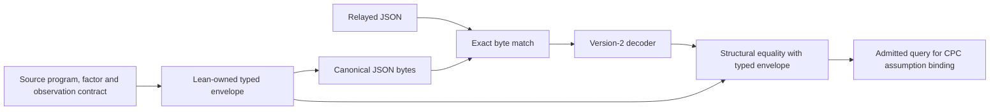

# RT-07 canonical JSON correspondence for accepted queries

The version-2 source gate already checked that a relayed JSON envelope matched the bytes generated by Lean. The remaining SCW-31 question was whether the accepted **typed decoder output** also matched the compiled source query, including its declarations and both ordered assumptions. The source compiler, supported sorts and canonical symbol map are the existing RT-07 profile. [Source-owned envelope](RT-07-SOURCE-OWNED-QUERY-ENVELOPE.md) · [Scenario 34](RESEARCH-SCENARIO-34-SOURCE-TO-QUERY-SEMANTIC-CORRESPONDENCE.md#76-qf_lia-admissibility-and-external-wirechecker-boundary)

## Binding the bytes and typed content



Lean constructs the expected typed envelope before rendering JSON. The gate compares the received bytes to that rendering, decodes them, and compares both typed expressions and all metadata to the expected envelope. The metadata comparison includes the ordered declaration names and sorts, factor identifiers and the observation contract. The term comparison recurses through operators, symbols, literals and ordered operand lists. A successful comparison carries an equality proof. This includes terms under both branches of an `ite`.

The kernel checks two entry-point theorems. `decodeSourceEnvelope_matches` binds any accepted decode to the exact Lean-generated bytes. `decodeSourceEnvelope_typed` proves that the source compiler's typed envelope and the JSON decoder output equal the same accepted value. Consequently an accepted wire term has the same evaluation as the corresponding Lean-owned renamed term for every valuation. The separately proved renaming lemma relates that term to the internal term under a pulled-back valuation. The [axiom audit](../../PROTOTYPES/DEPENDENCY-GRAPH-01/logos_binding/evidence/typed-json/axioms.txt) lists only the standard Lean axioms.

Relying on byte equality alone leaves the decoder result unspecified by the gate's theorem. A total serializer/parser inverse could additionally prove that all admitted source terms successfully round-trip. The structural gate takes a smaller step. It checks equality of every accepted result and fails closed if generation and decoding ever disagree. It retains the exact byte rule and does not admit alternate encodings with equivalent meaning.

## Validation and implications

| Check | Result |
| --- | --- |
| Int and Bool factor envelopes | Both pass the typed and byte gates. The [two emitted envelopes](../../PROTOTYPES/DEPENDENCY-GRAPH-01/logos_binding/evidence/typed-json/envelopes.jsonl) also match the baseline bytes from `41bd03e`. |
| Typed mismatch | Replacing either assumption, changing the contract, reversing declarations or changing declaration sorts is rejected by the typed comparison. |
| Nested terms and operand order | A matching nested expression is accepted. Swapped Boolean operands are rejected even when they would be semantically interchangeable for that operator. |
| Existing Logos paths | The source-derived CPC, source-to-wire-to-Logos and standalone parser/typed-renderer regressions continued to pass. |

This closes the exact acceptance boundary in SCW-31 for the existing typed JSON path. It supports reuse of the source compiler's theorem across a relayed query without delegating choice of assumptions to the relay. The observed fixtures exercise compatibility with previous encoding. The new theorem covers acceptance soundness and does not guarantee that every source query will be accepted. General interpretation of rendered Logos terms, complete proof-assumption semantics and the wider checker trust boundary remain under SCW-32–34. No performance measurement was taken. The diagram shows the gate order and the table records the discrete outcomes.

## Reproduce

Use Lean 4.36.0 commit `611c117bfaf7b7ae1cfcf246ce6fba31e8f509e9` and Logos pinned at `cf18742973861b3718d04c5f25775448098ff474`. Run from the repository root.

```sh
cd research/PROTOTYPES/DEPENDENCY-GRAPH-01/logos_binding
lake update --keep-toolchain
lake build --fail-fast LLMLangLogosBinding
lake env lean -DwarningAsError=true --run SourceQueryEnvelopeTests.lean
lake env lean -DwarningAsError=true --run SourceQueryEnvelopeTests.lean --emit > /tmp/rt07-wire.jsonl
cmp evidence/typed-json/envelopes.jsonl /tmp/rt07-wire.jsonl
lake env lean -DwarningAsError=true --run SourceWireRefutationTests.lean
lake env lean -DwarningAsError=true --run SourceCpcRefutationTests.lean
lake env lean -DwarningAsError=true --run Main.lean
```

For the axiom audit, import `SourceQueryEnvelope` and run `#print axioms` on `LLMLang.SourceQueryEnvelope.decodeSourceEnvelope_typed` and `LLMLang.SourceQueryEnvelope.decodeSourceEnvelope_matches`. The fixture output SHA-256 is `157270e520299085bd47f4bad8237e429a5cb0fd4e11e66cfaaf81d8e1ed1088`. Mermaid rendering was not checked locally.
