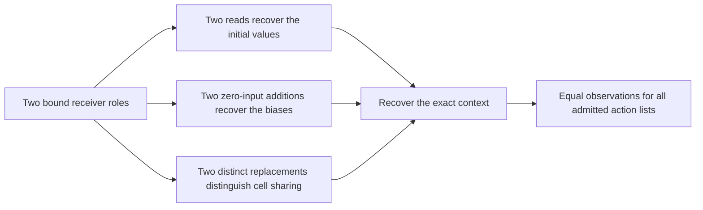

# Distinguish bound method contexts with fixed observations

The native RT-05 comparison found that method code and receiver values can agree while shared versus separate cells change observable behavior. This study asks whether a fixed observation set determines the entire context and every admitted trace in the same two-receiver model. Lean checks the general result on mathematical integers, and four native C and Rust settings check the exact bounded projection. [Native bound methods](../../semantic-representation/RT-05/RT-05-STATEFUL-BOUND-METHOD-2026-11-25.md) · [Mutable renaming proof](RT-32-MUTABLE-RENAMING-KERNEL-2026-11-25.md)

## Model and distinguishing probes

The context has fixed left and right receiver roles, an immutable integer bias for each role, and either one shared cell or two separate cells. An action reads the selected cell, adds its receiver's bias and input to the cell, or replaces the cell with the supplied value. Each action observes both the before and after values. A probe starts from its own copy of the context.

Two singleton reads recover the initial values. Two singleton additions with zero input recover the biases from the before and after values. The last two probes replace the left value with 0 and 1 respectively, then read the right role. Under sharing, the final read tracks the replacement. Under separate cells it remains at the original right value. One unchanged right value cannot agree with both 0 and 1. The fixed observations therefore determine the storage constructor and the integer contents.



Lean checks that identical signatures from the six probes imply exact context equality. It proves this is also equivalent to equal replies for every finite admitted action list. Three checked examples show that a changed bias or a split cell can be visible and that dropping the sixth probe misses a sharing distinction. The runner separately attempts a reflexivity proof of full equality for the shared-zero and separate-zero contexts and checks its rejection.

## Native alignment

The runner pins the native archive and the C and Rust source digests. It reconstructs the native policy projections from their verified archived keys and writes 108 equations covering the four modes and five original recipes. It then recompiles the two native observers under the four pinned settings and runs the six fixed probes at every context. A further 108 equations bind those fresh complete signatures to the Lean model. Each native configuration agrees on all six probe traces, including the mutated result of the sharing probes.

| Checked result | Count |
|---|---:|
| General model theorems | 4 |
| Checked counterexamples | 3 |
| Exact archived class equations | 108 |
| Archived recipe vectors checked | 2,160 |
| Fixed probe equations checked | 108 |
| New native probe vectors across four profiles | 2,592 |
| Distinct signatures with six probes | 108 |
| Distinct signatures with the first five probes | 99 |
| Refused false equivalence proofs | 1 |

The kernel audit records actual dependencies per theorem under the standard `propext`, `Classical.choice` and `Quot.sound` allowlist. All 216 closed archive and probe equations have empty axiom lists. The runner checks the exact generated artifacts in nine separate files under one compiled model. The fresh native measurements use the same C and Rust toolchain revisions as the archive.

## Implications and boundaries

The result gives a complete distinguishing set for this fixed action and context model. Code-only and value-only descriptors are insufficient for that observation contract. A complete context descriptor captures the receiver biases, current values and storage topology. The theorem models mathematical integers, while the native corpus uses small values fitting both implementations. General method resolution and trace semantics, source extraction, checked import coverage, live state versions, concurrency, FFI portability and independent review remain open.

Replay with CPython 3.12.14, Lean 4.36.0 at `611c117bfaf7b7ae1cfcf246ce6fba31e8f509e9`, Debian GCC 14.2.0-19 and Rust 1.85.1 at `4eb161250e340c8f48f66e2b929ef4a5bed7c181` on Linux x86-64. The initial LLMLang baseline is `d654106f67b07fcb944e0d32d2d980bb80e67b92`. The runner pins both the prior archive and every generated proof file by digest.

```bash
fixture=research/formal-verification/RT-32/BOUND-METHOD-OBSERVATIONS-01
PYTHONHASHSEED=1 python3 -B "$fixture/run.py" --lean "$(command -v lean)" > /tmp/llmlang-rt32-bound-method.json
cmp "$fixture/evidence.json" /tmp/llmlang-rt32-bound-method.json
python3 "$fixture/chart.py"
```

[Lean model and theorems](BOUND-METHOD-OBSERVATIONS-01/Receiver.lean) · [Reproduction and native checks](BOUND-METHOD-OBSERVATIONS-01/run.py) · [Axiom and observation ledger](BOUND-METHOD-OBSERVATIONS-01/evidence.json) · [Table generator](BOUND-METHOD-OBSERVATIONS-01/chart.py)
