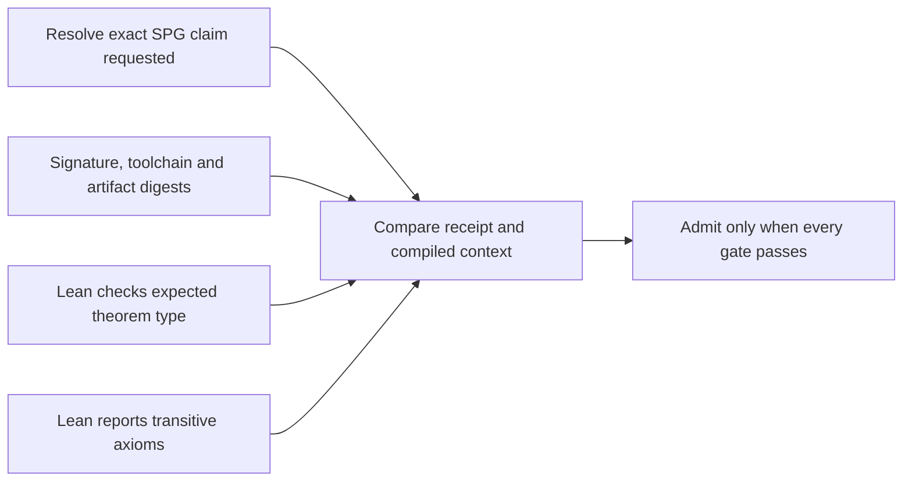

# RT-32 — Admission of compiled Lean claims and exact source subjects

A correctly signed Lean bundle can contain the wrong theorem, a theorem using a forbidden axiom or the right theorem for a different provider. In ten compiled cases, combining signature and byte checks with a theorem-type test, an axiom policy and an imported-context test admitted the two valid claims and rejected eight controls.

## Method

The fixture reuses the generated late-bound SPG caller and its two valid providers. It builds four Lean modules for each candidate. The receipt binds a theorem name, the exact emitted module digests, the Lean version and the intended source subject. The subject includes the graph root, caller implementation, provider, contract and binding identities. A repeatable demonstration key signs the canonical receipt. The test uses an explicitly different key for an unauthorized publisher.

The verifier compares the signed subject with the independently resolved SPG request and hashes the actual artifacts. In a fresh Lean import it uses `closedClaim` at the requested trace proposition, asks Lean for that declaration's transitive axioms, and checks that the imported scope constants reduce to the exact values independently obtained from SPG. The fixture permits `propext`. The tested proposition is ordered trace conformance, so different providers can have the same proposition at the selected caller while differing in their actual identity and returned value.



The harness evaluates the checks independently on known locally compiled controls so their outcomes can be compared. A production importer can validate the envelope and approved bytes before loading the selected artifact.

## Results

| Case | Signed bundle alone | Theorem and axiom checks alone | Combined decision |
| --- | --- | --- | --- |
| base | admit | admit | closed |
| changed-toolchain | reject | admit | toolchain-mismatch |
| different-bundle | reject | admit | bundle-mismatch |
| foreign-axiom | admit | reject | axiom-policy |
| missing-signature | reject | admit | issuer-or-signature |
| old-proof-for-rebound | reject | admit | receipt-subject |
| rebound | admit | admit | closed |
| signed-wrong-compiled-context | admit | admit | compiled-context |
| untrusted-issuer | reject | admit | issuer-or-signature |
| wrong-theorem | admit | reject | claim-mismatch |

The authenticated bundle alone accepts three invalid candidates. A name-only lookup finds `closedClaim` even when its claim is `True`. The expected theorem type accepts the foreign-axiom variant, and the axiom check detects its explicit premise. A signed receipt containing the old requested subject and the exact rebound bytes passes the envelope and theorem checks. The imported definitions still carry the rebound identities, so the context check rejects it.

The legitimate rebound provider passes after issuance of a fresh receipt for its exact subject. The old proof for the rebound request fails subject matching. Another compiled bundle proves the same statement and has the same context, but its bytes differ from the signed receipt. Missing, unauthorized or mismatched toolchain evidence also blocks admission. The ledger retains the actual import decisions and each signature-bearing artifact manifest.

## Implementation boundary

Use a complete exact subject and checked proposition alongside artifact provenance. A recognized axiom allowlist gives a scoped trust policy for the checked declaration. This experiment uses locally compiled artifacts and a fixed fixture signer. Production authority policy, verifying the compiled proof artifact chain beyond the four modules and pinned toolchain, runtime source correspondence, and general premise admission remain open.

## Reproduce

Use CPython 3.12.14, Lean 4.36.0 and OpenSSL 3.5.7 from the repository root. The runner compiles the candidate modules from exact SPG subjects and runs each import in a temporary directory.

```sh
fixture=research/formal-verification/RT-32/COMPILED-ADMISSION-01
output=$(mktemp)
python3 "$fixture/run.py" --output "$output"
cmp "$fixture/evidence.json" "$output"
python3 "$fixture/chart.py"
```

[Runner](COMPILED-ADMISSION-01/run.py) · [Evidence ledger](COMPILED-ADMISSION-01/evidence.json) · [Generated caller proofs](RT-32-GENERATED-CALL-CONTRACTS-2026-11-24.md) · [Compiled dependencies](RT-32-LEAN-COMPILED-DEPENDENCIES-2026-11-24.md)
