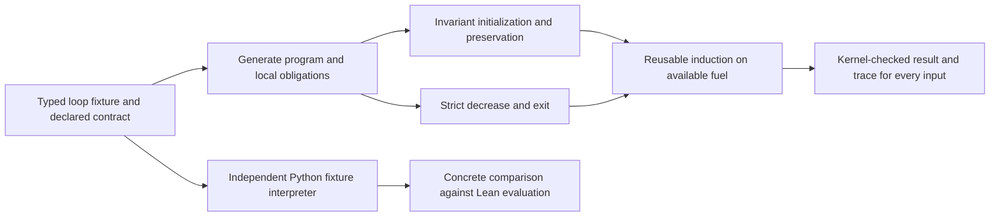

# RT-32 — Generate and check total-correctness obligations for a countdown loop

- **Evidence** — Kernel-checked total correctness in one candidate typed loop profile, with concrete source-model replay.
- **LLMLang baseline** — `3c0789c364ff4b54bb1d719e3f999b89e1d1ae06`.
- **Tracking** — [PLAN §2.4](../../../PLAN.md#24-verified-spg-to-lean-pipeline-rt-32) · [RT-32](RT-32-VERIFIED-SPG-TO-LEAN-PIPELINE.md).

## Question and model

Can a reusable Lean loop checker turn a typed program and its contract into separate proof obligations for initialization, preservation, termination and exit? The experiment admits a countdown loop over mathematical natural numbers and a deliberately narrow set of state operations. Its state contains the number of iterations remaining, an accumulator and an ordered trace. A successful iteration emits the old remaining count, adds a constant to the accumulator, emits the updated accumulator and decrements the remaining count. The exported source fixture keeps the operations ordered. Execution with exhausted fuel returns an explicit result distinct from success.

This is an extension experiment beyond the existing call-free scalar grammar. The JSON fixture describes a candidate typed loop, and the generator validates its profile before emitting the Lean program and obligations. The admitted generator supports one subtraction, one addition and two observation operations with small literal constants. The proof quantifies over every natural-number input. [Scalar SPG observation binding](RT-32-SPG-LEAN-OBSERVATION-BINDING-2026-11-24.md) · [Loop control prior art](../../language-design/RT-03/RESEARCH-SCENARIO-55-LOOP-RESULTS-LABELS-AND-CONTROL-TRANSFER.md)



For an input `n` and remaining count `r`, the invariant requires `r ≤ n`, accumulator equal to stride times `n - r`, and the exact ordered trace of the completed `n - r` iterations. The postcondition requires no remaining iterations, an accumulator equal to stride times the input, and the complete trace. The measure is the remaining count. The generic proof advances one modeled step per unit of fuel and uses strict decrease to show that fuel equal to the initial count suffices.

| Generated obligation | Use |
| --- | --- |
| Initialization | Establish the invariant before the first guard test, including an empty trace. |
| Preservation | Relate the next count, updated accumulator and appended events to the invariant. |
| Decrease | Establish that any taken iteration strictly reduces the natural-number measure. |
| Exit | Derive the return result and complete trace when the loop guard is false. |

## Checked evidence

Lean 4.36.0 kernel-checks all four obligations and the resulting total-correctness theorem for two generated programs with strides 2 and 5. Both final theorems depend on `propext` and `Quot.sound`. The arithmetic steps use `omega`, ordered lists use elementary rewrites, and a reusable proof composes the obligations. No proof depends on compiled decision procedure output. [Loop semantics and generic theorem](LOOP-OBLIGATIONS-01/LoopCore.lean) · [Generated theorem template](LOOP-OBLIGATIONS-01/Program.lean.in)

Each generated program also runs six successful concrete input and fuel pairs and two exhausted pairs. All 16 observations agree with the imperative Python replay of the same fixture, including the order and payload of every event in the successful trace.

| Control | Rejected at | Concrete witness at input 1 with fuel 2 |
| --- | --- | --- |
| Start accumulator at 1 | Initialization | Accumulator 3 and the corresponding changed event instead of 2. |
| Increment by 3 with stride-2 contract | Preservation | Accumulator 3 and the changed event instead of 2. |
| Subtract zero | Decrease and preservation | Fuel exhausted. |
| Stop with one remaining iteration | Exit | Accumulator 0 with no events. |
| Emit the two events in reverse order | Preservation | The return value and event multiset agree. The observed event sequence differs. |
| Omit the invariant | Profile admission | No obligations emitted. |

The concrete witnesses distinguish actual incorrect behaviors from tactic limits. Failed generated proof obligations block any proof claim.

## Implementation implications

A finite successful trace alone can test a selected execution. Proof of invariant preservation and exit establishes what a terminating admitted execution must return. The measure obligation gives the additional termination result. In this fixture an arithmetic-only invariant would allow the trace-order mutation to keep its result while changing the observable behavior. Generating a trace-aware obligation detected it without extending the generic proof.

This experiment supports reusing a small obligation interface with a deep loop interpreter and generated proof terms. The generator and its interpretation of the typed fixture remain outside the kernel. The kernel establishes total correctness over the generated Lean syntax, and the Python interpreter tests correspondence on the stated inputs. General source-to-Lean correspondence, the production verification IR, branches within the loop, early returns, foreign effects, machine integer overflow and independent evidence admission remain open.

## Reproduction

Run from the repository root with CPython 3.12.14 and the pinned Lean 4.36.0 release recorded in [evidence.json](LOOP-OBLIGATIONS-01/evidence.json). The runner generates Lean in temporary directories and checks the expected obligations, the final theorem axiom lists, concrete observations and all six controls. [Typed fixture](LOOP-OBLIGATIONS-01/fixtures.json) · [Replay](LOOP-OBLIGATIONS-01/replay.py)

```sh
study=research/formal-verification/RT-32/LOOP-OBLIGATIONS-01
python3 -B "$study/replay.py" > /tmp/llmlang-rt32-loop.json
cmp "$study/evidence.json" /tmp/llmlang-rt32-loop.json
```
