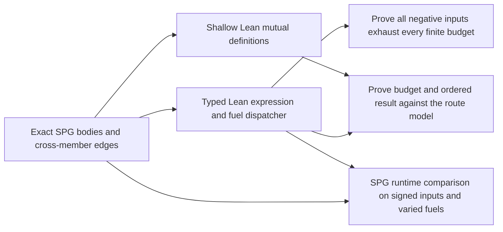

# RT-32 — Deep and shallow fuel correspondence for recursive SPG effects

For the two exact recursive bodies, Lean proved that a finite interpreter returns the shallow observation on nonnegative input `n` exactly when the call budget exceeds `n`. Lean separately proved exhaustion at every finite budget for every negative integer. An execution grid checked those results against the existing SPG evaluator in both group encodings.

## Method

The runner reads the exact stored term and local-call vector of each previously checked recursive SPG member. It maps each node into a typed Lean expression. The types distinguish integer operations and Boolean conditions. A structural evaluator interprets each expression with left-to-right operand order and lazy conditionals. A second dispatcher spends one unit of fuel per call and supplies the recursive callback. Success contains a value and ordered events. Exhaustion returns no observation, consistent with the SPG observer raising `FuelExhausted`.

The previous shallow translator produces direct Lean mutual functions with a natural decrease measure. The new interpreter uses integers internally. The proof relates both interpreter entries to the already checked ordered-route model for every nonnegative natural input and arbitrary natural fuel. The negative proof instead reasons directly over every signed negative input and every fuel value through the strictly decreasing integer argument.



## Results

| SPG encoding | Returned with sufficient fuel | Nonnegative exhaustion | Negative exhaustion |
| --- | ---: | ---: | ---: |
| keyed | 260 | 182 | 102 |
| structural | 260 | 182 | 102 |

Each encoding checks both members on inputs 0–12 and −1, −3 and −17 at fuels 0–16. All 1,088 SPG observations agree with Lean. Successful rows also agree with the independent arithmetic and path oracle. Both proof declarations report `propext` and `Quot.sound`. Swapping the typed deep operands while holding the shallow definitions fixed breaks the correspondence theorem. Changing the strict bound from `n < fuel` to `n ≤ fuel` fails at zero input and zero fuel.

## Implementation boundary

The deep embedding provides a checked account of bounded execution and the signed negative domain. The shallow embedding provides direct total functions for nonnegative inputs and retains the existing trace proof. The hybrid correspondence links them for these exact generated subjects. The Python renderer is connected to the stored SPG by structural inspection and finite replay. A verified decoder, partial effect visibility on budget failure, general recursion and contract admission remain open.

## Reproduce

Use CPython 3.12.14 and Lean 4.36.0 from the repository root. The runner produces both typed bodies from the stored group, compiles the combined Lean module and checks both proof mutations.

```sh
fixture=research/formal-verification/RT-32/DEEP-FUEL-01
output=$(mktemp)
python3 "$fixture/run.py" --output "$output"
cmp "$fixture/evidence.json" "$output"
python3 "$fixture/chart.py"
```

[Runner](DEEP-FUEL-01/run.py) · [Typed Lean template](DEEP-FUEL-01/DeepFuel.lean.in) · [Evidence ledger](DEEP-FUEL-01/evidence.json) · [Shallow effect proofs](RT-32-MUTUAL-RECURSIVE-EFFECTS-2026-11-24.md)
