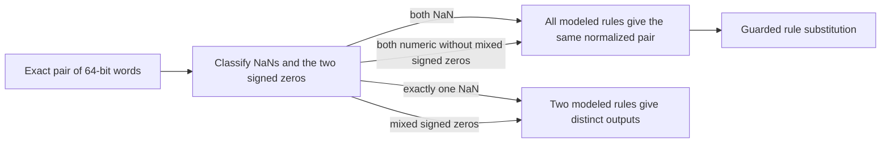

# Prove the agreement guard for binary64 extrema

The RT-05 native extrema fixture identified five distinct observed behaviors and seven candidate operation rules. This study checks the exact input guard under which all seven modeled rules yield the same result. That guard can serve as a proof obligation when a typed implementation wants to substitute one extrema rule for another. [Native extrema comparison](../../semantic-representation/RT-05/RT-05-NATIVE-F64-MINMAX-2026-11-25.md)

## Model and guard

The Lean model represents a binary64 input as an exact 64-bit word. It classifies NaN from the exponent and fraction encoding, distinguishes signaling input using the quiet bit, and recognizes the two exact zero words. Each rule returns a pair of extrema. All NaN outputs are projected to one canonical quiet NaN, while every other output bit is observable. The model orders non-NaN words by sign and magnitude. It uses no general native floating-point arithmetic or status flags.

The seven rules distinguish NaN propagation, preference for the numeric operand, left or right numeric ties, left or right selection on unordered comparisons, and propagation only for signaling NaN with right ties. Lean proves that all seven agree exactly when either both inputs are NaN, or both are numeric and the pair does not contain distinct signed zero words. Numeric includes infinities. The both-NaN branch depends on projecting every NaN output to the same marker.



The theorem also constructs the existence of a distinguishing rule whenever the guard fails. A pair containing one NaN lets propagation differ from the numeric-preference rule. For `(+0, −0)`, one rule gives `(−0, +0)` and a left-tie rule gives `(+0, +0)`. A separately compiled attempt to equate these outputs by reflexivity is refused. Neither counterexample requires float arithmetic beyond the defined selection rules.

## Native alignment

The runner pins the native ledger and its source digests. For every ordered pair in the archive it uses the actual raw results of the five native families, then generates an exact equation comparing their normalized outputs with the modeled rules. Each equation includes the guard result. The archive separates 518 unanimous pairs from 506 with different observations. The latter comprise 504 pairs containing exactly one NaN and two orders of mixed signed zeros.

| Checked result | Count |
|---|---:|
| Audited model declarations | 9 |
| Kernel-checked native pair equations | 1,024 |
| Archived native policy vectors | 5,120 |
| Guard admitted pairs | 518 |
| Guard refused pairs | 506 |
| Refused unguarded substitution proofs | 1 |

The 16 generated proof files use the same compiled model. Axiom auditing allows `propext`, `Classical.choice` and `Quot.sound` and records the actual transitive dependencies. The 1,024 replay equations use only these standard axioms.

## Application and limits

A lowering can derive this guard from input refinements and use the theorem once its source and target have been related to the modeled rules. The native archive checks those relationships on a finite corpus. General source and compiler correspondence, exact NaN sign or payload, hardware exception flags, dynamic rounding, additional arithmetic and independent review remain open. In particular, substituting a rule in a program that observes status flags needs a separate preservation result.

Replay with Lean 4.36.0 at `611c117bfaf7b7ae1cfcf246ce6fba31e8f509e9` and CPython 3.12.14. The initial LLMLang baseline is `3684d6c60721a8eba55715130fef34955c3d3238`. Reproducing the original native archive uses the exact GCC, glibc, Binutils, Rust, Node and V8 toolchains in its report. The proof runner uses the pinned archive and needs only Python and Lean.

```bash
fixture=research/formal-verification/RT-32/F64-EXTREMA-GUARD-01
PYTHONHASHSEED=1 python3 -B "$fixture/run.py" --lean "$(command -v lean)" > /tmp/llmlang-f64-extrema-guard.json
cmp "$fixture/evidence.json" /tmp/llmlang-f64-extrema-guard.json
python3 "$fixture/chart.py"
```

[Lean model and theorems](F64-EXTREMA-GUARD-01/Extrema.lean) · [Archive replay](F64-EXTREMA-GUARD-01/run.py) · [Axiom and observation ledger](F64-EXTREMA-GUARD-01/evidence.json) · [Table generator](F64-EXTREMA-GUARD-01/chart.py)
