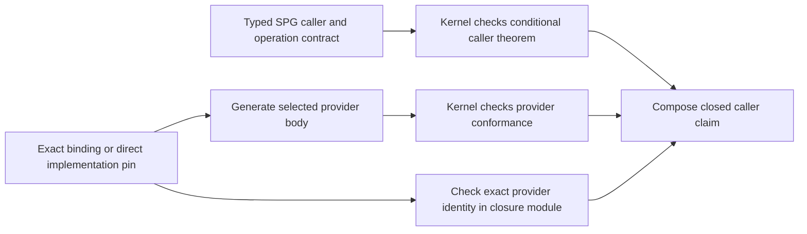

# RT-32 — Generate conditional and closed proofs for exact SPG calls

**Evidence** — Ten generated cases, seven closed Lean claims, and source/Lean observation checks.

## Question and admitted profile

A caller that invokes an operation can rely on its contract while a selected provider changes. A caller that pins an implementation includes that implementation's identity in its own body. Can the verifier reuse the first caller's conditional proof without reusing evidence about a provider that changed? The previous RT-32 comparison checked call-free body observations. The transitive closure study compared evidence identities and simulated proof receipts. This study generates and checks actual caller and provider obligations for two members of the existing typed SPG. [Call-free observation binding](RT-32-SPG-LEAN-OBSERVATION-BINDING-2026-11-24.md) · [Transitive proof closure](RT-32-TRANSITIVE-PROOF-CLOSURE-2026-11-24.md)

The caller accepts an integer, emits `argument` while evaluating it, then executes one unary integer call. The intended provider emits `first`, then `last`, and adds a stored integer constant. The caller has an exact trace contract. The provider can change that constant without changing its trace contract. Provider conformance is behavioral and checked separately. All positive and negative variants come from the existing SPG compiler. The generator reads registered body templates, exact call references, interface types, contract values and the selected operation binding from the stored graph.



The conditional theorem quantifies over any provider function satisfying the extracted trace contract. The generated provider module defines the selected body and proves the assumption for every integer. The closure module composes the two theorems and checks equality of its expected caller, provider and assumption identifiers with the imported module declarations. It also records the exact graph root and selected binding or direct reference. The generator and its input admission remain responsible for correspondence between those identifiers and the imported graph; literal identity equality inside Lean does not authenticate executors or prove the extractor complete.

## Observations

| Change | Operation call | Direct implementation pin |
| --- | --- | --- |
| Baseline, provider adds 1 | Caller and provider close | Caller and provider close |
| Rebind operation to provider adding 2 | Caller proof source is identical. Provider and closure need the new identity and proof. Runtime result changes. | Caller and provider proof sources and observations stay identical. Snapshot-scoped closure source refreshes. |
| Edit primary provider to add 4 | Caller proof source stays identical. Provider and closure need fresh evidence. | Caller body and conditional source change with the exact implementation pin. Provider and closure also change. |
| Rebind to the provider that emits `last` then `first` | Caller theorem still checks conditionally. Kernel rejects provider conformance and the closure is unavailable. | Keeps using the checked primary provider. |
| Broaden the provider contract to permit both event orders | Kernel rejects the conditional theorem for the unchanged strict caller contract. | The declared assumption is also too broad for the generated compositional proof. |

In the broader-contract control the directly selected provider still emits the original ordered trace. A separate body-specific proof could still establish the caller property. The contract-only proof cannot establish it from the weaker assumption. Likewise, the bad provider returns the same mathematical integer as the good alternate provider and violates the trace obligation. A stale provider identity also fails Lean's equality check even though both legitimate provider bodies satisfy the same contract.

Each of the seven closed claims is checked for all mathematical integer inputs in Lean. Five boundary and representative values per closed case give 35 matching observations between the original SPG evaluator and the generated Lean execution. The ledger includes the other three cases' SPG observations and the exact obligations that the kernel rejects. The conditional, provider and closed trace theorems report Lean’s standard propositional-extensionality axiom, `propext`. The checked property is ordered trace conformance. The sampled arithmetic equality does not constitute a result-value refinement proof.

## Implementation implications

Retain conditional proof identity only while the exact caller and assumed contract stay applicable. Bind closure to the exact resolution and checked provider obligation for the selected snapshot. A direct pin can invalidate the conditional artifact itself, even under the same declared trace contract. A broader contract may require a narrower imported theorem or a different caller proof. The bounded fixture leaves recursive calls, multiple heterogeneous arguments, exceptional or concurrent effects, independent source extraction and authenticated evidence admission open.

## Reproduction

Use CPython 3.12.14 and Lean 4.36.0 at revision `611c117bfaf7b7ae1cfcf246ce6fba31e8f509e9`:

```sh
study=research/formal-verification/RT-32/GENERATED-CALL-01
python3 -B "$study/run.py" --output /tmp/llmlang-generated-call.json
cmp "$study/evidence.json" /tmp/llmlang-generated-call.json
(cd research/PROTOTYPES/DEPENDENCY-GRAPH-01 && python3 -B -m unittest \
  tests.test_spg_representation tests.test_spg_ordered_lowering tests.test_spg_admission)
```

The [Lean core](GENERATED-CALL-01/CallCore.lean) defines the trace observation and ordered call. The [generator](GENERATED-CALL-01/run.py) emits modules into a temporary directory. The [ledger](GENERATED-CALL-01/evidence.json) preserves exact graph and module-source identities, tool versions, observations and kernel axiom audits.
