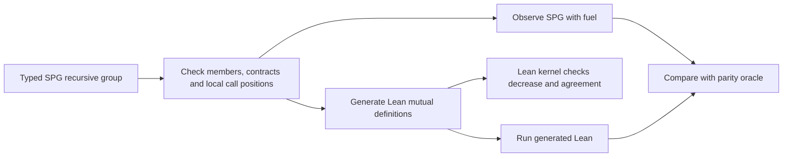

# RT-32 — Generated termination obligations for mutually recursive SPG members

Lean 4.36.0 accepted the generated even and odd functions with a decreasing natural-number argument for both keyed and structural SPG recursive groups. The kernel checked that both functions agree with an independently defined alternating Boolean pair for every natural number. Both group encodings also agreed with the SPG interpreter and the Python parity oracle for every tested input.

## Experiment

The fixture compiles two typed `Int → Bool` functions. At zero they return different Boolean literals. Otherwise each directly calls the other on the argument minus one. The extractor checks the typed bodies and quiet contracts and resolves the exact positions of both `local_call` edges within the recursive group. The generated Lean code uses a mutual block with `termination_by n` and `decreasing_by omega`. Its independent specification advances a Boolean pair by swapping values in each successor step. Induction proves agreement for the generated pair.



## Results

| Check | Keyed group | Structural group |
| --- | --- | --- |
| Exact SPG group identity, prefix | `a973b3f076cc` | `620265a2d526` |
| Kernel checks both decreases and agreement with the alternating pair | Passed | Passed |
| SPG observations agreeing with Lean and the independent parity oracle | 32 of 32 | 32 of 32 |
| Fuel `n + 1` returns and fuel `n` exhausts, for both members on 0–15 | Yes | Yes |
| Both members exhaust 32 units of fuel on −1 and −17 | Yes | Yes |

Lean reported `propext` and `Quot.sound` for both generated definitions and the agreement theorem. Changing the compiled keyed group to subtract zero invalidated the decrease obligation. Changing the even member's base result preserved the recursion measure and invalidated the agreement theorem. The ledger retains each mutated group identity and its observed diagnostic.

The two group encodings support the same measure for this fixture while retaining distinct group, member and generated artifact identities. The proof quantifies over Lean naturals. SPG uses signed integers, and the negative cases remain outside the proof domain. The extraction and finite runtime comparison provide the evidence connecting these exact SPG bodies to the generated definitions. A mechanized source correspondence, an admission proof for the nonnegative input restriction and termination measures for broader recursion remain open.

## Reproduce

Use CPython 3.12.14 and Lean 4.36.0 from the repository root. The runner generates Lean sources in a temporary directory and observes both positive cases and rejection controls.

```sh
fixture=research/formal-verification/RT-32/MUTUAL-TERMINATION-01
output=$(mktemp)
python3 "$fixture/run.py" --output "$output"
cmp "$fixture/evidence.json" "$output"
python3 -m unittest discover -s research/PROTOTYPES/DEPENDENCY-GRAPH-01 -p 'test_recursive_identity.py'
```

[Runner](MUTUAL-TERMINATION-01/run.py) · [Evidence ledger](MUTUAL-TERMINATION-01/evidence.json)
