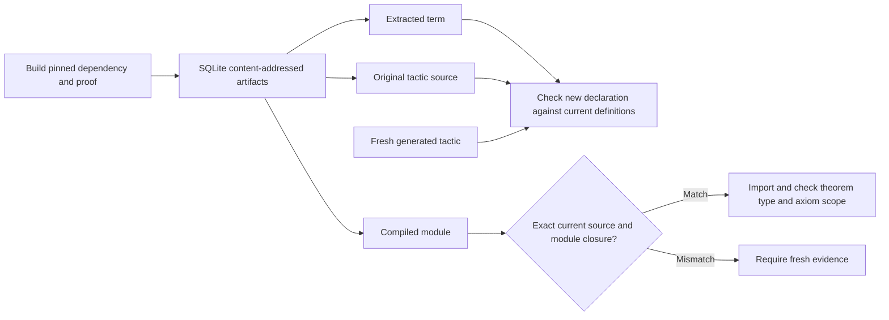

# RT-32 VAC-03 Lean term, tactic and module replay

[Verified SPG to Lean / #296](https://github.com/aivibeflow/LLMLang/issues/296) · [VAC-02/03 research plan](../RT-33/VERIFICATION-BACKEND-INTEGRATION-AND-ARTIFACT-CACHE.md)

A persistent proof cache can hold the tactic source, the elaborated proof as a printable term, or the compiled Lean module. Each carrier answers a different question. This fixture fixes an axiom-free proposition over natural numbers, `∀ n, step n = n`, and checks how the three carriers behave when the definition of `step` changes. Fresh reference generation emits its own small tactic script. All proof routes use the same pinned Lean build.



The SQLite prototype stores and reopens five exact artifact roles, including both compiled modules. Lean prints the actual proof term produced by the original tactic. The replay embeds that term without tactics in a new declaration, which is elaborated and checked against the current definitions. The import consumer separately supplies the required theorem type and queries the transitive axiom set. The exact module path compares source and compiled dependency bytes before importing the cached proof.

## Observations

| Current dependency | Stored term | Replayed tactic | Fresh generation | Ordinary compiled import | Exact compiled reuse |
| --- | --- | --- | --- | --- | --- |
| Original `n + 0` | Checked | Checked | Checked | Checked | Checked |
| Trailing comment | Checked | Checked | Checked | Checked | Refused before import |
| Definitionally equal `n + (0 + 0)` | Checked | Checked | Checked | Checked | Refused before import |
| Meaning changes to `n + 1` | Refused | Refused | Refused | Checked | Refused before import |

The comment edit changed the source digest while leaving the dependency module byte-identical. The equivalent expression changed both source and module digests while preserving the checked proposition. The changed-meaning row distinguishes loading an existing declaration from constructing a fresh proof under current imports. In this fixture the ordinary import and a separate invocation with `-t0` both accepted the imported theorem declaration. Exact compiled reuse refused all three changed closures before import. The conservative rule leaves room for a separate checked correspondence receipt when a source-only change is authorized.

Five controls cover a wrong theorem type, a declared premise outside the no-axiom policy, an absent compiled dependency, a missing stored role, and damaged stored bytes. Lean refused the wrong type and reported the explicit premise for the second control. The storage check refused missing or damaged artifacts without loading the affected module.

The study pins the Lean version and release commit, launcher, shared Lean library and `Init.olean`, as well as the fixture source and compiled artifacts. It covers one theorem, one imported module name and one small proposition grammar. It does not establish a universal external term serialization or authorize loading unknown modules. General import inventory extraction, compatibility receipts, production provenance, benchmark timing and the separate SMT certificate comparison remain open.

## Reproduce

Run from the repository root with CPython 3.12.14, SQLite 3.53.1 and Lean 4.36.0. The optional archive path must refer to a new file. It writes the five checked payloads so they can be inspected independently. The recorded evidence retains exact artifact digests and results. [Lean sources and runner](LEAN-ARTIFACT-REPLAY-01/) · [Evidence](LEAN-ARTIFACT-REPLAY-01/evidence.json)

```sh
fixture=research/formal-verification/RT-32/LEAN-ARTIFACT-REPLAY-01
python -B "$fixture/run.py" --lean "$(command -v lean)" --output /tmp/rt32-vac03-replay.json
cmp /tmp/rt32-vac03-replay.json "$fixture/evidence.json"
```
