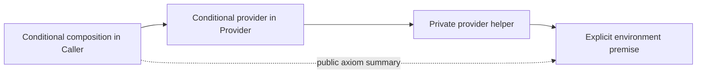

# RT-32 — Proof dependencies visible in compiled Lean modules

- **Evidence** — Actual declaration inspection and compiled-file digests from Lean 4.36.0.
- **LLMLang baseline** — `0484953d255684ba7a470218505eb87aae6d6850`.
- **Tracking** — [PLAN §2.4](../../../PLAN.md#24-verified-spg-to-lean-pipeline-rt-32) · [Transitive proof closure](RT-32-TRANSITIVE-PROOF-CLOSURE-2026-11-24.md).

## Question

Can an evidence importer reconstruct direct and transitive proof dependencies from an ordinary Lean import? A proof dependency graph needs to identify which helper or premise a theorem uses and which compiled files substantiate that path. Lean's standard transitive axiom report answers a narrower question about ultimate axioms. The experiment measures both views over the same compiled modules.

The [provider](LEAN-DEPENDENCIES-01/Provider.lean) exports two theorems of the same type. One proves the small proposition directly. The other goes through a private helper which invokes a deliberately explicit synthetic environment premise. The [caller](LEAN-DEPENDENCIES-01/Caller.lean) compiles one composition over each provider proof. An [inspection command](LEAN-DEPENDENCIES-01/Inspect.lean) asks Lean for constants appearing in the declaration type and, where available, its proof value. It reports fixture names and asks Lean's `collectAxioms` for the full transitive axiom list.



The dotted link is the axiom summary visible in the normal imported environment. The direct proof terms expose the three solid links when inspection has the private module data in view.

## Checked outcomes

| Inspection path | What it exposes in the fixture |
| --- | --- |
| During provider and caller compilation | The current module's proof values expose direct dependencies. The caller can see its own proof's reference to the provider while the ordinary imported provider's value remains hidden. |
| Normal downstream `module` import | Both theorem values are unavailable. Their type-dependency lists agree. Their exact axiom summaries still distinguish `propext` from the synthetic environment premise. |
| `import all Caller` and `import all Provider` | Exposes the proof terms and reconstructs all three edges in the diagram. The observed declarations agree with the records collected during the corresponding module's compilation. |
| Downstream file using legacy import mode | Its inspected declarations agree with the corresponding subset of the `import all` observation. |

Lean 4.36.0 computes exported transitive axiom summaries at serialization and looks them up for imported declarations. This accounts for the axiom list remaining visible when proof values are hidden in the environment. Removing the `.olean.private` files caused the command-line importer to fail in all three tested cases: a minimal public statement check, a normal import with the inspection command, and an `import all` inspection. The physical files requested by the importer and the declarations visible in the resulting environment are distinct observations. [Pinned Lean axiom collection](https://github.com/leanprover/lean4/blob/611c117bfaf7b7ae1cfcf246ce6fba31e8f509e9/src/Lean/Util/CollectAxioms.lean) · [Recorded import views](LEAN-DEPENDENCIES-01/evidence.json)

Two recompiled controls distinguish kinds of change.

- Adding a private relay theorem inserts a real edge between the provider helper and the environment premise. The public provider `.olean` stays byte-identical, and all three compiled caller files stay byte-identical. The provider's `.olean.private` and `.olean.server` hashes change. The public axiom summary stays the same.
- Replacing the environment premise use with the already-checked local theorem removes the synthetic axiom from the composed public summary. The exact type-dependency list stays the same. Recompiling produces different public and private artifacts for both provider and caller.

## Implications for the proof dependency graph

An axiom summary can support a scoped trust policy for a publicly imported theorem. Recording a direct proof graph needs more information. Capture exact edges in the module that owns each theorem before export, or inspect the complete pinned module bundle with explicit full imports. A cache key consisting only of public artifact hashes cannot distinguish the checked private relay change. If a receipt claims a specific proof path, bind it to the actual provider's private proof data and toolchain. A public-interface claim can have a different reuse boundary.

This experiment filters constants to its own fixture namespace when showing direct edges. The full standard axiom report is retained separately. It validates no LLMLang source-level correspondence, independent receipt authentication, or extraction of all proof and term dependencies across arbitrary projects. The evidence illustrates which Lean data are needed for those research gates.

## Reproduction

Use CPython 3.12.14 and Lean 4.36.0 at `611c117bfaf7b7ae1cfcf246ce6fba31e8f509e9` on x86-64. The runner builds and inspects all three variants in temporary directories and records source, script and compiled-file hashes. [Replay](LEAN-DEPENDENCIES-01/replay.py)

```sh
study=research/formal-verification/RT-32/LEAN-DEPENDENCIES-01
python3 -B "$study/replay.py" > /tmp/llmlang-lean-dependencies.json
cmp "$study/evidence.json" /tmp/llmlang-lean-dependencies.json
```
