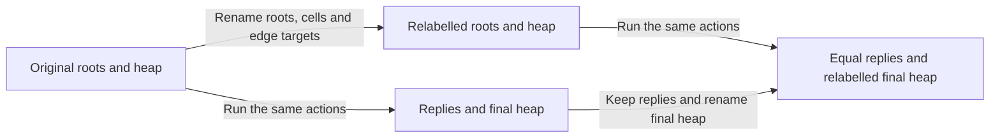

# Kernel-check mutable reference renaming

The native RT-05 comparison found that a shared cell table preserves mutation and reference equality under physical relabeling, while serializing each root separately can change behavior. This RT-32 study tests the mathematical premise of that normalization. It proves that a consistent bijection of locations preserves every observation of an admitted list of actions and relates the final heaps by the same bijection. It then checks exact equations against the native archive. [RT-05 native topology](../../semantic-representation/RT-05/RT-05-MUTABLE-REFERENCE-TOPOLOGY-2026-11-25.md)

## Model and proof

A heap maps abstract locations to cells, each with an integer value and an optional `next` location. Three fixed roots may point to the same location. A path counts how many `next` edges to follow from one root. The action alphabet reads a value, adds an integer to the selected cell, compares whether two successful paths name the same location, or replaces a cell's next link with the result of a path. The last action can create cycles. A missing path yields a missing reply for reads and writes, and equality is false when either location is missing. An absent link target clears the selected link. The model uses a total heap over the abstract location type and both sides have decidable location equality.



The path proof uses induction on the number of edges. A reference comparison sees the same equality because the renaming is injective. The update lemma uses the backward map to identify exactly the cell changed by a write. These lemmas establish the diagram for one action. Induction on the action list then proves it for any finite sequence and any decidable location set in the model. A separate checked example splits one shared self-loop into separate self-loops. Writing through one root then reading through another returns `11` in the shared heap and `10` in the split heap. The kernel rejects an attempted reflexivity proof equating the two observation lists.

## Native alignment

The archive binds 184 isomorphism classes, all of their tested relabelings and the matching CPython and Node observations. The proof runner pins the archive and both native source digests. For each class, it uses the original graph and the first archived relabeling. It verifies the archived keys of the shared-canonical and separate-root projections before compiling a four-way equation for the six recipes. The separate-root expectations include every archived difference on the selected variant. Each equation checks the full tagged reply vector, including value, Boolean and missing replies.

| Checked result | Count |
|---|---:|
| General model theorems | 9 |
| Checked projection counterexamples | 1 |
| Exact native class equations | 184 |
| Archived recipe vectors compared | 4,416 |
| Refused false proofs | 1 |

The audit allows only `propext` and `Quot.sound` and reports the actual transitive axioms per declaration. All 184 archive declarations use `propext` only. Unlike the path and action theorems, the archive check covers exactly the selected bounded projections. Each native runtime resets its heap per recipe, which agrees with the equation generated for each independent recipe.

## Consequences and limits

Physical identifiers can represent the correctly reconstructed heap while causing identity cache misses under renaming. Shared traversal can avoid those misses when it establishes the same bijection for roots, locations and all edges. Separate-root projection violates that premise by splitting shared cells. The result supports checking a reference-preserving bijection at the proof boundary. A verified importer and a general proof that the canonical traversal produces the required bijection remain separate work. The model does not cover allocation, external aliases, concurrency, extended memory operations or machine integer overflow. Source correspondence and independent review remain open.

Use CPython 3.12.14 and Lean 4.36.0 at revision `611c117bfaf7b7ae1cfcf246ce6fba31e8f509e9`. The initial LLMLang base was `86b6d1f071a809d470ad8b3d4dce2c2767cc72cc`. The native archive can be regenerated with Node 22.23.5 and V8 12.4.254.21-node.57. The proof replay uses the pinned archive with Python and Lean only.

```bash
fixture=research/formal-verification/RT-32/MUTABLE-RENAMING-01
PYTHONHASHSEED=1 python3 -B "$fixture/run.py" --lean "$(command -v lean)" > /tmp/llmlang-mutable-renaming-kernel.json
cmp "$fixture/evidence.json" /tmp/llmlang-mutable-renaming-kernel.json
python3 "$fixture/chart.py"
```

[Lean model and proof](MUTABLE-RENAMING-01/Heap.lean) · [Archive replay](MUTABLE-RENAMING-01/run.py) · [Axiom ledger](MUTABLE-RENAMING-01/evidence.json) · [Table generator](MUTABLE-RENAMING-01/chart.py)
