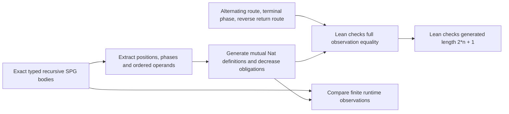

# RT-32 — Termination and ordered effects in mutual SPG recursion

Both recursive group encodings generated Lean definitions that terminate on natural inputs and agree with a forward-and-reverse trace model. The kernel checked both exact trace lengths. Reordering the recursive expression preserved its integer result and its multiset of events and broke the ordered-trace theorem.

## Method

The fixture compiles two typed `Int → Int` SPG implementations. On zero, each emits its own base event and returns zero or one. On a positive input, the left operand emits its entry event and calls the other member on the argument minus one. The right operand emits its exit event and returns zero. The evaluator observes both operands in order. The extractor checks both typed signatures, exact group positions, the cross-member reference, the two constrained expression shapes and the finite trace contracts.

The generated Lean definitions use mutual recursion with the natural input as the decreasing measure. Their result contains an integer and a list of events. A separate model constructs the route as a list of alternating phases, appends one terminal event and adds the exit events in reverse route order. The proof uses induction to compare the full pair and separately derives length `2*n + 1` for both generated functions.



## Results

| Group encoding | SPG and Lean observations | In finite trace contract | Outside finite contract |
| --- | ---: | ---: | ---: |
| keyed | 40 | 32 | 8 |
| structural | 40 | 32 | 8 |

The SPG evaluator, Lean execution and the Python arithmetic and route oracle agree for both members at 0–19 in both encodings. The 80 observations also distinguish exact fuel `n + 1` from exhaustion at `n`. Each SPG contract enumerates traces for 0–15. Inputs 16–19 still run and agree with the model. Their traces fall outside the finite attached contract. Lean quantifies over all natural inputs in the ordered model.

Three controls reach different gates. Reversing operand order at one recursive member preserves its integer and event counts at the checked witness and fails the Lean trace equality. A zero decrement fails the Lean measure check. Removing one finite trace fails exact contract extraction before generation. The positive proofs report `propext` and `Quot.sound`. The existing acyclic SPG admission checker independently rejects the recursive implementation kind in both encodings.

## Implementation boundary

An exact restricted extractor can generate and tie ordered-effect obligations to recursive SPG identities. The candidate separates a trace equality proof from finite contract admission and from the fuel policy of the interpreter. This evidence covers a fixed expression shape over the natural-number part of the source type. General typed admission of recursive imported values, mechanized source correspondence, a symbolic trace contract representation, and termination on other signed inputs remain open.

## Reproduce

Use CPython 3.12.14 and Lean 4.36.0 from the repository root. The generated modules and mutation variants live in a temporary directory during replay.

```sh
fixture=research/formal-verification/RT-32/MUTUAL-EFFECTS-01
output=$(mktemp)
python3 "$fixture/run.py" --output "$output"
cmp "$fixture/evidence.json" "$output"
python3 "$fixture/chart.py"
```

[Runner](MUTUAL-EFFECTS-01/run.py) · [Lean model template](MUTUAL-EFFECTS-01/TraceModel.lean.in) · [Evidence ledger](MUTUAL-EFFECTS-01/evidence.json) · [Call-only mutual termination](RT-32-GENERATED-MUTUAL-TERMINATION-2026-11-24.md)
