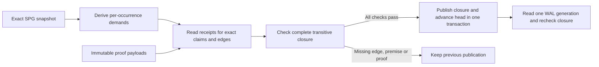

# RT-32 VAC-04 durable proof dependency closure

[Verified SPG to Lean / #296](https://github.com/aivibeflow/LLMLang/issues/296) · [Verification artifact cache work packages](../RT-33/VERIFICATION-BACKEND-INTEGRATION-AND-ARTIFACT-CACHE.md)

Proof evidence can satisfy a complete graph of obligations that varies with each program snapshot. A fixed inventory of one modular proof, one provider and one premise cannot describe repeated and transitive calls. This prototype derives occurrence-sensitive demands from existing typed SPG bodies and stores the exact adjacency for each requested claim. A cache request combines the claim, required edges, expected producer and checker version. It can retain multiple edge inventories for one claim when a new snapshot changes the dependencies.



The publication token binds the requested snapshot, inventory digest and resulting closure digest. It advances against an expected current token. The read path validates both the requested identity and reachable receipts within one SQLite read transaction. Independently derived demands provide the expected inventory. An observed receipt cannot remove an obligation by declaring fewer edges.

## Observations

Five SPG snapshots have 83 derived claim entries across their original inventories. The fixture changes the selected provider for a late call, keeps a pinned direct call, and separately edits a transitive provider. The accepted graph closure changes after each rebind or transitive edit. The mixed caller's modular receipt remains unchanged when its late provider changes.

| Control | Observed outcome |
| --- | --- |
| Two call occurrences select one provider and one discharge is missing | Closure remains pending. |
| A proposed root receipt lists fewer occurrence edges | The receipt misses the independently derived exact request. |
| The original receipts are offered for a rebound snapshot | Closure remains pending until the new inventory is satisfied. |
| A provider claim has an unresolved external premise | Publication waits for the exact premise receipt. |
| A second writer attempts to use the old publication token | The stale write refuses. An already-open WAL reader retains its earlier complete view. |
| A child exits after staging new receipts and updating the pointer, before commit | The previous closure and receipt count survive. A fresh exact retry publishes the new closure. |

The recursion fixture checks two mutually recursive natural-number functions together in Lean. Kernel checking accepts the simultaneous induction theorem with no axioms. Two locally claimed proofs depending on each other are refused as circular. The alternative semantic evidence node references the simultaneous theorem and awaits a separate policy admission receipt. It closes only after that exact receipt arrives. This models one admissible representation for an internally recursive proof group while keeping the external dependency graph acyclic.

The runtime fixtures use synthetic receipt dispositions for the selected SPG claims. The recursive theorem is checked independently and its exact source, environment and theorem report determine the proof-group identity. General recursive SPG lowering and correspondence, policy authentication, concurrent non-transactional storage and remote recovery remain open. [Occurrence derivation](RT-32-SPG-PDG-OCCURRENCES-2026-11-25.md) · [Fixed-role proof store](RT-32-PERSISTENT-PROOF-CACHE-2026-11-25.md)

## Reproduce

Run with CPython 3.12.14, SQLite 3.53.1, Git and Lean 4.36.0. Set `LEAN_BIN` to the Lean distribution's actual executable. The runner verifies the reused source files against their pinned branch revision and uses temporary SQLite databases and archive checkouts. [Replay](PDG-PERSISTENCE-01/run.py) · [Recursive group proof](PDG-PERSISTENCE-01/RecursiveGroup.lean) · [Evidence](PDG-PERSISTENCE-01/evidence.json)

```sh
fixture=research/formal-verification/RT-32/PDG-PERSISTENCE-01
python -B "$fixture/run.py" --lean "$LEAN_BIN" --output /tmp/rt32-pdg-replay.json
cmp /tmp/rt32-pdg-replay.json "$fixture/evidence.json"
```
