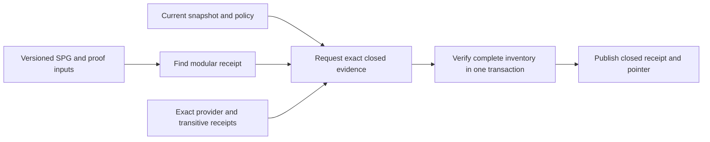

# RT-32 — Persistent modular and closed proof caching

A modular proof and a closed proof can have different valid lifetimes. This experiment defines their cache inputs, stores version-bound receipts under distinct keys and checks atomic publication and recovery with SQLite. It extends [incremental proof invalidation](RT-32-INCREMENTAL-PROOF-INVALIDATION-2026-11-25.md) and [exact caller evidence states](RT-32-CALLER-EVIDENCE-STATES-2026-11-25.md) for [PLAN §2.4](../../../PLAN.md#24-verified-spg-to-lean-pipeline-rt-32) and [#296](https://github.com/aivibeflow/LLMLang/issues/296).

| Entry | Inputs and admission |
| --- | --- |
| Modular theorem lookup | Versioned canonical SPG subject, exact caller and assumed callee contracts, ordered premises, semantic profile, decoder, generator, compiler and Lean toolchain. A direct call's SPG subject also binds its pinned provider. |
| Admitted proof payload | Store an immutable receipt under its own content address. An exact request can replay the same bytes. The fixture refuses a different payload for an existing key. Newly admitted bytes can receive a separate version. |
| Closed proof lookup | Bind the active snapshot, trust policy, and exact request and payload digests for the modular, provider and transitive receipts in the fixture. |
| Published result | Check required dependencies and update the active pointer in one write transaction. Recheck exact dependent payloads when reading a closed entry. |

The versioned key encodings are deterministic in the fixture. They use role-specific domains and a stable ordering of the dependency inventory. The result retains already checked historical entries when a new version makes them inapplicable to the active request. A changed policy or premise leads to a missed lookup under the new request. Authorization and kernel conformance evidence are assumed at admission of fixture dependency receipts.



## Observed controls

| Control | Outcome |
| --- | --- |
| Change any single modular lookup field | All nine cases miss the existing receipt. |
| Late provider rebind | The modular receipt remains applicable. The new closed request is refused until both exact dependencies are present. |
| Refresh leaf proof bytes or change trust policy | The closed request changes. Neither new request hits the previous receipt. |
| Repeat the same receipt or supply different bytes for its key | Exact repetition succeeds. The different payload is refused and the original remains available. |
| Omit a required role or change the request independently of its contents | Both publications are refused. |
| Read during a completed publication | A transaction that already read the old generation retains that view. A new read sees the complete publication. |
| Exit a writer with uncommitted receipt and pointer updates | A reopened reader sees the previous publication. The interrupted receipt is absent. Retrying the same request succeeds. |
| Damage one dependency payload in the scratch database | Both direct lookup and closed reuse fail on the content digest. |

The SQLite experiment uses one writer at a time and a WAL reader transaction. It tests process exit before commit, followed by reopening. Power interruption, distributed persistence, garbage collection, general proof DAG construction and production attestation require separate evidence. The [SPG occurrence study](RT-32-SPG-PDG-OCCURRENCES-2026-11-25.md) derives dependency inventories for its corresponding graph fragment. This storage fixture uses a fixed three-role inventory. The [compiled admission study](RT-32-COMPILED-CLAIM-ADMISSION-2026-11-24.md) supplies a separate validation profile. [DEP-183 and DEP-189](../../research-management/RESEARCH-DEPENDENCY-MAP.md#3-directed-dependency-register)

## Reproduce

Use CPython 3.12.14 linked against SQLite 3.53.1. Run from the repository root. The [ledger](PROOF-CACHE-STORE-01/evidence.json) records the key changes, lookup refusals and observed transaction outcomes. The command uses a temporary database.

```sh
set -eu
fixture=research/formal-verification/RT-32/PROOF-CACHE-STORE-01
out=$(mktemp)
trap 'rm -f "$out"' EXIT
LC_ALL=C PYTHONHASHSEED=1 python3 -B "$fixture/run.py" > "$out"
cmp "$fixture/evidence.json" "$out"
```
