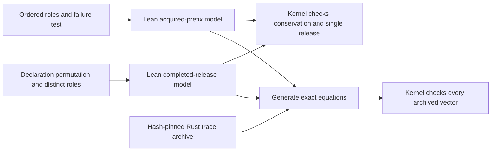

# Kernel-checked ownership for partial record construction

This RT-32 study separates general ownership obligations from a finite source correspondence check. It asks what a checked record cleanup model can guarantee for lists of arbitrary length, and whether the same Lean definitions predict the exact archived Rust observations for a closed three-field generator. The model covers live owned roles rather than language-level aliases or foreign resources.

## Claims and inputs

An ordered acquisition list gives the execution order. A Boolean test can fail each role. The successful prefix stops at the first failure, and abort releases that prefix in reverse. Successful completion has a separately ordered declaration list. That list must be a permutation of the acquisition roles. A completed record releases the fields it still owns and leaves at most one moved role for release in its later scope. Distinct acquisition roles are a separate premise for the single-release guarantee.

The Lean specification keeps declaration order, initialization order, abort release and transfer explicit. `List.Perm` states conservation of a multiset and leaves order available for the trace. `List.Nodup` excludes duplicate linear roles. Kernel-checked statements show that abort releases exactly the acquired multiset, never releases a role whose acquisition failed, and preserves distinctness. After completion the record and transfer releases together conserve the checked acquisition list. A valid transferred role occurs exactly once at the later scope and is absent from the record release. An absent role cannot produce a transferred release.



The equality generation reads the exact pinned ledger from the separate RT-05 Rust experiment. Each theorem compares a list of 32 input vectors, including the first error and the ordered numeric events, directly with the same Lean evaluator. The executable replay is checked too. The generator never substitutes native expected output into the evaluator. It emits the expected vectors on the separate sides of equality.

## Evidence

| Evidence | Count |
|---|---:|
| General ownership theorems | 11 |
| Checked counterexamples | 3 |
| Rejected proof applications | 2 |
| Generated archive equalities | 72 |
| Early-exit vectors in the equalities | 2,016 |
| Completed vectors in the equalities | 288 |
| Native executions represented | 4,608 |

The 14 hand-authored claims use only `propext`, `Quot.sound` and `Classical.choice` where listed in the ledger, and some have no axioms. The 72 generated equations are checked by definitional equality and audit to `propext` only. No theorem uses an added computation or unchecked certificate axiom.

The counterexamples expose three independent concerns. Duplicate roles can release twice. A declaration list that is not a permutation can release a nonexistent owner. Two opposite completion orders can conserve the same multiset and still produce different traces. The runner separately rejects proof applications that substitute a mismatched declared owner or treat a transferred field as still owned by the record.

## Scope and replay

The unbounded proofs establish properties of the written list model under its premises. They do not establish that a general parser or SPG extractor supplies the correct lists. The finite source link is an exact comparison with a pinned Rust observation archive of generated direct and staged constructors. Alias admission, cross-language lowering, foreign cleanup, fallible destructors, concurrency, production proof policy and independent review remain open. The result supports checking both role inventory and explicit sequence before reusing a conservation certificate.

Use CPython 3.12.14 and Lean 4.36.0 at revision `611c117bfaf7b7ae1cfcf246ce6fba31e8f509e9`. The initial LLMLang base is `57268bf3c07e71cb3fd0536189b125b6639e22ef`. The ledger pins the Lean source, generated replay, exact Rust archive and compared vectors by SHA-256. Run from the repository root.

```bash
fixture=research/formal-verification/RT-32/RECORD-OWNERSHIP-01
PYTHONHASHSEED=1 python3 -B "$fixture/run.py" --lean "$(command -v lean)" > /tmp/llmlang-rt32-record.json
cmp "$fixture/evidence.json" /tmp/llmlang-rt32-record.json
python3 "$fixture/chart.py"
```

See the [Lean ownership model](RECORD-OWNERSHIP-01/Ownership.lean), [comparison runner](RECORD-OWNERSHIP-01/run.py), [verification ledger](RECORD-OWNERSHIP-01/evidence.json), [table generator](RECORD-OWNERSHIP-01/chart.py), and [RT-05 native partial record evidence](../../semantic-representation/RT-05/RT-05-PARTIAL-RECORD-OWNERSHIP-2026-11-25.md).
