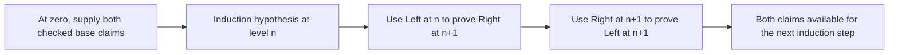

# RT-32 — Discharge recursive proof assumptions through joint induction

**Scope:** PLAN §2.4 and [#296](https://github.com/aivibeflow/LLMLang/issues/296), based on `a824e8e0d92f7ead7eac313376352ad21b3e8bca` in `research/all`.

A typed Proof Dependency Graph (PDG) records what a checked conditional claim still assumes. In recursion the claim templates can refer back to each other. A checker that accepts each pending receipt merely because its prerequisite also has a pending receipt can close a circular proof. This study distinguishes an unsupported cycle from two admissible ways to discharge mutual assumptions: every step decreases a natural measure, or one step stays at the same measure and follows a checked within-level order.

## Candidate proof model

Let `Left(n)` and `Right(n)` be arbitrary propositions indexed by a natural measure. Each conditional proof receipt names an exact indexed premise and conclusion. An accepted base fact names a checked level-zero claim. A finite query closes a root when there is a derivation from the available facts through the checked implications. A root without such a derivation stays conditional or pending. The absence of a derivation in the fixture is distinct from evidence of the negation.

With decreases in both directions, a joint theorem establishes `Left(n) ∧ Right(n)` by induction from both base proofs. Each step consumes the opposite claim at the previous level. A mixed scheme may prove one claim from the previous level and use it to justify the other at the same level. Its order is the measure followed by the fixed position within that level.



The diagram shows the mixed scheme with the left step using the right claim at the same level. The right step consumes the left claim at the preceding level. Proofs flow from already established premises. The symmetric scheme exchanges left and right.

The [Lean file](RECURSIVE-DISCHARGE-01/Discharge.lean) checks both-decreasing induction and both mixed alternatives for arbitrary propositions. Two checked countermodels show that decreasing steps without base facts can leave every claim false, and that same-level implications in both directions can agree at level zero yet fail to establish either claim at positive levels. All five theorem axiom reports are empty. Applying the decreasing rule to the same-level inputs separately fails Lean's type check.

## Finite check

The finite corpus crosses six maximum levels 0–5, four subsets of the base facts, four subsets of the two step families, and four choices of decreases. Each case has two root claims at its largest level. A forward checker adds a conclusion only after its premise is established. An independent oracle enumerates every Boolean assignment to the finite indexed claims, retains those models satisfying the facts and implications, and intersects their true claims. The forward result agrees with the oracle across all 384 cases.

| Edge pattern | Cases | Cases closing both roots | False root closures from checking immediate receipt presence |
| --- | ---: | ---: | ---: |
| Both steps decrease | 96 | 9 | 16 |
| Left stays at the same level | 96 | 14 | 18 |
| Right stays at the same level | 96 | 14 | 18 |
| Both stay at the same level | 96 | 4 | 40 |

The last column counts individual false root claims out of 192 per pattern. The shortcut treats a recorded conclusion as a discharged premise when checking the next edge. It reports 92 false root claims in this corpus. With both base facts and all steps supplied, same-level cycles still fail to establish positive-level roots. At level zero, both available base facts can close the two roots independently of the step pattern.

The mixed pattern can sometimes establish a particular positive-level pair with one base fact missing. That supports only the corresponding finite root judgment. The universal conjunction still needs evidence for both level-zero claims. The check distinguishes a request for one exact root from a request to close the entire group.

## Application and limits

An ordinary transitive receipt check can carry unresolved dependencies forward. A recursive group with a certified base and an exact ordered induction theorem supplies a different closure route. Treating every graph cycle as unprovable would decline both verified mixed variants. Treating any mutual conditional proof as closed would admit the countermodels. [Earlier transitive closure study](RT-32-TRANSITIVE-PROOF-CLOSURE-2026-11-24.md) · [Generated mutual termination](RT-32-GENERATED-MUTUAL-TERMINATION-2026-11-24.md)

A candidate production receipt would bind the exact group members, propositions, measure or within-level order, checked base and step evidence, and external assumptions. The kernel theorem checks the logical implication from those premises. This experiment supplies no source proof that a real callee follows the declared measure or that the PDG contains every source obligation. General recursive groups, arbitrary well-founded relations, checkable source correspondence, authorization, evidence invalidation and independent review remain open. No proof-state policy is selected.

## Reproduce

Use CPython 3.12.14 and Lean 4.36.0 at `611c117bfaf7b7ae1cfcf246ce6fba31e8f509e9`. The [runner](RECURSIVE-DISCHARGE-01/run.py) enumerates the finite cases and checks the Lean file and wrong-rule control in a temporary directory. The [ledger](RECURSIVE-DISCHARGE-01/evidence.json) records source hashes, masks for the distinguishing cases, counts and exact axiom output. There is no timing measurement. Mermaid syntax was inspected directly.

```sh
fixture=research/formal-verification/RT-32/RECURSIVE-DISCHARGE-01
LC_ALL=C PYTHONHASHSEED=1 python3 -B "$fixture/run.py" \
  --lean "$(command -v lean)" > /tmp/llmlang-recursive-discharge.json
cmp "$fixture/evidence.json" /tmp/llmlang-recursive-discharge.json
```
