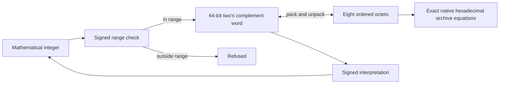

# Kernel-check signed I64 byte identity

The RT-05 native study compared five routes from serialized input through CPython and Node/V8. Three exact routes reconstructed the same typed graph. This follow-up asks whether one fixed-width byte representation has a reversible mathematical interpretation across all signed `I64` values, and whether that interpretation agrees with the archived hexadecimal route. [Cross-runtime integer study](../../semantic-representation/RT-05/RT-05-CROSS-RUNTIME-I64-ENCODING-2026-11-25.md)

## Model and proof boundary

The admitted mathematical value is an integer in the interval from `−2^63` inclusive to `2^63` exclusive. Encoding performs the range check, then converts the integer to a 64-bit two's complement word and divides it into eight octets in big-endian order, with the most significant octet first. Decoding concatenates the eight octets and interprets the word as signed. The type represents exactly eight octets and each octet is a Lean `BitVec 8`.



Lean checks both directions of packing, signed decoding, injectivity for admitted values and refusal outside the range. Every possible ordered eight-octet tuple decodes to an admitted integer and checked re-encoding returns that exact tuple. The proofs quantify over the model values and byte tuples. One counterexample proves that an unchecked conversion maps `2^63` to the encoding of `−2^63`. The other shows that placing the same nonzero octet at each end produces distinct values. A separate attempted proof that the checked encoder accepts the first wraparound is rejected.

## Native alignment

The runner binds the exact RT-05 archive and its source file digests before reading the 181 hexadecimal observations. For each one it checks the raw transport digest, the archived Node acceptance and decoded decimal value, and the SHA-256 identity computed by the original fixture from those octets. It then generates a Lean equation comparing both the complete ordered octet list and signed result against the archived observation. The SHA calculation is a Python replay at the archive boundary. The kernel equations address the mathematical projection of those observations.

| Checked result | Count |
|---|---:|
| General model theorems | 12 |
| Policy counterexamples | 2 |
| Exact native archive equalities | 181 |
| Refused false proofs | 1 |

The complete axiom audit of the 195 checked declarations contains only `propext`, `Quot.sound` and `Classical.choice`. Each archive equation uses only `propext` and `Quot.sound`.

## Implications and unresolved work

A checked fixed-width byte component provides a reversible typed value for graph identity and proof binding. A preserved numeric token or canonical decimal text can still serve as an exact transport if its parsing is independently connected to the same typed value. An ordinary JavaScript number can already lose precision by the time a byte encoder sees it. The prior experiment measures that trade-off across transports, while this study resolves the reversible byte component. General JSON admission, decimal-parser correspondence, SPG extraction, production encoder correctness, hash security, adoption and independent review remain open.

## Reproduction

Use CPython 3.12.14, Lean 4.36.0 at `611c117bfaf7b7ae1cfcf246ce6fba31e8f509e9`, and the native RT-05 archive introduced in `e6c21442136aea92eed1a90ee97395fd97237101`. Node 22.23.5 and V8 12.4.254.21-node.57 reproduce the original archive. The proof runner reads that archive and requires only Python and Lean.

```bash
fixture=research/formal-verification/RT-32/I64-BYTE-KERNEL-01
PYTHONHASHSEED=1 python3 "$fixture/run.py" --lean "$(command -v lean)" > /tmp/llmlang-rt32-i64.json
cmp "$fixture/evidence.json" /tmp/llmlang-rt32-i64.json
python3 "$fixture/chart.py"
```

[Lean model and theorems](I64-BYTE-KERNEL-01/Codec.lean) · [Replay](I64-BYTE-KERNEL-01/run.py) · [Axiom ledger](I64-BYTE-KERNEL-01/evidence.json) · [Table generator](I64-BYTE-KERNEL-01/chart.py)
