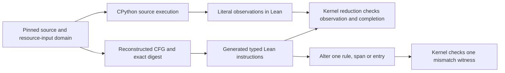

# RT-32 — Kernel-check source-derived cleanup observations

Lean checks the complete Boolean input domain for eight source-derived control-flow graphs. It verifies ordered effects and source spans, return and cause data, cleanup state and the staged handle boundary against the pinned CPython observations. It also checks a separate completion property and four counterexamples to altered graphs.

## Question and assumptions

The [RT-03 source study](../../language-design/RT-03/RT-03-SOURCE-CLEANUP-CFG-2026-11-25.md) compares an extracted graph with execution of the same text on CPython. Can the checked statement cover the observations that distinguish these alternatives, including cleanup on a pending return, and can it be regenerated for exact input bytes?

The admitted corpus consists of eight source functions with two Boolean inputs and separate failure controls for two nested cleanup slots. Acquiring a slot and probing a Boolean are total in this fixture. Cleanup can report failure and retain a debt. Return expressions can stage a handle that is delivered only if the pending return completes. This handle and its debt are modeled program obligations.

## Proof and replay

The driver reruns the independent native-source harness and compares its entire ledger with the committed one. It reconstructs each graph from the recorded source and verifies both digests. Each Lean program is then generated from the exact graph. The generated oracle definitions use the literal native observation rows, including exact byte columns. A typed Lean interpreter follows the generated graph and fails closed on an invalid node, an invalid resource transition or exhausted fuel.



Each agreement theorem quantifies over both Boolean arguments and both cleanup-failure flags for one exact generated program. Its proof splits the four Booleans and reduces the resulting equality with `decide`. A separate theorem checks that each slot's terminal state matches its failure flag, only a caller-owned handle is returned, and a caller receives a handle only when both cleanups succeed. The mutated graphs are checked against the original oracle. This checks a finite profile, so it needs neither an SMT answer nor an independently authored Lean implementation of each source program.

## Results

| Checked statement | Theorems | Input coverage |
| --- | ---: | --- |
| Exact source observation | 8 | 16 inputs per program |
| Resource completion | 8 | 16 inputs per program |
| Mutated graph differs | 4 | One witness per mutation |

All 20 statements report only `propext` in their transitive axiom sets. Four inequalities distinguish eager guard evaluation, bypassing cleanup on a pending return, changing only the first source span, and an invalid graph entry. The first two controls exercise effect and ownership differences. The span-only control keeps the graph semantics and distinguishes the source-bound observation. The invalid-entry control abstains through `none`.

## Implications and limits

An executable check can attach stronger finite-state evidence to a generated graph when its expected observations cover source positions, ordered effects, causes and ownership. Exact hashes bind the replay artifacts operationally. Lean checks the generated definitions and literal oracle, while extraction, span interpretation, CPython execution and the adapter's resource contract remain outside the kernel. The result covers all Boolean inputs to these eight programs. It leaves canonical LLMLang SPG admission, general source correspondence, cancellation, foreign resources and whether to preserve all causes in the chosen semantics open. Independent review remains pending.

## Reproduce

Use CPython 3.12.14 and Lean 4.36.0 at commit `611c117bfaf7b7ae1cfcf246ce6fba31e8f509e9`. The driver builds a temporary Lean module, reproduces the source oracle and audits the theorem axiom sets.

```sh
fixture=research/formal-verification/RT-32/SOURCE-CLEANUP-KERNEL-01
output=$(mktemp)
python3 -B "$fixture/run.py" --lean "$(command -v lean)" > "$output"
cmp "$fixture/evidence.json" "$output"
python3 "$fixture/chart.py"
```

[Lean model](SOURCE-CLEANUP-KERNEL-01/CleanupModel.lean) · [Generator and replay](SOURCE-CLEANUP-KERNEL-01/run.py) · [Replay ledger](SOURCE-CLEANUP-KERNEL-01/evidence.json)
