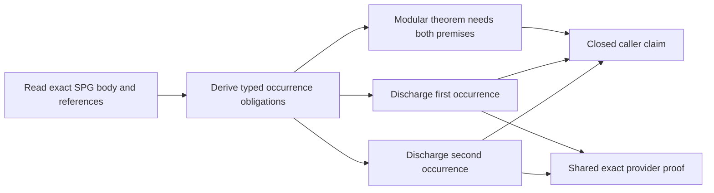

# RT-32 — Deriving proof dependency nodes from SPG call occurrences

A proof dependency graph records what establishes a claim about a semantic graph. Each call occurrence can add an obligation even when two occurrences share one provider proof. This experiment derives the inventory directly from compiled SPG bodies and applies the existing exact receipt closure checker. It extends the [generated caller experiment](RT-32-GENERATED-CALL-CONTRACTS-2026-11-24.md) and [transitive receipt comparison](RT-32-TRANSITIVE-PROOF-CLOSURE-2026-11-24.md) for [PLAN §2.4](../../../PLAN.md#24-verified-spg-to-lean-pipeline-rt-32) and [#296](https://github.com/aivibeflow/LLMLang/issues/296).

The admitted fragment has acyclic unary integer operations with typed argument expressions, exact or operation-level references, and ordered effects. Every stored reference entry must correspond to one distinct occurrence path in the decoded body. An operation-level call resolves from the concrete snapshot and rechecks the selected implementation's operation. A direct call uses its exact pinned implementation. Branch arms can contribute static obligations even if a particular input skips them.

| Proof graph node | Semantic subject and required evidence |
| --- | --- |
| Source correspondence | Exact implementation and observation profile. |
| Modular contract theorem | Caller body and contract, source correspondence and every per-occurrence premise declaration. |
| Call premise | Caller identity, occurrence path and invocation mode, referenced identity and required contract. |
| Binding and discharge | Concrete snapshot, exact selected provider, matching binding and proved provider conformance for this occurrence. |
| Closed claim | Exact snapshot and implementation, with the modular theorem and every transitive call discharge. |
| Receipt | Exact claim kind and subject, expected typed edges, checker, toolchain, disposition and proof artifact. |



The inventory comes from semantic subjects before candidate receipts are inspected. In a repeated call, the two discharges can both consume one exact provider proof. Two separate proof edges remain necessary because the caller theorem depends on two argument evaluations and two ordered call effects. Lean checks trace composition for arbitrary provider functions given their pointwise trace premises, including the repeated-provider corollary. Both model theorems have empty axiom lists.

## Results

Six source fixtures compile to typed SPGs. The corpus tests repeated, mixed direct/late and nested calls, late rebinding and an edit to a transitive provider. All 30 integer observations agree with independent result and trace formulas. Two occurrences selecting the same provider produce two separate entries. In the mixed case, a late rebind changes only the late occurrence's provider, while the direct one remains pinned. A transitive body edit preserves the entry implementation identity and changes the snapshot-scoped closure.

| Receipt control | Result |
| --- | --- |
| Derive expected edges from a shortened receipt | Incorrectly closes after losing one occurrence. |
| Derive expected edges from SPG and replay the same shortened receipt | Refused for a missing required edge. |
| Remove only one occurrence discharge | Pending. |
| Replay a receipt from another checker identity | Refused for provenance. |
| Remove a transitively reached discharge | Pending despite local receipts. |
| Reuse the old snapshot's closure after a transitive edit | Pending under the new requested scope. |

All six complete synthetic receipt graphs close against their derived inventories. Their receipts exercise topology and provenance checks using declared fixture dispositions. The Lean declarations independently establish the abstract trace algebra. These results leave production theorem authenticity, authenticated receipts, recursion, verified SPG decoding, and complete correspondence from general source programs open. The SPG remains the semantic source for the derived inventory. The proof graph records evidence about it. [DEP-188 and DEP-189](../../research-management/RESEARCH-DEPENDENCY-MAP.md#3-directed-dependency-register)

## Reproduce

Use Git 2.56.1, CPython 3.12.14 and Lean 4.36.0 at `611c117bfaf7b7ae1cfcf246ce6fba31e8f509e9`. Run from the repository root with archive commit `21800dd85aa37721e2748001d307033be0b2fac1`. The [ledger](SPG-PDG-OCCURRENCES-01/evidence.json) records the occurrence paths, semantic and proof identities, observations and negative controls.

```sh
set -eu
fixture=research/formal-verification/RT-32/SPG-PDG-OCCURRENCES-01
out=$(mktemp -d)
trap 'rm -rf "$out"' EXIT
lean -DwarningAsError=true "$fixture/Occurrences.lean" > "$out/axioms.txt"
cmp "$fixture/axioms.txt" "$out/axioms.txt"
LC_ALL=C PYTHONHASHSEED=1 python3 -B "$fixture/run.py" > "$out/evidence.json"
cmp "$fixture/evidence.json" "$out/evidence.json"
```
