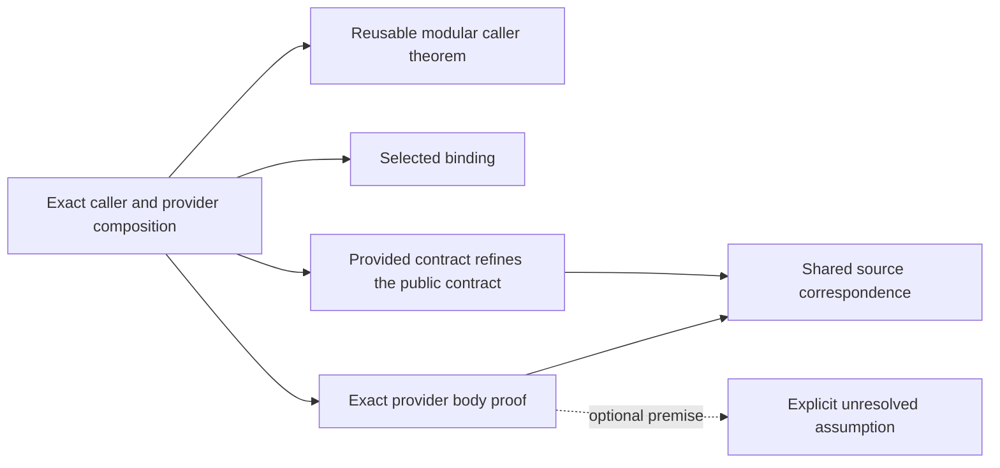

# RT-32 — Transitive proof closure with exact claims and receipts

- **Evidence** — Executable closure and invalidation experiment over a fixed expected graph and simulated proof receipts.
- **LLMLang baseline** — `4371dc19a012d111535622d967a43054c762b945`.
- **Tracking** — [PLAN §2.4](../../../PLAN.md#24-verified-spg-to-lean-pipeline-rt-32) · [RT-32 proof dependency graph](RT-32-VERIFIED-SPG-TO-LEAN-PIPELINE.md#31-compositional-proofs-and-the-proof-dependency-graph).

## Question and boundaries

When can a checked modular caller theorem support a closed program claim? The modular theorem can depend only on the public contract. The composition for one selected provider also needs the provider's exact body proof, refinement of its provided contract to the public contract, source correspondence, and binding evidence. A closed claim needs the full dependency chain, including premises of those supporting proofs. The experiment compares complete traversal with a policy that looks only at a claim and its immediate receipts. [Prior checked modular caller proof](../../semantic-representation/RT-05/PUBLIC-INTERFACE-MODULAR-CALLER-2026-11-24.md)

A claim has a role, subject revision, theorem and observation profile. A receipt pins that claim, ordered expected dependencies, the producer and toolchain, the local status and the artifact identifier. The expected inventory is a separate input. Comparison against it prevents a receipt from silently omitting an expected dependency. A missing premise stays visible even when present receipts report locally checked results.



The two paths to source correspondence form a diamond. A closed result includes that exact receipt once. The optional premise blocks closure until evidence for the matching claim arrives.

## Comparison and controls

The transitive candidate follows the complete expected graph, matches each receipt at its exact claim and detects cycles along the active path. It publishes an evidence digest only if no blocker remains. The digest includes each reachable claim and exact receipt identity. The independent oracle starts with no closed claims and repeatedly adds a locally checked claim when every required claim is already closed. This is the least fixed point of closure. A cycle with no completed justification cannot create its own evidence.

| Evaluation | Result |
| --- | --- |
| 512 directed three-node graphs, including self-edges, with eight available-receipt masks and all three roots | 12,288 root cases. Transitive closure agrees with the fixed-point oracle throughout. It closes 879 cases. |
| Local checked result plus immediate receipts | 2,577 false admissions in the same corpus, caused by transitive gaps or cycles. |
| Shared source correspondence | Six distinct receipts close the diamond. A missing grandchild, an omitted edge or a missing expected claim prevents a digest. |
| Provider body changes while the public contract remains fixed | The old body receipt is stale. The abstract caller receipt is reusable and the refreshed provider evidence changes the exact closure digest. |
| Public contract changes | A receipt for the old modular theorem does not match the new claim. |
| Producer, toolchain, source binding or premise changes | An unexpected producer or toolchain and an unsupported source binding prevent closure. A missing explicit premise is distinguished from other missing receipts. Its exact replacement closes the bounded composition. |
| Exact proof artifact changes within a matching receipt | Produces a different closure digest even when the claim and dependencies stay fixed. |
| Cyclic discharge | A dependency from the shared source correspondence back to its consumer blocks release even when all local receipts say checked. |

[Machine-readable results and ten controls](TRANSITIVE-CLOSURE-01/evidence.json)

## Implementation consequence

A checked premise graph can reuse a mathematical theorem under an unchanged public contract while refreshing the evidence for a specific binding. A release record needs the selected subject, exact required claims and complete checked evidence. An immediate-edge check cannot distinguish an unresolved deeper obligation from a fully discharged composition. Maintain separate statuses for unresolved assumptions, pending artifacts, unsupported sources, provenance mismatches and cyclic discharge.

The graph and receipts in this comparison are fixtures. The closure engine assumes that the expected inventory is complete and that the supplied receipt identities came from genuine checked artifacts. Matching producer and toolchain names does not authenticate anything. Extraction of claim edges from source and actual Lean dependencies, authenticated origins, finite resource bounds, independent evidence admission, and policy for real recursive proof justifications remain open.

## Reproduction

Run with CPython 3.12.14 from the repository root. Five Python hash seeds produced byte-identical evidence. The existing Lean 4.36.0 modular caller comparison also replays independently, with its own evidence file and a different claim scope. [Closure](TRANSITIVE-CLOSURE-01/closure.py) · [Independent oracle and controls](TRANSITIVE-CLOSURE-01/check.py)

```sh
study=research/formal-verification/RT-32/TRANSITIVE-CLOSURE-01
PYTHONHASHSEED=1 python3 -B "$study/check.py" > /tmp/llmlang-rt32-closure.json
cmp "$study/evidence.json" /tmp/llmlang-rt32-closure.json
proof=research/semantic-representation/RT-05/public-refinement-pilot
python3 -B "$proof/modular_provider.py" --output /tmp/llmlang-rt32-modular.json
cmp "$proof/modular-provider-results.json" /tmp/llmlang-rt32-modular.json
```
