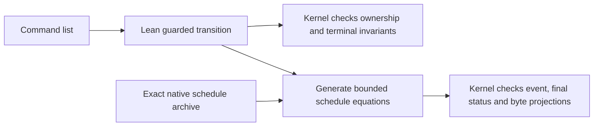

# Check the native worker's cancellation and settlement model in Lean

This RT-32 study compares a checked worker protocol with the native RT-01 observations. It asks which safety properties hold for arbitrary command lists in a guarded model, and whether eight bounded schedule projections match the exact CPython and Rust archive. The model distinguishes permitting a write, having an established outcome, and reporting completion after release. [Worker experiment](../../language-design/RT-01/RT-01-RESOURCE-WORKER-SETTLEMENT-2026-11-25.md)

## Model and obligations

A role starts idle. It may acquire a handle, accept a cancellation before the next effect, attempt a write, record its outcome, or settle. Revocation records whether a handle still needs release. A successful or failed attempted write yields a known outcome. The settling step drops any owned handle before reporting the terminal state. The model absorbs later commands at settlement and can report the same outcome again without repeating resource operations.

The kernel checks that a write requires ownership, no command from a revoked state attempts another write, and terminal reporting leaves no owned handle. A release moves to the absorbing terminal state, giving at most one close per role for any finite command list. Cancellation after a known outcome preserves that outcome. The separate job-state update lemma concerns local state, with the event order still coming from the schedule.



The two counterexample theorems represent the distinguishing policy changes. Admission-only checking can permit a revoked write in the model. An eager terminal result can leave a live handle. A separate false proof attempts to replace a previously known success with revocation and fails kernel admission.

## Bounded archive

The runner pins both native implementation sources and the complete ledger. It reads the guarded observations and the authored read-only masks from the original schedule source. It generates eight Lean equalities for the same transition model used in the general proofs. Each equality includes the ordered event labels, the live-handle bits, the release flag, the final status and the final byte projection. The two job variables are evaluated separately. The fixture assumes the forwarded command is authorized.

| Evidence | Count |
|---|---:|
| General checked properties | 10 |
| Checked policy counterexamples | 2 |
| Rejected late-cancel proof | 1 |
| Exact archive schedule equalities | 8 |
| Archived worker handoffs checked | 56 |
| Archived terminal job outcomes checked | 16 |

All hand-authored claims and generated archive equations pass. The axiom ledger lists `propext` and the standard `Quot.sound` only. The native evidence has 24 guarded process runs across CPython and Rust O0/O3, with 56 distinct ordered handoffs across the eight schedules. The Lean equations bind the observations in the exact archived projection.

## Limits and replay

The proofs cover state transitions and command-list properties of the authored model. The native archive covers the controlled Linux protocol. The scope leaves general source extraction, arbitrary kernel scheduling and system-call interruption, process-crash recovery, external authorization and independent review open. The result supports explicit pre-effect validation and post-release completion obligations while keeping the model-to-implementation boundary visible.

Use CPython 3.12.14 and Lean 4.36.0 at revision `611c117bfaf7b7ae1cfcf246ce6fba31e8f509e9`. The initial LLMLang base is `8a2968da3eca0a960eeddc7136d8ab85672c6235`. The runner pins the native input and generated replay source. Replay from the checkout containing the native worker experiment.

```bash
fixture=research/formal-verification/RT-32/WORKER-CANCEL-01
PYTHONHASHSEED=1 python3 -B "$fixture/run.py" --lean "$(command -v lean)" > /tmp/llmlang-rt32-worker.json
cmp "$fixture/evidence.json" /tmp/llmlang-rt32-worker.json
python3 "$fixture/chart.py"
```

See the [Lean model and theorems](WORKER-CANCEL-01/Worker.lean), [archive replay](WORKER-CANCEL-01/run.py), [verification ledger](WORKER-CANCEL-01/evidence.json), and [table generator](WORKER-CANCEL-01/chart.py).
