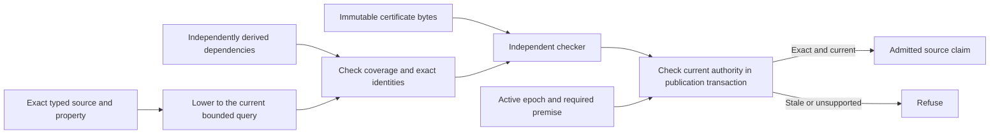

# RT-33 VAC-15 scoped cache admission soundness

[Verified SPG to Lean / #296](https://github.com/aivibeflow/LLMLang/issues/296) · [Verification artifact cache work packages](VERIFICATION-BACKEND-INTEGRATION-AND-ARTIFACT-CACHE.md)

The source claim in this fixture says that one observed natural-number result is in the declared scope and equals the requirement. The typed counterexample query asks for a value in scope that equals the observation and differs from the requirement. A certificate can correctly refute the query merely because the observed value lies outside the query's bound. Source admission therefore needs an independent coverage check in addition to exact query and proof checking.

The Lean development defines the counterexample interpretation, its form with the bound folded on the observed value, two supported semantic certificate classes, and the conditions for admission. The theorem `foldCorrespondence` proves the bound fold under the exact equality constraint. `checkerSound` proves soundness for the small modeled certificate classes. `admittedSource` derives the requested source claim from exact query binding, coverage and a checked certificate. Five further declarations cover refusal due to epoch, premise, inventory and unsupported certificates, and the counterexample to solver-bound admission alone. All eight have empty axiom lists.



## Observations

The native replay regenerates the exact SMT-LIB query and checks cvc5 Alethe certificates with Carcara. The original task is admitted. When the requirement is 3, the observation is 7 and the bound is 4, cvc5 returns UNSAT and Carcara verifies the folded query certificate. The source gate still refuses because the observation lies outside scope. A different result inside scope is SAT and supplies no UNSAT evidence. Changing the typed bound from 4 to 5 while the observed value remains in scope preserves the folded SMT bytes and changes the exact request identity.

Ten further controls refuse changed source revision or semantics, a different bound with equal wire, an Alethe hole, missing or forged dependency inventories, corrupted dependency and proof bytes, a revoked premise, and an earlier policy epoch. An exhaustive six-gate projection checks 64 combinations. Only the exact original candidate reaches the certificate check in that projection.

The SQLite WAL experiment runs both orders of revocation and publication after an exact receipt has been checked. Revocation first refuses the write. Publication first creates one historical receipt, including on exact repetition, and revocation removes its active applicability. An independently checked receipt for a different artifact is refused while authority is still current.

The Lean argument proves a scoped model. The executable checks connect its gates to real tool outputs and storage transactions for this corpus. Trust in the native checker, complete source extraction and dependency inventory, cryptographic provenance, correspondence for general source languages, and distributed transaction semantics remain outside the proof. [Persistent certificate replay](RT-33-SMT-ARTIFACT-REPLAY-2026-11-25.md) · [Proof action identities](RT-33-TYPED-PROOF-KEYS-2026-11-25.md)

## Reproduce

Use CPython 3.12.14, SQLite 3.53.1, Lean 4.36.0, cvc5 1.4.2 and Carcara 1.1.0. The runner checks the earlier certificate adapter against the exact branch revision. [Lean model](CACHE-ADMISSION-SOUNDNESS-01/Admission.lean) · [Native checks](CACHE-ADMISSION-SOUNDNESS-01/run.py) · [Recorded evidence](CACHE-ADMISSION-SOUNDNESS-01/evidence.json)

```sh
fixture=research/formal-verification/RT-33/CACHE-ADMISSION-SOUNDNESS-01
python -B "$fixture/run.py" --lean "$LEAN_BIN" --cvc5 "$CVC5_BIN" --carcara "$CARCARA_BIN" \
  --output /tmp/rt33-vac15-replay.json
cmp /tmp/rt33-vac15-replay.json "$fixture/evidence.json"
```
