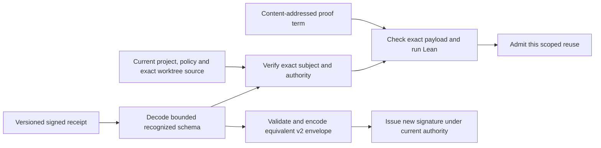

# RT-33 VAC-10 proof reuse across worktrees and receipt versions

[Semantic build and cache graph / #300](https://github.com/aivibeflow/LLMLang/issues/300) · [Verification artifact cache work packages](VERIFICATION-BACKEND-INTEGRATION-AND-ARTIFACT-CACHE.md)

A proof artifact can have the same bytes in two worktrees and still need a new admission when the project, relevant source or policy changes. This experiment defines a scoped cache request with the project, branch, proof profile, theorem shape and import source, artifact digest, checker identity, and issuer epoch. It creates two independent Git projects and two local clones. Every scratch checkout uses `research/all`. Both independent projects deliberately produce the same initial commit ID.



The worktree reader captures the two required regular-file roles independently of receipt data. It rejects symbolic links and passes the captured bytes to the proof replay. The proof profile accepts the two admitted definitions in this study and one exact preapproved term. The checker identity binds the pinned Lean version, launcher, shared library and core import. A trusted signer can identify a subject and evidence but does not replace the proof check.

The receipt decoder enforces a closed field set, version, byte budget, SHA-256 syntax, unique role and object fields, and exact expected input roles. Version 1 lists input roles. Version 2 records them in a map and makes the branch explicit. The fixture can migrate the supported version 1 envelope because its profile is scoped to the single branch. Both input orders migrate to identical version 2 bytes. The migrated bytes require a new signature and retain the same proof artifact digest.

## Observations

Twenty-four controls include five admitted reuses and 19 refusals. An unchanged clone and a clone with an unrelated committed documentation edit reuse the same proof. Uncommitted changes to the required definition block the earlier receipt despite an unchanged Git head. With a new signature for the changed definition, the native Lean replay still refuses the old proof term. A different project with the same exact commit requires its own authorized receipt. Its new receipt can reuse the same stored proof bytes after checking.

The newly signed version 2 envelope succeeds, and reusing the previous signature over its bytes fails. Eight malformed or unsupported wire records were refused before artifact retrieval. Separate controls reject stale authority, an unrecognized signer, an incorrect checker, missing CAS bytes, corrupted CAS bytes, and correctly authenticated evidence outside the supported proof profile.

The prototype tests local Git worktrees and fixture Ed25519 keys. It does not define a production project authority or support arbitrary proof terms and imports. Concurrent reads, distributed transport, version policies outside the supported migration and remote artifact lifetime remain separate work. [Lean proof artifact replay](../RT-32/RT-32-LEAN-ARTIFACT-REPLAY-2026-11-25.md) · [Typed proof admission](RT-33-TYPED-PROOF-KEYS-2026-11-25.md)

## Reproduce

Use Linux, Git 2.56.1, CPython 3.12.14, OpenSSL 3.5.7 and Lean 4.36.0 from the repository root. The runner verifies the two supporting artifacts at their pinned revision. It creates scratch Git repositories and temporary signing keys. [Replay](CACHE-WORKSPACE-REUSE-01/run.py) · [Evidence](CACHE-WORKSPACE-REUSE-01/evidence.json)

```sh
fixture=research/formal-verification/RT-33/CACHE-WORKSPACE-REUSE-01
python -B "$fixture/run.py" --lean "$LEAN_BIN" --output /tmp/rt33-vac10-replay.json
cmp /tmp/rt33-vac10-replay.json "$fixture/evidence.json"
```
