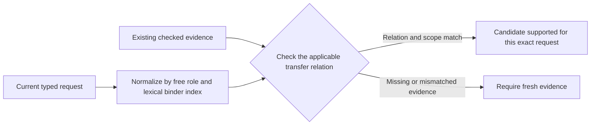

# RT-33 VAC-06/07/08 checked transfer of proofs and counterexamples

[Lean, Logos and SMT integration / #295](https://github.com/aivibeflow/LLMLang/issues/295) · [Verification artifact cache work packages](VERIFICATION-BACKEND-INTEGRATION-AND-ARTIFACT-CACHE.md)

A prior proof or counterexample can be a candidate for a new claim. Reuse depends on a typed relation between the exact old evidence and the requested subject. This study compares three relations in a closed fragment of integer and Boolean equalities, negation, and lexical let binding.

| Candidate | Required check |
| --- | --- |
| Theorem under a different contract | Prove that the new precondition implies the original one and that the original conclusion implies the requested conclusion. |
| UNSAT certificate for a core | Independently check the old core certificate, then establish that the current query entails every exact core clause in the same typed environment. |
| SAT witness or counterexample | Resolve every declared role and sort, then evaluate all current assertions under the complete assignment. |



The Lean kernel checks two general composition theorems and a concrete natural-number instance, all without axioms. Their hypotheses require the implication or entailment evidence. The executable checks use an intentionally conservative sufficient entailment rule for conjunctions. Every required typed core clause must appear in the current query. Free symbols normalize by stable role and sort. Local binders normalize to lexical indices, preserving which declaration each occurrence refers to.

## Observations

cvc5 returned two named assertions from a four-assertion contradiction. The runner regenerated just those constraints, produced an Alethe certificate for that reduced query, and checked it with Carcara. An unrelated checked certificate and a core without a checked certificate were both refused. Across ten request variants, cvc5 and Z3 agreed on all six UNSAT and four SAT verdicts.

| Changed request | Old checked UNSAT core | Old SAT witness |
| --- | --- | --- |
| Original, reordered assertions, typed renaming, or added fact | Accepted for all four | Refused |
| Different contradiction or swapped stable input roles | Refused | Refused |
| Core assertion removed, original SAT source, or renamed SAT source | Refused | Revalidated in all three |
| Still SAT after flipping a Boolean requirement | Refused | Refused |

The new contradiction received a different Carcara-checked certificate. Swapping the stable roles preserved the rendered SMT-LIB bytes and changed the semantic subject, so the old core transfer was refused. An exact source model was mapped to stable roles and rechecked rather than read as a verdict. Partial and incorrectly typed assignments failed independently. A legitimate local rename preserved the typed normal form. Capturing a free reference changed its typed representation and the evaluated result.

The comparison does not establish general implication search, minimal cores, a verified implementation of the typed normalizer, general SMT-LIB lowering, or arbitrary captured-variable repair. The fixture uses exact clause inclusion and a fixed interpretation. Similarity retrieval supplies no substitute for the checked relations, and a failed transfer leaves fresh generation or checking available. [Persistent certificate replay](RT-33-SMT-ARTIFACT-REPLAY-2026-11-25.md)

## Reproduce

Use CPython 3.12.14, cvc5 1.4.2, Carcara 1.1.0, Z3 4.13.3 and Lean 4.36.0. Use the actual distribution binaries. [Replay](CHECKED-TRANSFER-01/run.py) · [Lean theorems](CHECKED-TRANSFER-01/Transfer.lean) · [Exact solver and checker observations](CHECKED-TRANSFER-01/evidence.json)

```sh
fixture=research/formal-verification/RT-33/CHECKED-TRANSFER-01
python -B "$fixture/run.py" --lean "$LEAN_BIN" --cvc5 "$CVC5_BIN" \
  --carcara "$CARCARA_BIN" --z3 "$Z3_BIN" --output /tmp/rt33-transfer-replay.json
cmp /tmp/rt33-transfer-replay.json "$fixture/evidence.json"
```
