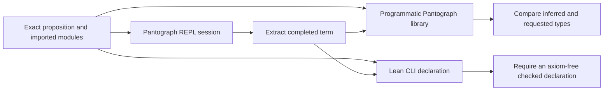

# RT-33 Lean and Pantograph adapter comparison

[Lean, Logos and SMT integration / #295](https://github.com/aivibeflow/LLMLang/issues/295) · [Backend integration plan](VERIFICATION-BACKEND-INTEGRATION-AND-ARTIFACT-CACHE.md)

The fixture compares a fresh theorem check in Lean CLI, an interactive proof in the Pantograph REPL, and programmatic elaboration through the compiled Pantograph library. All three routes use Lean 4.31.0, the toolchain required by Pantograph 0.3.17. The REPL binds each handle to a session, reset generation, exact imports and requested proposition. A solved proof state must have no goals, holes, unresolved metavariables or unsafe dependencies. Its printed term is independently checked as a declaration of the exact requested theorem by the Lean CLI.



| Route | Evidence produced |
| --- | --- |
| Lean CLI | A fresh checked declaration and transitive axiom report. |
| Pantograph REPL | Session-local proof state, tactic diagnostics, completion flags and a printable term. |
| Pantograph library | An elaborated expression whose inferred type is explicitly checked against the requested proposition. |

## Observations

Six propositions complete via all three routes. Every extracted protocol term is independently rechecked. A printed unused binder causes one strict CLI replay to fail the unused-variable linter. A declaration-local option for that specific lint permits the exact same term to check. Other warnings remain errors. The supported proof state and all admitted declarations have no axioms in the checked cases.

An ordinary `expr.echo` request provides a type hint. For a `False` request it can still return `True.intro` and report the inferred type `True`. The programmatic adapter refuses that type mismatch explicitly. Raw protocol tactics, the independent CLI check and the guarded programmatic route all refuse the wrong term. A protocol state with no goals can still report `hasSorry`. That state earns no admission, and Lean CLI rejects it under the warning policy. Unresolved goals, malformed JSON and an invalid proposition also remain distinct outcomes.

A numeric state ID is reused after reset. The wrapper refuses an old handle across generation or session changes and checks its exact proposition. A saved state restores under exact imports and bytes in a new session, and the restored term passes independent checking. Changed imports or checkpoint bytes are refused before loading. Using the old term against a changed definition also fails all three routes.

The protocol timeout cooperatively interrupts a waiting tactic without a proof. The same session can solve a fresh request afterward. The CLI comparison uses process termination after its fixture tactic signals that elaboration is pending. It returns no proof, and a fresh CLI run succeeds. Neither route receives credit for a killed command or for a closed goal count alone.

The checked subset uses one ordinary source import, one trusted test tactic, and basic Lean propositions. The programmatic route calls the compiled Lean library interfaces through a small Lean runner. General native FFI ABI, arbitrary tactic acceptance, proof-state transport across toolchain versions, and production worker isolation remain open. [Earlier compiled proof comparison](../RT-32/RT-32-LEAN-ARTIFACT-REPLAY-2026-11-25.md)

## Reproduce

Use CPython 3.12.14 and build Pantograph with `lake build repl` under its Lean 4.31.0 distribution. The comparison used Pantograph commit `d704b851542b1d2caf1287f65c49f5011f687c05`. The official x86-64 Lean archive SHA-256 was `07a633cc8d9151cbc08825ea4cdda50d4b02a2c9cb852c0131b13046f49cad7f`. The emitted evidence records the built tool and module identities. [Pantograph source](https://github.com/leanprover/Pantograph/tree/d704b851542b1d2caf1287f65c49f5011f687c05) · [Executable comparison](PANTOGRAPH-ADAPTER-01/run.py) · [Evidence](PANTOGRAPH-ADAPTER-01/evidence.json)

```sh
fixture=research/formal-verification/RT-33/PANTOGRAPH-ADAPTER-01
python -B "$fixture/run.py" --lean "$LEAN_BIN" --repl "$PANTOGRAPH_REPL" \
  --library "$PANTOGRAPH_LIBRARY" --output /tmp/rt33-pantograph-replay.json
cmp /tmp/rt33-pantograph-replay.json "$fixture/evidence.json"
```
