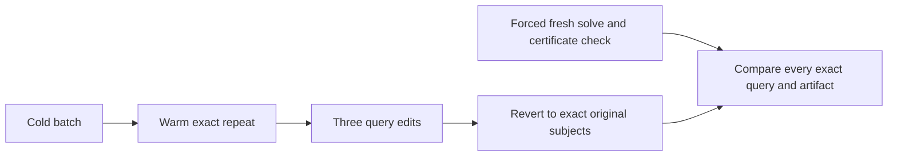
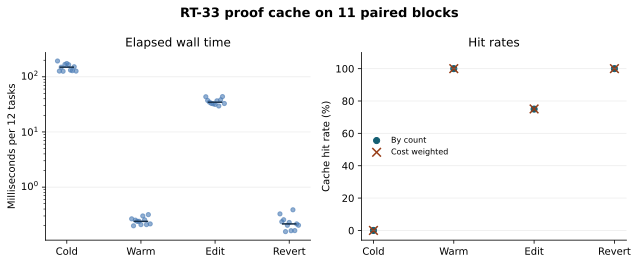

# RT-33 VAC-13/14 paired proof-cache benchmark

[Semantic build and cache graph / #300](https://github.com/aivibeflow/LLMLang/issues/300) · [Verification artifact cache work packages](VERIFICATION-BACKEND-INTEGRATION-AND-ARTIFACT-CACHE.md)

The benchmark compares fresh certificate generation and checking with reuse of an already checked artifact under the exact current request. The corpus contains 12 integer contradictions and three relevant query edits. Edits to description text leave the other nine scopes unchanged. Every cache miss runs cvc5 to generate an Alethe certificate and Carcara to check that certificate against the exact query. A hit checks the current request scope and the stored artifact digest. Each solver and checker command starts a fresh native process.

Eleven paired blocks each begin with a new SQLite database. Every block measures cold, warm, edit and revert batches. A separate forced oracle checks all 15 query variants without consulting the cache. The oracle runs before the cache batches in six blocks and after them in five. The subject order within each batch uses a fixed shuffle seed. The recorded time includes request projection, lookup, solver and checker invocations where needed, submission to SQLite where applicable, and intervening orchestration. The native stage timers report elapsed launch-to-exit time and Linux peak RSS using a small C parent. This avoids inheriting the larger Python launcher memory watermark.



## Measurements

One logical CPU in a shared AMD EPYC 9V74 Linux guest ran the tagged solver and checker. Each recorded batch contains 12 tasks. All 693 rows retain exact query and proof digests, stage times, child RSS, artifact bytes and store bytes. The forced oracle matched every query and certificate digest across all blocks. Six extra controls include a changed query and policy, copied stale receipt, corrupt payload, a Carcara `holey` result, and a metadata-only edit. The false admissions were refused and the metadata-only case retained an exact hit.

| Cache batch | Median time per batch | Median matched forced oracle | Cache hits | Median cost-weighted hit rate |
| --- | ---: | ---: | ---: | ---: |
| Cold | 149.52 ms | 117.28 ms | 0/132 | 0% |
| Warm | 0.240 ms | 117.28 ms | 132/132 | 100% |
| Edit | 34.64 ms | 121.14 ms | 99/132 | 75.09% |
| Revert | 0.215 ms | 117.28 ms | 132/132 | 100% |

Cost weighting uses solver plus checker stage time from the matching forced oracle task in the same block. Cold batches spent a median 63.71 ms in the solver, 17.67 ms in the checker and 28.13 ms publishing. Warm batches spent a median 0.126 ms projecting requests and 0.103 ms in lookup. The median ratio of paired forced-oracle time to measured edit time is 3.35. A fixed-seed bootstrap over the 11 paired block ratios yields a 95% empirical interval of 3.16–3.57. The bootstrap describes this small captured sample.

Across 330 measured invocations of each native tool, cvc5 peak RSS was 7,040 KiB and Carcara's median peak was 3,212 KiB, with a range of 3,024–3,332 KiB. Each stored certificate used 143–145 bytes. Every batch finished with a 20,480-byte SQLite file in this small corpus. The offline fixture used zero LLM requests and tokens. It exercised no proof-search hint reuse, retained solver sessions or provider billing.



These measurements characterize one local cache, one certificate fragment and one shared guest. Native process startup is a large part of the baseline. They leave open workload diversity, proof size distribution, external latency, remote trust, and live model synthesis cost.

## Reproduce

Use Linux with PID file descriptors, CPython 3.12.14, SQLite 3.53.1, GCC 14.2.0, cvc5 1.4.2 and Carcara 1.1.0. Use one pinned CPU and set the paths to the actual native executables. Regenerating benchmark timings yields new observations. Summarizing the archived CSV with Matplotlib 3.10.8 regenerates the captured statistics and chart. [Runner](PROOF-CACHE-BENCHMARK-01/run.py) · [Native measurement helper](PROOF-CACHE-BENCHMARK-01/measure.c) · [Analysis and chart](PROOF-CACHE-BENCHMARK-01/analyze.py) · [Raw measurements](PROOF-CACHE-BENCHMARK-01/raw.csv) · [Summary](PROOF-CACHE-BENCHMARK-01/summary.json) · [Deterministic protocol ledger](PROOF-CACHE-BENCHMARK-01/protocol.json)

```sh
fixture=research/formal-verification/RT-33/PROOF-CACHE-BENCHMARK-01
taskset -c 0 python -B "$fixture/run.py" --cvc5 "$CVC5_BIN" --carcara "$CARCARA_BIN" \
  --csv /tmp/rt33-cache-benchmark.csv --protocol /tmp/rt33-cache-protocol.json
cmp /tmp/rt33-cache-protocol.json "$fixture/protocol.json"
python -B "$fixture/analyze.py" "$fixture/raw.csv" /tmp/rt33-cache-summary.json /tmp/rt33-cache-chart.svg
cmp /tmp/rt33-cache-summary.json "$fixture/summary.json"
```
