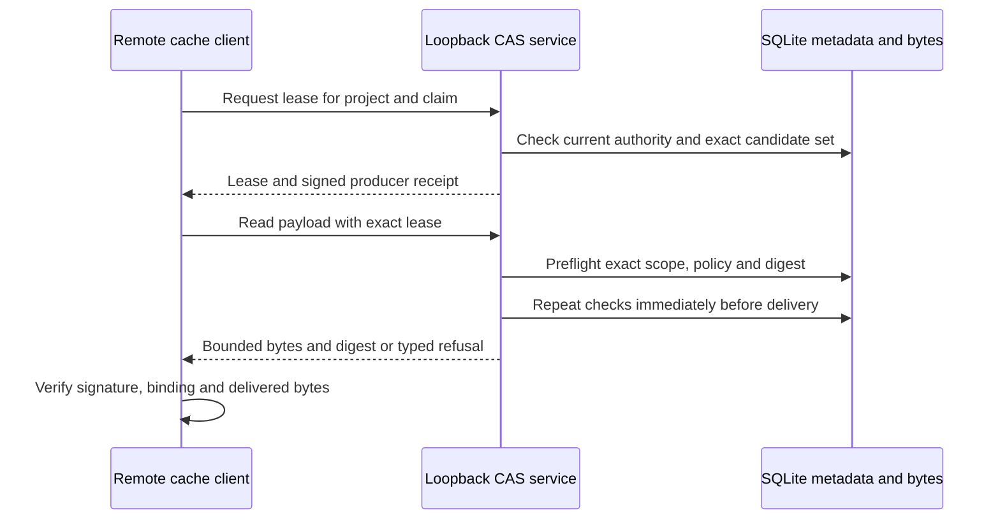

# RT-33 VAC-11/12 authenticated proof CAS delivery and lifecycle

[Semantic build and cache graph / #300](https://github.com/aivibeflow/LLMLang/issues/300) · [Verification artifact cache work packages](VERIFICATION-BACKEND-INTEGRATION-AND-ARTIFACT-CACHE.md)

A team cache can share immutable proof bytes among projects while keeping authorization and admission local to each project. This prototype uses a SQLite WAL store and independent HTTP client and server connections on loopback. An approved producer signs the project, claim, artifact digest and policy epoch. A separate check record is required for publication. The server issues a bounded lease to a specific authenticated reader only when there is one eligible result for the current claim.



The service serializes the final bounded response with revocation and collection. Leases bind the audience, project, claim, address, expiry and issuer epoch. Garbage collection retains published payloads and live leases. An exact lease continues to protect bytes after the corresponding publication is removed. A dispute between current authorized candidates blocks both new discovery and delivery through an earlier lease until the dispute is resolved.

## Observations

The replay records 27 observations across real HTTP exchanges, SQLite operations and Ed25519 verification. Two projects reference one physical blob through separate authorized receipts. Cross-project discovery, a borrowed lease from another audience, and an unknown session all fail. The client rejects duplicate JSON fields, damaged signatures and changed payload bytes. The service independently refuses damaged stored bytes. Failing to establish an independent check blocks publication even when the producer signature is valid.

| Controlled schedule | Observed disposition |
| --- | --- |
| Two valid candidate publications in either order | Conflict. Both fresh requests and earlier leases are refused. |
| Two authorized publishers race | Both immutable candidates are retained and discovery reports a conflict. |
| Collection competes with a remote read after the publication is removed | The active lease protects the bytes and the read succeeds. |
| Release or expiry removes the last lease | Collection removes the otherwise unreferenced payload and the old lease fails. |
| Revocation falls between preflight and delivery | The final check refuses before sending artifact bytes. |
| Revocation follows a successful response | The earlier response remains delivered and subsequent reads are refused. |
| The same audience returns under a new epoch | The old lease remains invalid. A new receipt and lease authorize fresh delivery. |
| Service restarts on the same SQLite database | The current receipt and lease remain usable. Expired leases remain unusable. |

The proof decisions come from a controlled independent fixture ledger. The random session and lease identifiers are omitted from reproducible evidence. This is a single-service loopback comparison with local fixture keys and one shared lock. It establishes the selected linearization points for bounded responses. Production authentication, transport security, distributed locks, large streaming responses, multi-replica lease recovery and trust policy adoption remain open. [Local worktree and receipt migration](RT-33-CACHE-WORKSPACE-REUSE-2026-11-25.md)

## Reproduce

Run from the repository root with CPython 3.12.14, SQLite 3.53.1 and OpenSSL 3.5.7. The test creates temporary keys, a database and local listeners on ephemeral ports. The only reused signer source is verified against a pinned branch revision. [Service](REMOTE-PROOF-CAS-01/store.py) · [Replay client](REMOTE-PROOF-CAS-01/verify.py) · [Evidence](REMOTE-PROOF-CAS-01/evidence.json)

```sh
fixture=research/formal-verification/RT-33/REMOTE-PROOF-CAS-01
python -B "$fixture/verify.py" /tmp/rt33-vac1112-replay.json
cmp /tmp/rt33-vac1112-replay.json "$fixture/evidence.json"
```
