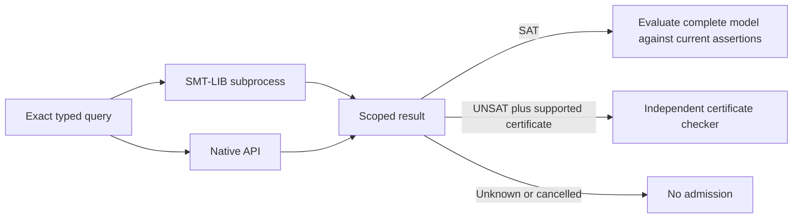

# RT-33 SMT-LIB and native solver adapter comparison

[Lean, Logos and SMT integration / #295](https://github.com/aivibeflow/LLMLang/issues/295) · [Backend integration plan](VERIFICATION-BACKEND-INTEGRATION-AND-ARTIFACT-CACHE.md)

The replay compares four routes for one typed integer fragment. Each route consumes the same two assertions and a declared integer symbol. One route per solver uses SMT-LIB over subprocess input. The other uses its versioned Python binding to the native library. The adapter validates the shared input type before translating it. Version reports and binary digests track the CLI executables, Python extensions and shared solver libraries separately.



| Capability in the tested route | cvc5 | Z3 |
| --- | --- | --- |
| SAT model | CLI and native API | CLI and native API |
| Push, pop and reset | SMT-LIB and native API | SMT-LIB and native API |
| Resource exhaustion | Explicit `unknown` through both routes | Explicit `unknown` through both routes |
| Independent proof evidence | Carcara verifies Alethe from CLI and native API | Native proof object present. Independent checking left open. |
| Native in-process interruption | The pinned Python API has no public interrupt method on its solver. The worker is terminated. | Native context interruption returns `unknown`. |

## Observations

Fifty-six checks cover 14 typed queries and four routes. Every SAT/UNSAT outcome matches the independent equality oracle. All 28 SAT model values match the required integer and exclude the other integer. Four incremental sessions reproduce the exact `SAT → UNSAT → SAT → SAT` push/pop/reset decisions. Reset restores a fresh scope with the newly asserted value. Four constrained runs report UNKNOWN, and the replay checks strict typed-literal refusal on all three translation paths.

cvc5 CLI and the tested native library produce identical Alethe bytes for the proof control. Carcara accepts both against the exact query and refuses both against different assertions. The native Z3 transcript contains a proof object, which receives no independent proof disposition here. A raw mixed-sort assertion `x = true` is refused by cvc5. Both Z3 interfaces accept it and produce the integer 1. The shared adapter rejects that input before either translation. Each raw subprocess also refuses a malformed assertion through a protocol error.

In four cancellation experiments, both CLI workers and the cvc5 native worker are terminated at an exposed pending-check boundary and deliver no verdict. Z3's native context receives an interrupt and returns UNKNOWN. All four routes separately start a fresh successful request afterward. These checks do not establish resumability after interruption. No partial result is admitted.

The comparison covers a closed two-assertion fragment and the installed CLI and Python views of each solver. Library build identities can differ while fixture outcomes agree. General parser equivalence, larger proof rule coverage, safe embedding and process lifecycle beyond the controlled cases remain open. [Persistent cvc5 and Carcara evidence](RT-33-SMT-ARTIFACT-REPLAY-2026-11-25.md)

## Reproduce

Use CPython 3.12.14 with the official `cvc5==1.4.2` and `z3-solver==4.13.3.0` packages. Set the paths to cvc5 1.4.2, Z3 4.13.3 and Carcara 1.1.0. [Adapter comparison](SMT-ADAPTER-COMPARISON-01/run.py) · [Evidence](SMT-ADAPTER-COMPARISON-01/evidence.json)

```sh
fixture=research/formal-verification/RT-33/SMT-ADAPTER-COMPARISON-01
python -B "$fixture/run.py" --cvc5 "$CVC5_BIN" --z3 "$Z3_BIN" --carcara "$CARCARA_BIN" \
  --output /tmp/rt33-smt-adapters-replay.json
cmp /tmp/rt33-smt-adapters-replay.json "$fixture/evidence.json"
```
