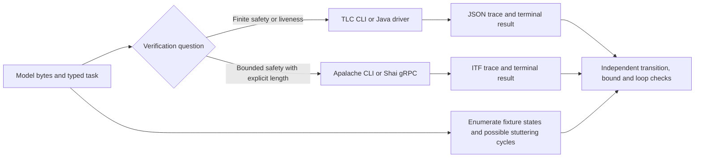

# TLC and Apalache temporal verification adapters

[Backend integration brief](VERIFICATION-BACKEND-INTEGRATION-AND-ARTIFACT-CACHE.md) · [Tracking issue #295](https://github.com/aivibeflow/LLMLang/issues/295)

This bounded experiment compares four execution routes for a shared TLA+ model. The same model bytes can be sent to TLC as a module and config, to Apalache as a CLI file and options, or to Apalache's Shai checker as in-memory source and request-local JSON inside protobuf. The important input distinction is the verification question. TLC finite complete-state checking, TLC liveness under an explicit fairness assumption, and Apalache bounded safety use different obligations even when they share a model.

The [fixture](TEMPORAL-ADAPTER-01/Probe.tla) starts at integer zero, increments up to four and then remains at four. It contains a range invariant, a deliberately false `TooLow` invariant and an eventual-four property. The temporal model allows stuttering and optionally requires weak fairness of `Next`. Weak fairness prevents indefinite stuttering at a value where the increment is continuously enabled.



The Java driver calls the same pinned TLC implementation as its CLI and records the return value of `TLC.process()` before mapping it to a process status. It supplies an embedding comparison with an identical checker. The Apalache checker service produces the same ITF trace structure as the CLI. The observed gRPC status is independent of the application result. A successful transport can return a model violation or an invalid property selection.

| Request | TLC CLI and Java | Apalache CLI and Shai gRPC |
| --- | --- | --- |
| `Safe` | Five distinct states and an empty queue | Checked through four transitions |
| `TooLow` through two transitions | Adapter routes finite exhaustive tasks | Checked within two transitions |
| `TooLow` at the third transition | Violation with states 0, 1, 2, 3 | Violation with the same states at bound three |
| `Missing` | Checker reports unresolved property | CLI error and gRPC application failure with transport OK |
| `Eventually`, weak fairness | Complete finite liveness check succeeds | Outside the scoped bounded-safety adapter |
| `Eventually`, no fairness | Violation with a stuttering loop below four | Outside the scoped bounded-safety adapter |

The 18 native observations cover five tasks on each TLC route and four on each Apalache route. The adapter refuses six request shapes before serialization, including finite liveness on the bounded safety route and bounded tasks with an absent or negative bound. Four single-field changes alter exact request identity.

The Python oracle computes the reachable prefixes, checks the initial value and each transition, and validates the first failing state against the selected invariant. It refuses four altered witnesses with a wrong type, invalid transition, missing failure or excessive length. It also checks that the finite temporal violation's loop stays below four and is permitted by the exact fairness variant. A checked finite completion depends on the stated model and TLC fingerprinting profile. The bounded Apalache result through two transitions does not imply safety at the third.

For three subprocess routes, the harness observes the start of the search and terminates its local process group before a result. For Shai, a 1 ms client deadline returns `DEADLINE_EXCEEDED`, followed by a successful ping and ordinary check on the same service. That experiment establishes the client disposition and continued service availability. It does not establish that an expired RPC stops server-side evaluation. The server rejects a request with a file-backed source at the transport level with `INVALID_ARGUMENT`. Other protocols, such as Apalache's explorer JSON-RPC, and the CLI's bounded temporal mode have distinct capabilities and remain outside this comparison.

A candidate LLMLang receipt should carry the model and effective configuration identities, the selected property, finite versus bounded semantics, the bound when applicable, fairness, native completion, and trace verification. In-memory transport can avoid path-dependent requests. A subprocess can provide a controlled process-lifetime boundary. Requests routed to gRPC need cancellation accounting independent of receipt admission. The [checkpoint study](RT-33-TEMPORAL-CHECKPOINT-2026-11-25.md) separately covers exact recovery and inductive initialization and consecution.

## Reproduce

The experiment uses Linux x86-64, OpenJDK 21.0.13, CPython 3.12, GCC with glibc, and `grpcio` and `grpcio-tools` 1.80.0 with `protobuf` 6.33.6. The pinned TLC Java artifact is `2026.11.19.180144` at [`bc1b506`](https://github.com/tlaplus/tlaplus/tree/bc1b506bdcad80bb518bf3776a9161c34ff0fc4c), SHA-256 `fdffef247f563ef6edbfd44958d2a82db79e7564e07cb673262d896353fa6713`. The [Apalache 0.63.0 release](https://github.com/apalache-mc/apalache/releases/tag/v0.63.0) archive has SHA-256 `a756e96af249bf33cd7629667a49472cb26ac8227c48583da139b414834d59df`, and its installed JAR has SHA-256 `f2d43f2e279a657be50b2ecec3a013ba2915266008a2562b38412c3269347dc9`. Use the release's unpacked CLI, including its adjacent JAR.

Generate the Python stubs from the release's [command executor proto](https://github.com/apalache-mc/apalache/blob/67b8ec69d8b3d702ed9afcf6a4a086fe0ab3cb5f/shai/src/main/protobuf/cmdExecutor.proto), SHA-256 `4d525a623434f625835218d5e876674f1a3e8c1360b076c7d39c634bbf48cdd2`. Set `PROTO_DIR` to the pinned file's directory. The runner compiles a small bind wrapper for the local server process and verifies the IPv4 loopback listener in Linux's network table before making requests.

```sh
study=research/formal-verification/RT-33/TEMPORAL-ADAPTER-01
scratch=$(mktemp -d)
python3 -m pip install --target "$scratch" grpcio==1.80.0 grpcio-tools==1.80.0 protobuf==6.33.6
export PYTHONPATH="$scratch"
python3 -B -m grpc_tools.protoc -I "$PROTO_DIR" --python_out="$scratch" \
  --grpc_python_out="$scratch" "$PROTO_DIR/cmdExecutor.proto"
python3 -B "$study/run.py" --tlc "$TLC_JAR" --apalache "$APALACHE_BIN" \
  --out "$scratch/replay.json"
cmp "$study/observations.json" "$scratch/replay.json"
```

The [machine-readable observations](TEMPORAL-ADAPTER-01/observations.json) record categorical results, request and source identities, traces and cancellation disposition. No throughput or latency comparison is inferred from this experiment.
