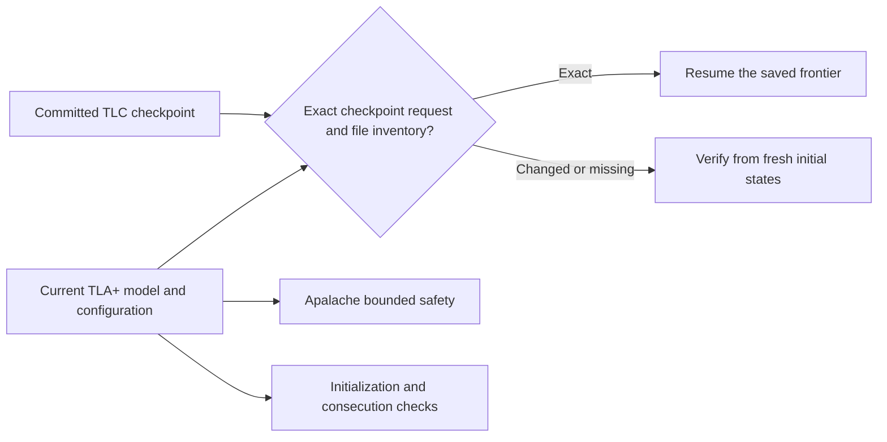

# RT-33 VAC-09 exact temporal checkpoint recovery

[Lean, Logos and SMT integration / #295](https://github.com/aivibeflow/LLMLang/issues/295) · [Verification artifact cache work packages](VERIFICATION-BACKEND-INTEGRATION-AND-ARTIFACT-CACHE.md)

A TLC checkpoint saves the frontier and previously explored states of a particular run. This study compares resuming that run, verifying changed input from the beginning, and asking Apalache separate bounded and inductiveness questions. All model variants use a small typed counter with range safety and a temporal goal of eventually reaching its configured bound. Each TLC request carries the exact TLA+ module, configuration, worker and fingerprint settings, and tool identities.



The checkpoint driver requests a checkpoint through TLC's public force mechanism. An auxiliary thread wakes the checker after initial states have been produced. The driver exits after TLC reports a completed checkpoint. The replay makes independent copies of the scratch checkpoint for its comparisons. The optional archive records exact bytes and their manifest. The committed evidence records the stable experimental outcomes because the bytes and explored prefix can vary with scheduling. [Pinned TLC source](https://github.com/tlaplus/tlaplus/tree/bc1b506bdcad80bb518bf3776a9161c34ff0fc4c)

## Observations

The original TLC model has limit 120,000. Recovery starts with a nonempty saved frontier. It and the fresh original search both finish with 120,001 distinct states and accept the invariant and weak-fairness temporal goal. A changed initialization starts at 120,001, outside the invariant. A fresh check rejects that state. As a controlled comparison, the ordinary recovery entry point reports success when given the old checkpoint with those changed source bytes. The exact wrapper refuses before recovery because the source digest differs.

The wrapper also refuses changed bound, changed fairness, a configuration without the temporal property, different engine identity, different worker profile and a missing queue checkpoint. Fresh runs of the small model distinguish its two fairness variants. With weak fairness, the eventual-bound property holds. With fairness removed, TLC supplies a stuttering counterexample. Apalache's safety result for that variant concerns only `Init`, `Next`, the invariant and the stated bound.

| Small-model Apalache question | Maximum transitions | Result and checked witness |
| --- | ---: | --- |
| Original initialization | 0 | Checked |
| Original consecution from any safe state | 1 | Checked |
| Original bounded safety | 5 | Checked |
| Bounded safety with fairness removed | 5 | Checked |
| Changed initialization | 0 | Violation at 5 |
| Widened transition, bounded safety | 4 | Checked |
| Widened transition, bounded safety | 5 | Violation along 0, 1, 2, 3, 4, 5 |
| Widened transition, consecution | 1 | Violation from 4 to 5 |

The finite Python oracle independently enumerates reachable integer values for each bounded query and every allowed starting state for the one-step induction obligation. It validates the type, start state, transitions and final failing state in each Apalache ITF witness. Successful initialization and consecution support induction for this explicit counter transition and range invariant. They do not settle fairness or the temporal goal. These results leave general LLMLang-to-TLA+ correspondence, non-counter transitions, production checkpoint integrity across hosts, and temporal proof caching open.

## Reproduce

Use CPython 3.12.14, OpenJDK 21.0.13 with Java source-file launch, TLC `2026.11.19.180144` at `bc1b506`, and Apalache 0.63.0. The Apalache release archive SHA-256 is `a756e96af249bf33cd7629667a49472cb26ac8227c48583da139b414834d59df`. Use the executable from that distribution for `APALACHE_BIN`. The runner records both JARs' deployed identities and writes only to temporary task directories unless an archive path is supplied. [Apalache release](https://github.com/apalache-mc/apalache/releases/tag/v0.63.0) · [Fixture](TEMPORAL-CHECKPOINT-01/) · [Evidence](TEMPORAL-CHECKPOINT-01/evidence.json)

```sh
fixture=research/formal-verification/RT-33/TEMPORAL-CHECKPOINT-01
python -B "$fixture/run.py" --tlc "$TLC_JAR" --apalache "$APALACHE_BIN" \
  --output /tmp/rt33-vac09-replay.json
cmp /tmp/rt33-vac09-replay.json "$fixture/evidence.json"
```
