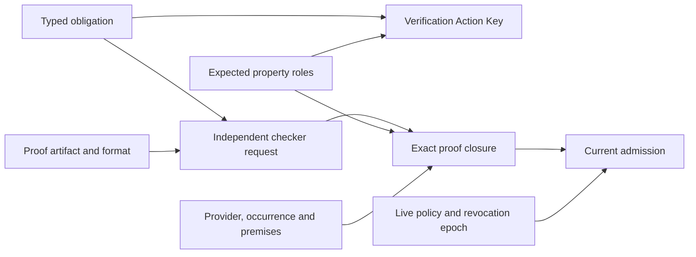

# RT-33 VAC-01/05 typed proof identities and admission

[Semantic build and cache graph / #300](https://github.com/aivibeflow/LLMLang/issues/300) · [Verification artifact cache work packages](VERIFICATION-BACKEND-INTEGRATION-AND-ARTIFACT-CACHE.md)

A verification task needs exact identities for the claim, the execution that generated a candidate, the candidate proof bytes, the check, the transitive closure, and admission under current policy. The prototype extends the existing package Action Key projection and canonical encoding. The integer-result and ordered-event fixtures require different typed semantic projections. Both require exact source correspondence and their respective observation semantics.

| Identity | Bound data |
| --- | --- |
| Obligation | Typed property, subject, ordered hypotheses and semantic profile. |
| Execution | Obligation and complete role-tagged dependencies carried into the existing Action Key, plus backend, registry, runtime, options and limits. |
| Proof artifact | Format and exact immutable bytes. |
| Check | Obligation, artifact, checker and its imports and options. |
| Closure | Obligation, checked subject, exact relevant projections, provider and call occurrence, and premise disposition. |
| Admission | Exact closure, the requested assurance policy and its current epoch. |



The candidate treats dependency declarations as a typed set sorted by role and subject. It keeps the order of hypotheses in the obligation. The role inventory is independent of the proposed cache record. The generic package shape validator can accept a record declaring completeness with a role omitted. The dedicated proof check compares the proposed roles with the current expected inventory before deriving the keys.

## Observations

Sixty-five thousand five hundred thirty-six binary combinations across two properties and 15 changes matched a separate expected invalidation table. All six input-role orders per property yielded the same identity. Missing, duplicate, and substituted roles were refused for both properties. A change to the arithmetic projection invalidated execution and transitive closure for integer results. The equivalent trace limitation applied to ordered effects. A backend-only change altered the execution key. The proof check remained keyed to the supplied bytes and checker scope, without claiming that a different executor produced them.

Across both properties, substituting artifact equality for check equality would miss 30,720 changes. Substituting obligation equality for execution equality would miss 15,360. Substituting closure equality for admission equality would miss 96. A governance epoch change can preserve mathematical evidence while requiring a current admission envelope. A backend change also requires correctly scoped execution provenance when a receipt claims which backend ran.

The replay uses real local Ed25519 signing and OpenSSL verification for 12 controls. Exact approval passes initially and under the refreshed policy. Revocation, a stale epoch, an unapproved issuer, a damaged signature, different occurrence, missing or corrupted CAS bytes, unresolved premises, and missing checker evidence refuse separately. A correctly signed and rehashed replacement artifact also fails because the independent check does not match it.

The scope and independent checker results are fixture-defined for this identity study. No mathematical proof checker was replaced by a signature. Production property-closure extraction, authenticated policy distribution, store lifecycle and cross-version compatibility remain open. [Native Lean replay](../RT-32/RT-32-LEAN-ARTIFACT-REPLAY-2026-11-25.md) · [CPC and Alethe replay](RT-33-SMT-ARTIFACT-REPLAY-2026-11-25.md)

## Reproduce

Run with CPython 3.12.14 and OpenSSL 3.5.7 from the repository root. The runner verifies the four reused prototype files against their branch revision. It creates temporary fixture keys and retains only deterministic decisions. [Executable checks](TYPED-PROOF-KEYS-01/run.py) · [Evidence](TYPED-PROOF-KEYS-01/evidence.json)

```sh
python -B research/formal-verification/RT-33/TYPED-PROOF-KEYS-01/run.py /tmp/rt33-proof-keys-replay.json
cmp /tmp/rt33-proof-keys-replay.json research/formal-verification/RT-33/TYPED-PROOF-KEYS-01/evidence.json
```
