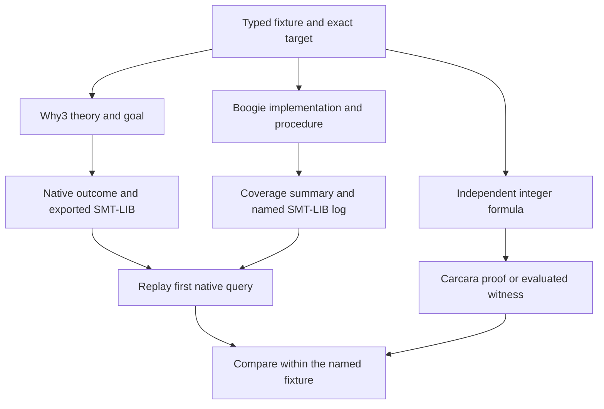

# Why3 and Boogie named verification conditions

This bounded RT-33 experiment addresses [#295](https://github.com/aivibeflow/LLMLang/issues/295). A verification condition (VC) is a proposition generated from the requested source obligation. LLMLang needs to bind evidence to a particular typed obligation and query. Successful process exit alone admits a missing or rejected obligation in the tested Boogie route.

The fixture assumes integer arithmetic with unbounded values and embeds a deliberate false decoy in each source file. The selected `Verify` requires `i = 3`, computes `r = i + 1`, and claims either `r = 4` or `r = 5`. `Decoy` requires `r = 99`. The Why3 route uses a quantified formula in a theory, `-T Fixture -G Verify`, the normal Z3 driver, JSON output and separate SMT-LIB export with `-o`. The Boogie route uses an implementation with one contract, `/proc:Verify`, and the solver log with `@PROC@` in the output path. The harness checks those target labels and replays each native script through its first `check-sat`.



The native branches check which condition each frontend actually emits for the named request. The independent branch reconstructs `i = 3 ∧ ¬(i + 1 = required)` from the fixture arithmetic. A statement covering more constructs would require a correspondingly stronger correspondence argument.

| Fixture | Why3 1.8.0 and Z3 4.13.3 | Boogie 3.5.8.0 and Z3 4.13.3 |
| --- | --- | --- |
| Valid target with a false decoy present | `Valid`, exit 0, first exported solver result UNSAT | One verified, zero errors, exit 0, first logged result UNSAT |
| False postcondition | `Unknown (sat)`, no model, exit 2, first exported result SAT | Postcondition diagnostic, exit 0, first logged result SAT |
| Select false decoy | Same SAT disposition for `Decoy` | Named `Decoy` log and a failed postcondition |
| Missing name | Explicit missing goal, exit 1 | Zero verified and zero errors, exit 0 |
| Int/Bool equality | Type error, exit 1 | Type error, exit 0 |
| Requested limit of 1 on false target | Native step-limit diagnostic, exit 2 | The logged Z3 option is `:rlimit 1`. The frontend returns the postcondition diagnostic in this fixture |
| Host cancellation after the solver starts | No verdict, exit 1 in the packaged launcher | No verdict, exit 143 in the .NET launcher |

The fourteen observations cover seven cases across two CLI routes. The outer cancellation is a deterministic interruption of a deliberately blocked, local solver fixture. The two numeric resource knobs have backend-specific semantics. One observation shows a Boogie result despite the small limit. A portable timeout contract should record the actual disposition and distinguish backend resource exhaustion from host cancellation.

The two SAT witnesses both have `i = 3` and `r = 4`. The harness asks Z3 for the integer and evaluates the source precondition, assignment and postcondition with Python integer arithmetic. For the valid target, cvc5 reports UNSAT. Its emitted Alethe certificate contains holes for the concrete arithmetic rewrites, and Carcara returns `holey`. A [separately authored certificate](WHY3-BOOGIE-ADAPTER-01/independent-valid.alethe) proves the two opposite integer inequalities and resolves their equality against its negation. Carcara returns `valid` for that certificate against the independent, unmodified formula. This establishes the fixture obligation within the stated source mapping. The native frontend verdicts and saved queries provide provenance and replay evidence. General soundness of either frontend translation, native/session APIs, certificate production for arbitrary VCs, and portability across releases remain outside the selected routes.

A candidate capability record should include frontend and solver versions, named selection mode, driver or options, supported evidence exports, and interruption scope. Bind the exact source and selected goal to the emitted condition before checking artifacts. Require positive coverage of the requested name and validated evidence for admission. Keep a native verdict as diagnostic information when proof or witness checking fails. Store actual artifact bytes for production exact identity. The replay JSON normalizes temporary paths and CRLF and omits reported wall time so its query hashes identify portable comparison text.

## Reproduce

Linux x86-64, CPython 3.12.14, .NET runtime 8.0.34, Why3 Debian `1.8.0-2+b1`, Z3 4.13.3, cvc5 1.4.2 (`282d5e0`), Carcara 1.1.0 ([revision](https://github.com/ufmg-smite/carcara/tree/5d817d86bd18ea2a850a580d602f17f36959ee99)), and Boogie 3.5.8.0 from [NuGet](https://api.nuget.org/v3-flatcontainer/boogie/3.5.8/boogie.3.5.8.nupkg). Prepare dependencies in a writable scratch directory. The directly installed Why3 CLI also works when its packaged library/data paths already resolve. For a relocated Debian package, the included launcher uses unprivileged PRoot to resolve the two package paths. Extract Why3 under `$WHY3_BUNDLE/root`, and PRoot and libtalloc together under `$WHY3_BUNDLE/proot` using `dpkg-deb -x`.

| Archive | Fingerprint |
| --- | --- |
| [Why3 Debian package](https://deb.debian.org/debian/pool/main/w/why3/why3_1.8.0-2+b1_amd64.deb) | SHA-256 `71089b84b3fdc7f6b83b6f5f43498aa921900ba23374be46f0ffefd2617d30da` |
| [PRoot 5.4.0-3](https://deb.debian.org/debian/pool/main/p/proot/proot_5.4.0-3_amd64.deb) | SHA-256 `bebc55a4461cb6cf3063f8248aa2c93f12e2426d054cc85e42271b349d2f514f` |
| [libtalloc2 2.4.0-f2](https://deb.debian.org/debian/pool/main/t/talloc/libtalloc2_2.4.0-f2_amd64.deb) | SHA-256 `2cbba68ca13003a0da794f5bcc44d95d0a191514fdd2d2764858b37215f0867c` |
| Boogie NuGet | SHA-256 `75b2632533baa1ae7d6840bf65e123ca55834ec2dba520e3913e1abc209e5fda` |
| [.NET runtime Linux x64](https://builds.dotnet.microsoft.com/dotnet/Runtime/8.0.34/dotnet-runtime-8.0.34-linux-x64.tar.gz) | SHA-512 `3949c533b04b0f2b8ed7f6a595409806857891de07eca5ff2795c3ffecc5c373c8977ce296ea1124cef0890f8afeb3365a3bb8514d11a91ba79adb5c47c27ddb` |

From the repository root, using the executable paths for these versions:

```sh
study=research/formal-verification/RT-33/WHY3-BOOGIE-ADAPTER-01
export WHY3_BUNDLE=/absolute/path/to/why3-bundle
python3 -B "$study/run.py" \
  --why3 "$study/why3-debian" --dotnet "$DOTNET_EXE" --boogie-dll "$BOOGIE_DLL" \
  --z3 "$Z3_EXE" --cvc5 "$CVC5_EXE" --carcara "$CARCARA_EXE" --out /tmp/why3-boogie.json
cmp "$study/observations.json" /tmp/why3-boogie.json
```

The [observations](WHY3-BOOGIE-ADAPTER-01/observations.json) preserve source text and hashes, native query text and normalized hashes, exit codes, diagnostics, checked witnesses and both Alethe certificates. These are categorical outcomes, displayed directly in the table. No throughput or latency conclusion was tested.
