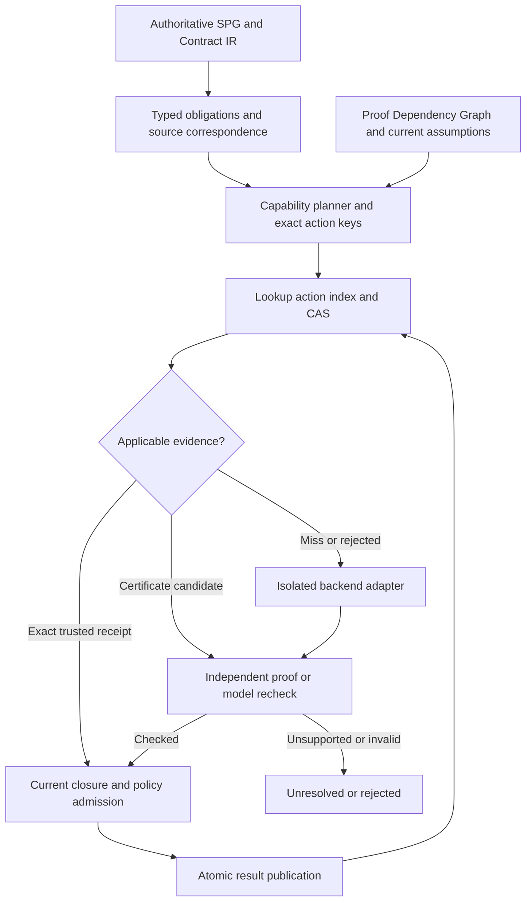
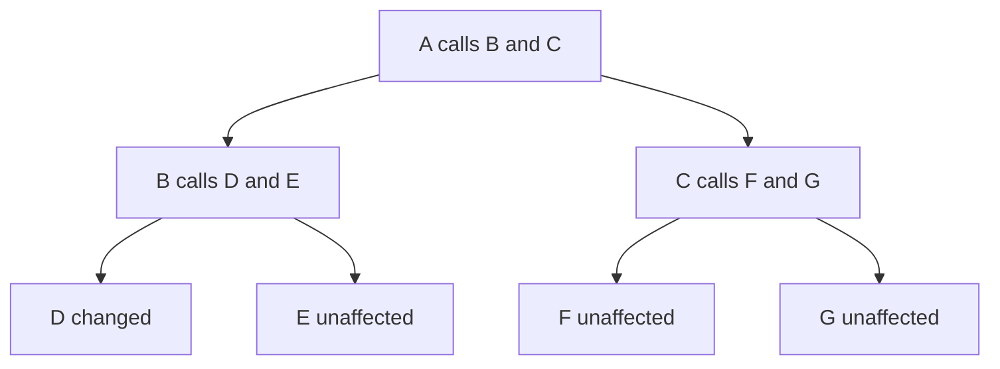

# RT-33 / RT-32 / RT-11 — Multi-backend integration and verification artifact cache

**Status:** Candidate architecture and research execution brief; no new experiment executed, no normative decision.  
**Date:** 2026-11-25. **Priority:** P0 for exact local reuse and independently checked evidence; P1 for advanced reuse.  
**Branch baseline:** `43a84b9ea0375561838d45b80ca822fb02c725df`.  
**Related:** [RT-33 backend orchestration](RT-33-PROOF-BACKEND-SELECTION-AND-ORCHESTRATION.md), [RT-32 pipeline](../RT-32/RT-32-VERIFIED-SPG-TO-LEAN-PIPELINE.md), [RT-11 semantic action cache](../../toolchain-and-collaboration/RT-11/SEMANTIC-COMPILATION-CACHE.md), [RT-36 assumptions](../RT-36/RT-36-FORMAL-VERIFICATION-ASSUMPTIONS-AND-TRUST.md), [PLAN](../../../PLAN.md#35-verification-artifact-cache-and-incremental-proof-reuse-rt-11323336).

## 1. Objective and evidence baseline

LLMLang should avoid repeating expensive proof search, translation, solver calls and LLM proof construction when applicable evidence already exists. The candidate Verification Artifact Cache (VAC) is a logical specialization of the existing semantic action cache and content-addressed store (CAS), not an independent semantic authority or a second competing cache-key system. Its granularity is an independently meaningful obligation or derivation with complete tracked inputs; module-level artifacts and grouped obligations may be economical too.

The branch already contains important evidence:
- [Incremental proof invalidation](../RT-32/RT-32-INCREMENTAL-PROOF-INVALIDATION-2026-11-25.md) compares 8,192 controlled profiles: late-bound modular evidence has 32 exact hits, direct-pinned evidence 16, and each mode has one exact closed hit. Treating modular success as closed success creates 31 and 15 false closed hits respectively.
- [Persistent proof cache](../RT-32/RT-32-PERSISTENT-PROOF-CACHE-2026-11-25.md) implements distinct versioned modular and closed receipt keys and SQLite transactional publication with a fixed three-role inventory. It rejects missing/corrupt dependencies, conflicting receipts and stale policy; it demonstrates process-exit rollback, not power-loss or distributed durability. Kernel conformance and authorization of supplied fixture receipts are assumed.
- [Verification reuse identity](../../research-management/RT-00/RT-00-C-VERIFICATION-REUSE-IDENTITY-RECHECK-2026-11-24.md) reports 26 passing tests of synthetic subject, dependency and verification identity, not persistent certificate reuse.
- [Public provider rebind](../../semantic-representation/RT-05/PUBLIC-INTERFACE-VERIFICATION-REBIND-2026-11-24.md) rejects stale concrete receipts after a compatible provider replacement. The modular alternative requires a separately checked theorem and composition.
- [Incremental solver evidence](../RT-07/RT-07-INCREMENTAL-SOLVER-EVIDENCE-2026-11-25.md) and [proof format receipts](../RT-07/RT-07-PROOF-FORMAT-RECEIPTS-2026-11-25.md) establish scoped evidence, not general interchangeability.

The remaining hypothesis is that a backend-independent persistent cache of exact proof artifacts, with a separate checking and admission layer, can reduce end-to-end time and LLM token cost without admitting any new unjustified claim. Existing fixture outcomes do not establish this for production LLMLang.

## 2. Backend integration and artifact inventory

SMT is a class of methods, not a particular library. Start with subprocess isolation and versioned protocols; compare native API/FFI only after measuring overhead, memory, cancellation, failure recovery and evidence fidelity. Backend selection is per typed obligation and required evidence strength, never an alteration of authoritative semantics.

| Backend | Candidate integration | Persistent artifacts | Session-only or important boundary |
|---|---|---|---|
| Lean 4 / Logos | CLI, Lean API, C FFI, REPL/Pantograph | Proof source, elaborated terms, exact theorem/import manifests, checked receipts, .olean build artifacts | Tactic states and loaded environment; pin imports, kernel, axiom set and generator; do not trust arbitrary imported binary modules |
| Z3 | SMT-LIB subprocess or native C/C++/language bindings | Exact query, model, UNSAT core, supported proof output, independently checked receipt | push/pop and assumptions within compatible live context; solver result alone is not a portable certificate |
| cvc5 | SMT-LIB, C/C++/Python/Java APIs | Alethe/CPC certificates, exact assumptions, query, model, core, check receipts | Test supported proof rules; independent Carcara/Ethos/Logos route only for admitted formats/fragments |
| TLA+ SANY/TLC | Java tooling or CLI | Spec/config, bounded/exhaustive result, trace, exact model checkpoint | Recovery of same run is not sound reuse after arbitrary model edits; record fairness, initial states, actions, parameters, constraints, bounds and completion |
| Apalache | CLI / JSON-RPC where supported | Generated model, ITF counterexamples, bounded query, inductiveness obligations | Bounded safety is not general unbounded proof; separate initialization, consecution and safety |
| Why3 | OCaml API / CLI | VC, proof session, transformation chain, proof attempts | Obsolete attempts need replay; record prover version and transformations |
| Boogie / Dafny | CLI / .NET integration study | Procedure and VC results, fine-grained dependency summaries | Reuse rules require validated dependencies; cache does not prove source-to-IR preservation |
| Rocq / Isabelle | CLI, protocol or native integration study | Terms, theory/module build artifacts and check receipts | Versioned kernel, imports, axioms and plugins |
| CBMC / Frama-C / Alloy / SPIN | CLI, Java or OCaml interfaces as appropriate | Bounded claims, traces, queries, analysis receipts | Keep unwind bounds, memory model, approximations and soundness limits |

Prior art (documentation, not LLMLang integration tests; version-pin in experiments): [Lean Lake](https://lean-lang.org/doc/reference/latest/Build-Tools-and-Distribution/Lake/), [Lean FFI](https://lean-lang.org/doc/reference/latest/Run-Time-Code/Foreign-Function-Interface/), [Pantograph](https://github.com/leanprover/Pantograph), [Lean REPL](https://github.com/leanprover-community/repl), [Z3 API](https://z3prover.github.io/api/html/), [SMT-LIB](https://smt-lib.org/), [cvc5 proof production](https://cvc5.github.io/docs-ci/docs-main/proofs/proofs.html), [Alethe](https://cvc5.github.io/docs-ci/docs-main/proofs/output_alethe.html), [TLA+ tools](https://github.com/tlaplus/tlaplus), [Apalache](https://apalache-mc.org/docs/apalache/index.html), [Why3 session/replay](https://why3.org/doc/manpages.html), [Fine-grained Caching of Verification Results (Boogie)](https://www.microsoft.com/en-us/research/publication/fine-grained-caching-verification-results/). Compare [SMT-Switch](https://github.com/stanford-centaur/smt-switch), [Carcara](https://github.com/ufmg-smite/carcara), and [Ethos](https://github.com/cvc5/ethos). No claim of stable embedding ABI or cross-version binary portability follows from these interfaces.

## 3. Architecture and interface



The graph separates cache hits from proof acceptance. A failed recheck is a miss or rejection; it cannot produce success. A backend can supply several evidence artifacts and explicit obligations for correspondence. Conceptual interface (not LLMLang syntax):

```text
VerificationBackend:
  identity() -> versioned executable, libraries, protocol, capabilities
  supports(obligation, evidenceRequirement) -> supported | unsupported | unknown
  verify(obligation, assumptions, limits) -> BackendResult
  checkArtifact(obligation, artifact, checkProfile) -> CheckReceipt
  cancel(requestId)
BackendResult:
  outcome, artifacts[], residualAssumptions[], bounds, diagnostics, provenance
```

Separate backend outcomes (SAT/UNSAT/UNKNOWN, timeout, unsupported, error) from checked claim status, assumption closure, and policy admission. Preserve the existing research vocabulary: proven, conditional, pending_dependencies, partial/bounded, refuted, unsupported, unknown, stale, rejected. A timeout or resource failure is not a reusable semantic verdict. Cached failure logs may guide scheduling with exact run context, but never become proof. An unbounded theorem, finite exhaustive result, and bounded exploration are distinct evidence classes.

## 4. Identities, lifecycle and storage

| Identity | Meaning |
|---|---|
| ObligationHash | Canonical typed claim, scope, semantic profile, hypotheses and relevant symbol identities; not just text or name |
| VerificationExecutionKey | Existing ActionKey specialization: subject/obligation, complete role-typed dependencies, language version and registry digest, translator, backend, toolchain, configuration, environment, seed and limits as relevant |
| ProofArtifactHash | Hash of immutable artifact bytes with explicit format and digest domain; independent of request key |
| CheckActionKey | Exact artifact plus intended obligation, checker identity, checked environment and trust-relevant options |
| ProofClosureHash | Exact checked occurrence-level dependencies, proof receipts, premise dispositions, relevant provider bindings and source correspondence |
| AdmissionKey | Current requested assurance policy, trust/revocation epoch, exact closure and admission rule; separate from mathematical proof generation |

Start with conservative exact matching; permit a candidate found by obligation identity to be rechecked under a new execution/check profile, never automatically accepted as a hit. Canonical serialization must be versioned, domain-separated and unambiguous, with typed sorted sets only when order is semantically irrelevant. Do not omit hidden environment or dynamic dependencies: incomplete closure fails closed. Reuse across language/toolchain versions requires checked compatibility. Different valid proof bytes may have different artifact identities even for the same claim; handle authorized conflicts explicitly rather than last-writer-wins.

Candidate physical layout: one CAS of immutable blobs, a SQLite or equivalent derived action index, typed artifact/obligation/provenance/closure indexes, and isolated ephemeral session state. Workspace/machine-local storage first; later share across worktrees, CI and authenticated team caches. Cache state is derived/evictable, not part of semantic package identity. Verify digest, format, expected claim, checker receipt, producer authorization and current policy separately. Use atomic transaction publication and immutable read snapshots, quotas, safe decoding, retention/GC leases and failure fallback. An attacker can supply a consistent digest for false content; hashing is integrity, not truth. Avoid loading untrusted .olean or arbitrary tactic/plugin code in privileged processes. Signatures establish provenance, not mathematical correctness. Revoke admission without necessarily deleting the underlying conditional theorem.

### Cache layers

| Logical layer | Reuse |
|---|---|
| L1–L3 | Semantic projection, VC generation, backend input translation and correspondence |
| L4 | Exact run receipts for pinned input/action/profile |
| L5–L6 | Proof terms/certificates, independently checked lemmas and proof scripts |
| L7 | Closure/composition and admission receipts scoped to current dependencies and policy |
| L8 | Counterexamples and traces, only after revalidation for current semantics and bounds |

Keep LLM tactic suggestions and intermediate proof states as hints, not checked evidence. Replaying a script may cost almost as much as proof generation; compare against kernel checking an elaborated term. Solver live contexts may reuse learned information via push/pop and assumptions but are not persistent cross-version artifacts. Scope assertions, assumptions, solver options and request identity; recover with fresh context if protocol state is uncertain.

## 5. Invalidation and more general proof reuse



Illustrative only: when D changes implementation and still satisfies the same abstract contract, verify D, retain modular theorems B and A if genuinely parameterized by the contract, and refresh closure for B/A. C/E/F/G remain applicable if all relevant dependencies are unchanged. If D changes its contract, recheck B or establish an implication bridge; A may retain its modular proof if B's contract remains valid. If B/A proof consumes D's concrete body (inlining, unfolding, exact pin), invalidate the dependent proof too. Recursive groups need a checked induction/fixed-point argument, never circular admission.

| Change | Proposed handling |
|---|---|
| Formatting or irrelevant metadata | Reuse only after validated semantic projection |
| Unrelated SPG node | Reuse with complete property-specific dependencies |
| Subject body/contract | Regenerate affected VCs and check changed obligations |
| Provider body only | Verify provider and refresh exact closure; reuse valid modular caller proof |
| Contract dependency | Require exact match or checked implication/refinement bridge |
| Checker/toolchain/import change | New execution/check key; old artifact can be a candidate for rechecking |
| Policy/revocation change | Refresh admission and affected closure; retain mathematical artifact if still valid |
| Unknown dependency, missing blob, invalid signature or corrupted proof | Refuse reuse; recompute if feasible |

If an existing theorem is P implies Q, and a new claim is P' implies Q', reuse through checked P' implies P and Q implies Q' plus composition. This is a theorem-level rule under the same interpretation, transition relation, frame/effect/termination and assumptions; changed implementation also requires correspondence or proof of behavior refinement. A stronger precondition or weaker postcondition helps a provider theorem but may break callers or public API refinement. Reject vacuous assumptions and hidden theory changes. For UNSAT, a checked proof of core C transfers to F' only if F' entails all of C under the same typed semantics. A raw unsat core is not a proof. For SAT, validate the complete model/witness against the new exact query; for model-checking counterexamples replay initial state, steps and violated property/fairness. Alpha-equivalence and variable renaming require capture-avoiding, typed canonicalization or a checked mapping. Approximate similarity is only candidate retrieval.

## 6. Performance hypothesis and experimental protocol

For obligations i with cold cost c_i, hit admission/recheck cost r_i, and hit set H, approximate sequential time as sum(c_i for misses) + sum(r_i for H) + planning/storage overhead. Equal-cost simplification: T_warm/T_cold = (1-h)+h*r+overhead/T_cold. At h=0.95 and r=0.01 with zero overhead, 100 min becomes 5.95 min (~16.8x). This is an illustrative calculation, not a measurement. Cold builds can slow down. Parallel critical path, heavy-tailed proof costs, disk/network traffic and checker cost may dominate.

Compare cold, warm exact, cold forced oracle, unrelated edit, contract-preserving body edit, incompatible contract edit, direct pin/inlining, revert, policy revocation, solver/checker version update and cross-worktree reuse. Use pinned tools, controlled host, fixed corpus and seeds; record exact query/source/receipt hashes and raw JSON/CSV plus chart generation. Measure stage-separated wall time, CPU, peak RSS, disk bytes, lookup/read/check/search times, hit and cost-weighted hit rates, LLM tokens, proof and counterexample size, false acceptance/refusal, unknown and unsupported counts. Report distributions and paired comparisons; include cache overhead and cases slower than clean verification. For nondeterministic solvers, an UNKNOWN on a fresh run is not a refutation of an independently checked cached proof; use independent semantic oracles and evidence-strength comparison, not equality of raw statuses.

## 7. Work packages and exit gates

These local VAC labels are proposed work-package identifiers, not new RT taxonomy entries or issue numbers. Existing RT-32, RT-33, RT-11, RT-07 and RT-36 studies remain authoritative historical evidence.

| ID | Priority | Work |
|---|---|---|
| VAC-01 | P0 | Versioned typed obligation/action/check/closure identities, exact dependencies and canonicalization |
| VAC-02 | P0 | Persistent source-bound cvc5 CPC/Alethe certificates and checker replay; Z3 scope comparison |
| VAC-03 | P0 | Lean proof term vs script vs .olean reuse, pinned imports and axiom inventory |
| VAC-04 | P0 | Occurrence-sensitive incremental PDG closure including recursion, diamonds and rebind |
| VAC-05 | P0 | Admission checks, policy changes, external assumptions, stale/forged/missing evidence |
| VAC-06 | P1 | Checked implication/refinement and alpha-equivalent proof reuse |
| VAC-07 | P1 | UNSAT core/subsumption reuse and independent checking |
| VAC-08 | P1 | SAT models and trace replay after changes |
| VAC-09 | P1 | TLC same-run recovery vs changed model and Apalache inductiveness/bounds |
| VAC-10 | P1 | Cross-branch/project reuse with exact context and access control |
| VAC-11 | P1 | Remote CAS authentication, poisoning, concurrency, leases, recovery and eviction |
| VAC-12 | P1 | Cross-version checking and evidence compatibility |
| VAC-13 | P0 | Representative cold/warm/edit benchmarks and stage-separated costs |
| VAC-14 | P1 | LLM proof hints, stable tactic-state fingerprints and token-cost comparisons |
| VAC-15 | P0 | Formal soundness argument for exact and proof-mediated admission |

Required negative controls: omitted dependency, changed symbol/sort, incompatible provider, different bounds/fairness, altered axiom set, revoked premise, proof substitution, corrupted bytes, forged producer, incomplete/cyclic closure, conflicting results, concurrent stale policy, crash during publication, missing artifact, unknown/timeout, and unsupported checker rule. Prove in a scoped formal model that admitted cached evidence entails the same exact source claim as a sound fresh checking route under current assumptions; connect the model to concrete decoding, translation, completeness and publication boundaries. Do not equate passing finite tests with a general proof. Success requires zero unexplained false admissions in adversarial corpus, independent replay, explicit trust boundaries and measured performance with reproducible artifacts. No production backend, storage schema or performance claim is selected here.
