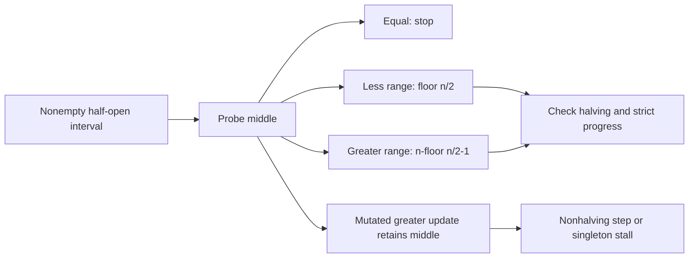

# RT-34 — Check exact binary-search probe and progress bounds

The worst-case count for the half-open binary-search model is zero at size zero and `floor(log2(n)) + 1` for positive sizes. Lean proves the bound and an attaining path. Native C agrees with the bound on 13,354 sorted input pairs at each of two compiler profiles. A one-element interval demonstrates why a faulty update invalidates the progress premise.

## Question and size domain

[CXB-004](RT-34-COMPLEXITY-BENCHMARK.md#2-proposed-case-matrix) asks what a logarithmic search cost requires from representation, sortedness and comparison. This pilot compares a linear upper bound, a tight halving bound, and a floor-log candidate that omits the last probe. The model counts one probe when the algorithm inspects the middle entry in a half-open interval. A separate profile counts the two conditional tests in the C code. Equality is always tested. Order is tested only after unequal values.

The native fixture uses a random-access array of small signed integers. The inputs are nondecreasing, with either distinct even values or repeated triples. The target ranges from `-1` through `2*n+1`. Sizes span 0–64 and the neighbors of powers of two at 128 and 256. For these arrays, target `-1` always takes the left branch and reaches the bound. Sortedness is a separate premise for membership correctness.

## Checked model

At interval size `n>0`, a nonterminal left step retains `floor(n/2)` entries and a right step retains `n-floor(n/2)-1`. Both are at most half and strictly smaller than `n`. Lean proves the budget recurrence for every positive natural size, all-step soundness for abstract probe paths, existence of a path that always takes the larger left interval, and the linear upper bound. It also proves that the floor-log formula without the final probe is strictly below the exact bound at every positive size.



The [native harness](BINARY-SEARCH-COST-01/search.c) stops if an attempted update violates halving. It distinguishes an interval that shrinks too little from one that remains unchanged. This lets the experiment observe the singleton counterexample without waiting on an infinite loop. A separate membership oracle checks the result of the original search on every sorted input.

## Results

| Shape | Cases | Floor-log undercounts | Linear bound overcounts | One test per probe undercounts | Mutant nonhalving | Mutant stalls |
| --- | ---: | ---: | ---: | ---: | ---: | ---: |
| distinct | 6,677 | 2,755 | 6,666 | 6,604 | 4,258 | 1,024 |
| duplicates | 6,677 | 1,327 | 6,668 | 6,604 | 5,023 | 981 |

The 53,418 native result rows include both implementations, two GCC optimization levels and one unsorted control per level. The table gives per-profile counts. The validated implementation returns correct membership in all sorted trials. Every size and both array shapes attain the exact upper bound, including the zero-probe empty input. At size one with stored value 0 and target 1, the mutation keeps the interval at size one after one comparison. A run preserving the update would revisit the same state.

For the unsorted input `[8,2,4,6]` and target 8, the original search returns a miss in two probes. The actual path stays within the certified budget of three, even as the membership result fails. Counting one conditional test per probe underestimates the separately instrumented test profile whenever there is an unequal probe followed by an order test. All seven Lean statements use at most `propext`, `Classical.choice`, and `Quot.sound`.

## Implications and limits

A checked complexity claim needs a precise size measure, a progress invariant and an event definition. The sortedness premise and the cost premise justify different claims. A scope may certify a probe bound even when the caller's membership contract is unsupported. A linked representation, a comparator with data-dependent work, an effectful comparison, or generic extraction of progress from implementation code requires additional proof.

The unbounded Lean claims cover the halving model. The C comparison checks the listed finite sizes and reports model events, including counted conditional tests. It does not measure CPU instructions or wall time, prove a lower bound for every search algorithm, establish arbitrary native/source correspondence, or select a resource profile. Independent benchmark adjudication remains pending.

## Reproduce

Use CPython 3.12.14, Debian GCC 14.2.0-19 and Lean 4.36.0 at revision `611c117bfaf7b7ae1cfcf246ce6fba31e8f509e9`. The ledger pins source, aggregate observations, every size maximum and the identical ordered native output digest per profile.

```sh
fixture=research/formal-verification/RT-34/BINARY-SEARCH-COST-01
output=$(mktemp)
python3 -B "$fixture/run.py" --cc gcc --lean "$(command -v lean)" > "$output"
cmp "$fixture/evidence.json" "$output"
python3 "$fixture/chart.py"
```

[Lean proof](BINARY-SEARCH-COST-01/SearchCost.lean) · [Native fixture](BINARY-SEARCH-COST-01/search.c) · [Replay](BINARY-SEARCH-COST-01/run.py) · [Ledger](BINARY-SEARCH-COST-01/evidence.json)
