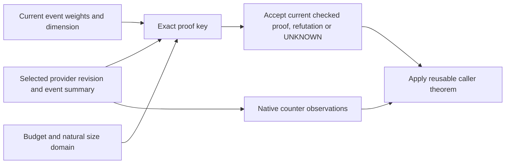

# RT-34 — Compare call-cost proof reuse across provider and profile changes

A functional call contract misses five known budget violations after provider, cost profile or budget changes. Reusing only the old exact proof key is safe in the fixture and retains one case. A reusable caller theorem with a fresh, exact cost proof gives four proven, three refuted and four unknown cases.

## Question and cost contract

[CXB-027](RT-34-COMPLEXITY-BENCHMARK.md#2-proposed-case-matrix) requires revalidation of resource evidence after callee, contract or model changes. The [abstraction for public provider binding](../../semantic-representation/RT-05/PUBLIC-INTERFACES-AND-CONTRACT-REFINEMENT.md) distinguishes a functional contract from a provider's exact binding. This experiment applies that distinction to one cost-bounded call.

Each provider returns `n+7` for a natural input size. Providers differ in two abstract event counts, called reads and callbacks. Each count has an affine rate and fixed part. The cost profile weights the two event channels. The caller's provider-event budget is an affine upper bound over all natural sizes, including zero. It intentionally excludes caller overhead, physical I/O, CPU and wall time.

## Checked proof and evidence binding

Lean proves that the weighted event count is itself affine. For unbounded natural sizes, a provider respects the budget exactly when its rate and fixed term are both within the corresponding coefficients of the budget. A fixed-term violation has a size-zero counterexample. A rate violation has a witness at the budget's fixed term plus one. The reusable caller theorem requires the current provider's weighted summary to satisfy the bound.



The driver pins the provider's abstract source data, cost profile weights, exact budget and size domain in each key. It generates seven exact scoped proofs or counterexamples and separately attempts to apply the original proof to the slower provider. Lean rejects that application with a type mismatch. The baseline proof key can be compared without revalidating a new provider proof.

The functional policy treats the unchanged public result contract as enough to reuse the baseline budget proof. The exact-key policy reuses only the original proof on an unchanged key. The checked-rebind policy can apply the same caller theorem to a freshly checked exact provider/profile/budget receipt. A missing or mismatched receipt gives UNKNOWN even when an independent experiment knows the underlying cost.

## Results

| Cache and evidence rule | Proven | Refuted | Unknown | False proofs | Unbound proofs |
| --- | ---: | ---: | ---: | ---: | ---: |
| functional_contract | 11 | 0 | 0 | 5 | 4 |
| same_exact_key | 1 | 0 | 10 | 0 | 0 |
| checked_rebind | 4 | 3 | 4 | 0 | 0 |

All policies see the same 11 snapshots. A false proof certifies a budget that actually fails. An unbound proof certifies it without a proof for the input key. An outcome can count in both columns. The four UNKNOWNs under exact rebinding include absent evidence and proof material tied to an old provider or old profile.

At unit weights the two equal-cost providers both have cost `2*n+1` despite different event mixes. The slower provider costs `3*n+1` and has the same return. Increasing the callback weight changes the original provider's cost to `4*n+1`. Tightening its budget to `n` also fails, including at size zero. A lower-cost provider meets the tightened budget with a fresh proof.

Native GCC O0 and O3 agree on all 544 observed result and event vectors. The native witnesses also exceed each intentionally violated budget. The kernel audits of the two generic theorems and seven concrete claims use at most `propext` and `Quot.sound`.

## Implications and limits

The coefficient comparison gives a cheap precise checker for this unbounded affine profile. Exact provider and proof binding can stay separate from caller-theorem reuse. A provider's declaration alone cannot justify a resource guarantee, and a weight or size-domain change can invalidate a proof while leaving every returned value unchanged.

The native evidence covers four small generated providers and 68 sizes. It validates counted events, while the unbounded proof applies to the abstract affine semantic model. General extraction of cost from LLMLang, exact binary identity, signed and authenticated evidence, finite or multivariate bounds, composed calls, imported provider assumptions, independent adjudication and representative cost profiles remain open.

## Reproduce

Use CPython 3.12.14, Debian GCC 14.2.0-19 and Lean 4.36.0 at revision `611c117bfaf7b7ae1cfcf246ce6fba31e8f509e9`. The runner pins generated code by digest and records every tested proof key and checked theorem.

```sh
fixture=research/formal-verification/RT-34/CALL-COST-BINDING-01
output=$(mktemp)
python3 -B "$fixture/run.py" --cc gcc --lean "$(command -v lean)" > "$output"
cmp "$fixture/evidence.json" "$output"
python3 "$fixture/chart.py"
```

[Lean cost and binding model](CALL-COST-BINDING-01/CallCost.lean) · [Generator and replay](CALL-COST-BINDING-01/run.py) · [Evidence ledger](CALL-COST-BINDING-01/evidence.json)
