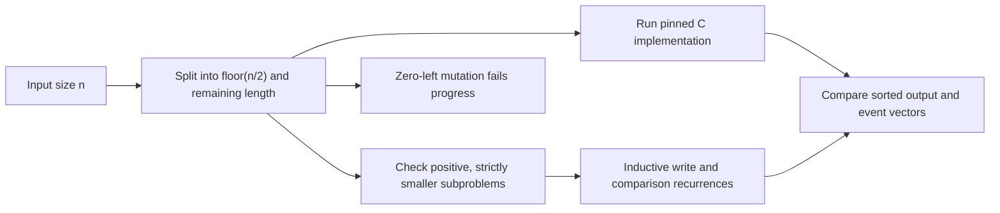

# RT-34 — Check balanced recursion, merge writes and comparison bounds

Lean checks a tight comparison recurrence for an abstract balanced merge tree at every natural input size. It proves an exact output-write formula at powers of two. A recursively interleaved input attains the comparison bound at all 103 tested native sizes. Replacing the two real subproblem sizes by equal floor halves undercounts writes at 93 sizes.

## Question and cost profile

[CXB-010](RT-34-COMPLEXITY-BENCHMARK.md#2-proposed-case-matrix) requires a recursive cost bound with correct base cases, a progress measure and a lower-bound witness at the chosen scope. This study covers one top-down merge sort with integer input and a total comparator. It distinguishes writes into the merge output, writes to copy that output back, and element comparisons. Loop overhead, stack use, bit complexity, hardware and runtime timing are outside these counts.

At size `n<2` the merge-work counts are zero. At larger sizes the two calls have lengths `a=floor(n/2)` and `b=n-a`. A merge writes each of its `n` entries. It compares only when both remaining inputs are nonempty. On a comparison, it consumes one entry before proceeding.

## Checked recurrences and method

The native implementation and the proof each use the same stated split. Lean independently proves strict decrease for both subproblems and the local comparison bound of `n-1`. It lifts the bound and an attaining path to every abstract merge tree. The write recurrence is `W(n)=n+W(a)+W(b)` with the stated base cases. The comparison recurrence has the same structure with `n-1` at each internal node. The kernel proves that its maximum `M(n)` satisfies `M(n)+(n-1)=W(n)` for positive `n`. It also proves `W(2^k)=k*2^k` for every natural `k`.



The replay compares native C at GCC O0 and O3 with independent Python sorting and a stack-based work oracle. A generated Lean probe evaluates the proved recurrence at the same sizes. For the deliberately worst input family, odd ranks go left and even ranks go right at every split, with each subinput arranged recursively. The merge consequently keeps both halves live until the final comparison in the measured cases. The separate proof of abstract attainment concerns legal consume-one comparison paths.

## Results

| Input family | Sizes | Comparison bound attained | Comparison bound loose | Equal-floor writes undercount |
| --- | ---: | ---: | ---: | ---: |
| ascending | 103 | 3 | 100 | 93 |
| descending | 103 | 4 | 99 | 93 |
| duplicates | 103 | 9 | 94 | 93 |
| alternating | 103 | 103 | 0 | 93 |

The native run covers sizes 0–96 along with 128, 256 and their adjacent sizes. There are 412 valid measurements and five split controls per compiler profile, for 834 observations. All valid sorted results, write counts and comparison bounds agree with their independent checks. The zero-left mutation is rejected at sizes 2, 3 and 16 before recursion or cost is recorded. The same mutation leaves the size-zero and size-one base cases valid.

The equal-floor candidate counts two size-`floor(n/2)` calls even when one real call is larger. At size three it predicts three output writes where the real trace has five. At size 128 the recurrence predicts 896 output writes, 896 copyback writes for this implementation and a maximum of 769 element comparisons. Ascending, descending and duplicate inputs reach that maximum less often than recursive interleaving. Seven theorem audits report only standard Lean axioms.

## Implications and limits

A verifier can use separate recurrence obligations for exact writes and data-dependent comparisons. A functional result contract permits implementations with different resource vectors. A claimed tight comparison bound needs an attainable path under the same representation and comparator assumptions, and a claimed recursion bound needs a progress proof for every split shape.

The abstract recurrence and its attaining legal paths are checked over unbounded natural sizes. The native correspondence covers the listed sizes and families, and the alternating input construction is validated there. The result leaves general source extraction, verified array-level correspondence, other sort algorithms, resource-optimality under a workload and independent adjudication open. It does not select a normative cost profile.

## Reproduce

Use CPython 3.12.14, Debian GCC 14.2.0-19, and Lean 4.36.0 at revision `611c117bfaf7b7ae1cfcf246ce6fba31e8f509e9`. The ledger records tool versions, generated module and native output digests, each event vector and the proof axiom sets.

```sh
fixture=research/formal-verification/RT-34/MERGE-RECURRENCE-01
output=$(mktemp)
python3 -B "$fixture/run.py" --cc gcc --lean "$(command -v lean)" > "$output"
cmp "$fixture/evidence.json" "$output"
python3 "$fixture/chart.py"
```

[Lean recurrence and proof](MERGE-RECURRENCE-01/MergeCost.lean) · [C fixture](MERGE-RECURRENCE-01/merge.c) · [Replay](MERGE-RECURRENCE-01/run.py) · [Ledger](MERGE-RECURRENCE-01/evidence.json)
