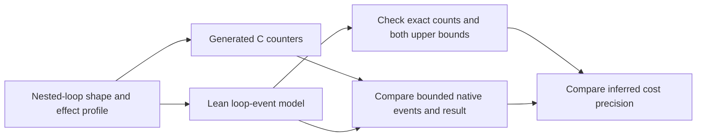

# RT-34 — Compare checked cost inference for dependent nested loops

Lean proves exact counts over unbounded natural sizes for square and triangular loop domains. Native C agrees with the model in 536 runs over a bounded domain. Both safe envelope bounds overcount most inputs. A candidate that omits a guard effect undercounts 132 of 268 inputs in each cost profile.

## Question and admitted fragment

[CXB-008](RT-34-COMPLEXITY-BENCHMARK.md#2-proposed-case-matrix) requires a dependent loop bound and a branch-infeasibility control. This pilot compares a square outer/inner domain with a triangle whose inner bound is the current outer index. Both use outer index `i` from zero to `n-1` and inner index `j` starting at zero. Each inner iteration records one body event. The branch `j >= i` records a guarded effect. An optional lowering variant records one additional effect per inner iteration. Every variant returns `n`.

The cost vector measures explicitly declared abstract events. Loop conditions, machine instructions, observed time, allocations and unrelated runtime work are outside the profile. The unit profile assigns weights `(1,1,1)` to body, guarded and additional events. The effect-weighted profile assigns `(2,5,3)`. An unmodeled external bound has no assumed cost and yields UNKNOWN.

## Method and certified bounds

The [runner](NESTED-LOOP-COST-01/run.py) generates C loops and Lean fixture selections from the same small typed model. It compares both executions with a separate closed-form oracle. The symbolic claims quantify over all natural sizes and all nonnegative cost weights in the model. The native C observations use `uint64_t` with sizes 0–64, 128 and 256, where no counters overflow.



Let `T(n) = n(n-1)/2`. A triangular program visits `T(n)` inner iterations and has zero guarded effects. Its loop has `j < i`, which contradicts the effect guard. A square program visits `n*n` iterations and has `T(n+1)` guarded effects. Lean proves the doubled triangle identity, the exact event counts, and both upper envelopes. The rectangular bound assumes `n*n` inner visits and a guarded effect on every visit. The dependent bound counts exact visits but still charges the guarded effect on all of them. The exact calculation uses the actual guarded-event count. The unsound control zeroes that count regardless of the loop bound.

## Results

| Cost profile | Inputs | Rectangular overcounts | Dependent overcounts | Guard-omission undercounts | Extra work, same result |
| --- | ---: | ---: | ---: | ---: | ---: |
| unit | 268 | 262 | 260 | 132 | 131 |
| effect_weighted | 268 | 262 | 260 | 132 | 131 |

The four program variants and 67 sizes give 268 observations per execution profile. GCC optimization levels 0 and 3 both match the closed-form oracle. Lean execution matches the same 268 result/event vectors. The two weighted comparisons evaluate those vectors, so the table counts the same inputs for both cost profiles. Every tested strict loss of precision remains within the proved upper-bound direction.

At `n=64`, the base triangular program costs 2,016 unit events, against 4,032 in its dependent bound and 8,192 in the rectangular bound. The extra-work variant still returns 64 and records 2,016 more events. For the base square program, omitting the guard misses 2,080 of 6,176 unit events at the same input. Nine Lean statements report either no axioms or only `propext` and `Quot.sound`.

## Implications and limits

Rectangular envelopes need less path information and can prove loose resource constraints. Counting exact dependent iterations can tighten them while retaining a conservative effect bound. Exact guarded cost needs the branch predicate and loop domain together. Equal results under a lowering do not establish an unchanged cost. A proof identity needs the event vocabulary, weights, size domain and the implementation or graph whose events it describes.

The unbounded theorems concern the abstract loop model. Agreement with generated native code is checked only for the listed finite sizes. The compiler may implement equivalent counters with different physical work. General source extraction, arbitrary loop/recursion bounds, effectful guard evaluation, external summaries, cost-preserving lowering and independent benchmark adjudication remain open. No production cost profile, optimal algorithm or CPU budget is selected.

## Reproduce

Use CPython 3.12.14, Debian GCC 14.2.0-19 and Lean 4.36.0 at revision `611c117bfaf7b7ae1cfcf246ce6fba31e8f509e9`. The ledger pins generated C and Lean sources by digest, records every counted vector and lists the proof axioms. The finite run enumerates the listed inputs without sampling.

```sh
fixture=research/formal-verification/RT-34/NESTED-LOOP-COST-01
output=$(mktemp)
python3 -B "$fixture/run.py" --cc gcc --lean "$(command -v lean)" > "$output"
cmp "$fixture/evidence.json" "$output"
python3 "$fixture/chart.py"
```

[Typed fixture and replay](NESTED-LOOP-COST-01/run.py) · [Lean cost model](NESTED-LOOP-COST-01/Cost.lean) · [Evidence ledger](NESTED-LOOP-COST-01/evidence.json)
