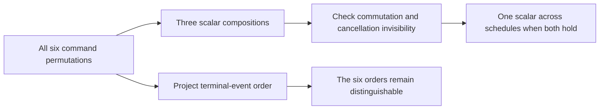

# Checked schedule-invariance criterion for the common resource workload

**Date** 2026-11-25 · **Plan** §2 and §6.5 · **Issue** [#293](https://github.com/aivibeflow/LLMLang/issues/293)

Lean proves an exact two-condition test for whether all six schedules of two commands and one cancellation produce the same final scalar. It also proves that the terminal-event projection still identifies the schedule. Four kernel-checked theorems use no axioms. The executable Lean model agrees with all 9,216 scalar observations of the pinned four-profile fixture.

## Model and invariance test

Let the target operation be `t`, the other operation be `p`, and the initial state value be `v`. Both operations are arbitrary deterministic endomorphisms on the same type. An endomorphism maps values of that type back to the same type. A cancellation before the target suppresses that operation. A cancellation after it preserves its effect. Each command retains an identifying terminal event. The model executes only permutations of one target, one peer and one cancellation.

| Relative order | Final scalar |
|---|---|
| Target before peer, and target before cancellation | `p(t(v))` |
| Peer before target, and target before cancellation | `t(p(v))` |
| Cancellation before target | `p(v)` |

The first two branches must agree for the two operations to commute at the supplied value. The first and third branches must also agree for cancellation to be invisible at that value. Lean proves that both equalities together are necessary and sufficient. Global commutativity over all values is stronger than required for one fixed input. The proof is generic over the state type but works under the exact three-command schedule premise.



The complete traces may contain write, refusal, cancellation and resource settlement data. This proof uses their terminal-event projection, where target settlement, peer settlement and cancellation each leave a distinct name. Because that projection reconstructs the schedule, even an invariant scalar cannot justify reusing an exact ordered observation for another schedule. A consumer that asks only for the scalar can use the two-equality test under the same premises. A consumer that needs the actual effect trace needs the delivery order or a schedule-quantified property with its own evidence.

## Correspondence to the scoped fixture

The executable Lean bridge uses integer changes with per-operation grants and refusal on negative balance. It renames the targeted request to `t` and the other request to `p`, then evaluates every schedule through the proved model. Python separately replays the actor observations from the exact prior fixture. It checks the Lean scalar, compares the terminal-event projection to the requested schedule, and confirms the two equalities against observed invariance. The bridge checks 1,536 finite inputs, with 9,216 comparisons each for scalar and terminal projection. The test includes retained and released leases, which do not alter the scalar equations in this fixture. [Four-profile experiment](../language-design/RT-03/RT-03-FOUR-RESOURCE-PROFILES-2026-11-25.md)

| Commutes at the input | Cancellation invisible at the input | Inputs |
|---|---|---:|
| Yes | Yes | 936 |
| Yes | No | 504 |
| No | Yes | 64 |
| No | No | 32 |

The 568 cases with exactly one satisfied condition are counterexamples to accepting either condition alone. The theorem gives a scoped inference rule. The finite replay independently checks correspondence for the pinned cases. Neither establishes correspondence for a full source parser, a transport, dynamic authority, blocking receives, multiple cancellations, asynchronous cleanup, or interleavings within the operations. These require stronger semantic premises and new proofs or observations. [Dependency map](../research-management/RESEARCH-DEPENDENCY-MAP.md)

## Reproduction

Use Lean 4.36.0, CPython 3.12.14 and Git with the pinned research revision. The harness checks exact Python input blobs, all model outputs, theorem audit lines and ledger bytes across replay.

```sh
fixture=research/formal-verification/SCHEDULE-INVARIANCE-01
PYTHONDONTWRITEBYTECODE=1 python "$fixture/check.py" --out /tmp/llmlang-schedule-invariance.json
cmp "$fixture/evidence.json" /tmp/llmlang-schedule-invariance.json
```

[Lean proof and executable instance](SCHEDULE-INVARIANCE-01/Schedule.lean) · [Bridge and independent comparison](SCHEDULE-INVARIANCE-01/check.py) · [Replay ledger](SCHEDULE-INVARIANCE-01/evidence.json)
