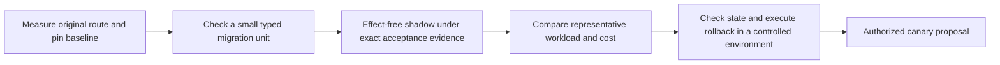

# RT-01 adoption criteria and staged migration

A migration should advance only as far as its evidence supports. The bounded readiness model distinguishes study, effect-free shadow eligibility and eligibility to propose a canary. Production rollout remains a separate decision.

## Candidate gates

| Stage | Required evidence and exit criterion |
| --- | --- |
| Study | Record the immutable original source and workload, typed operation boundary, expected behavior and gaps. Retain the original route as authoritative. |
| Effect-free shadow | Bind the exact baseline and unit, require independent observations and prove isolation from authoritative effects. Compare result, errors, traces and uncovered cases. |
| Canary proposal | Add representative project and participant evidence, measured operational cost against owner-approved thresholds, reversible state, checked rollback and explicit authority. |
| Production decision | Recheck exact current route and data state, authorize separately, and retain observable stop conditions and a recovery plan. |



Use an explicit migration unit and source binding before comparing implementations. Keep authority for writes with one route. Define success, failure and rollback conditions on actual data and downstream consumers before proposing a switch. Existing prototype evidence informs experiment design, while live applicability requires the current repository and environment. [End-to-end examples](RT-01-END-TO-END-EXAMPLES-2026-11-25.md) · [RT-28 source reconciliation](../../compiler-and-translation/RT-28/RT-28-SOURCE-OCCURRENCE-AND-MIRROR-BINDING-2026-11-25.md)

## Checked readiness model

The replay assigns checked, unknown or failed to nine prerequisites and independently compares all 19,683 combinations. A single fully checked profile reaches canary eligibility, 242 reach effect-free shadow eligibility and 19,440 remain study-only. Withholding any individual fact from the fully checked context prevents canary eligibility. Use of prior fixture observations in an actual project would require exact correspondence and revalidation.

This model defines the gating logic. Its complete input case is synthetic. It makes no claim that an existing LLMLang deployment meets the nine prerequisites. A real representative trial, performance thresholds, operational ownership and authorized cutover remain subject to separate decisions and evidence. [Native interoperability evidence](../../compiler-and-translation/RT-28/RT-28-NATIVE-BUILD-HANDOFF-2026-11-25.md)

## Reproduce

Use CPython 3.12.14. Python hash seeds 37 and 71 produce evidence SHA-256 `08596096ffa640b73eb4b5a57c8a501b3e379163d6166a7cec51a2bbb0bb6a7b`. [Evidence ledger](ADOPTION-READINESS-01/evidence.json)

```sh
LC_ALL=C PYTHONHASHSEED=37 PYTHONDONTWRITEBYTECODE=1 \
  python research/language-design/RT-01/ADOPTION-READINESS-01/check.py > /tmp/rt01-adoption.json
```
