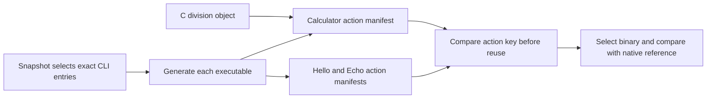

# Scope CLI build actions to native provider dependencies

This RT-01 and RT-11 study compares rebuild policies when the checked CLI workload changes. It uses actual generated Rust executables and an independently compiled C division provider. It asks which action inputs govern reuse when a recipe or compiler setting changes, or when a provider changes while the declared semantic entry and snapshot keep their identities. [Typed CLI workload](RT-01-TYPED-CLI-VERTICAL-SLICE-2026-11-25.md)

## Action inputs and alternatives

The fixture emits a separate executable for Hello, Echo and Calculator. The first two use the workload's hosted runtime. Calculator additionally links an exact C object for checked division. Two C implementations truncate toward zero with identical checked outputs. A third rounds down and serves as a validly compiled but behaviorally incompatible provider. Each version uses the same native entry type and reports divide-by-zero and overflow separately.

An action manifest records the semantic entry, generated source digest, compiler profile, optimization setting and any exact provider object. The generated source binds the entry rather than displaying the whole snapshot digest. The native link input exists only for Calculator. The resulting binary has its own artifact hash. The four key rules use the entry hash, the selected snapshot, the snapshot plus all three action manifests, or the one exact relevant manifest.



Each of six edits starts from the same warm baseline. The edits change the Hello literal, the Echo separator, the equivalent or incompatible provider, the Rust optimization profile, or Echo and the equivalent provider together. The runner builds the physical artifacts for every distinct exact action and executes the required corpus cases. It uses those observations to evaluate the selection and planned compilation count for each key. This counts a whole-key rebuild even when an equivalent physical action already exists elsewhere in the experiment.

## Results

Ten distinct Rust actions physically compile and produce 126 observed case executions. The policy totals count 18 action requests, three per edit. A stale action selects a cached binary from a different required manifest. Output differences compare exact case outcomes against the native build requested by that edit. A masked invalid provider is an incorrectly retained previous binary that passes the existing contract where the requested provider fails it.

| Key design | Planned compilations | Stale actions | Output differences | Masked invalid provider |
|---|---:|---:|---:|---:|
| Entry hash | 3 | 6 | 2 | 1 |
| Semantic snapshot | 9 | 5 | 2 | 1 |
| Whole snapshot and all action inputs | 18 | 0 | 0 | 0 |
| Exact scoped action inputs | 9 | 0 | 0 | 0 |

The scoped key cuts planned compilations from 18 to nine with the same selected exact manifests and outputs as the full key. The equivalent C replacement retains all 24 Calculator observations but changes its exact selected object and action. The floor provider changes the two negative quotient outputs. The entry-only and snapshot-only policies return the old binary in that scenario and hide both failures. Changing optimization also invalidates the exact actions even when the finite observed outputs agree.

## Limits and replay

The measured corpus covers three executables, one native dependency, fixed tool versions and six controlled edits. The key manifest is explicitly assembled by the fixture. General source-derived dependency extraction, distributed cache authority, product provenance, mutable toolchain input closure, and timing or resource claims remain open. No latency or speedup distribution is inferred from the counted actions. Human and model authoring comparisons remain separate evidence requirements.

Use CPython 3.12.14, Debian GCC 14.2.0-19 and Rust 1.85.1 on x86-64 Linux. The ledger pins source and prerequisite fixture digests, exact object and executable identities, and per-case results. Replay from the repository root with the linked typed workload present.

```bash
fixture=research/language-design/RT-01/CLI-ACTION-KEYS-01
PYTHONHASHSEED=1 python3 -B "$fixture/run.py" > /tmp/llmlang-rt01-cli-action-keys.json
cmp "$fixture/evidence.json" /tmp/llmlang-rt01-cli-action-keys.json
python3 "$fixture/chart.py"
```

See the [C provider](CLI-ACTION-KEYS-01/division.c), [build and replay runner](CLI-ACTION-KEYS-01/run.py), [measured ledger](CLI-ACTION-KEYS-01/evidence.json), [table generator](CLI-ACTION-KEYS-01/chart.py), and [RT-11 binding invalidation benchmark](../../toolchain-and-collaboration/RT-11/RT-11-BINDING-INVALIDATION-BENCHMARK.md).
