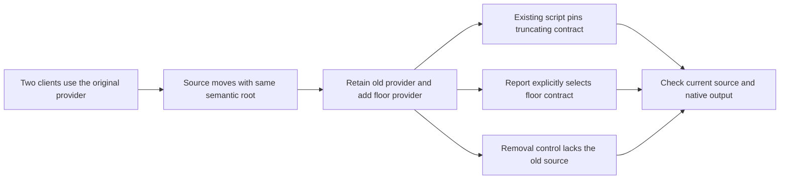

# Preserve and migrate Calculator call sites through a provider split

This RT-01/20 experiment exercises the reference workload's provider move and split task. It asks whether old and opt-in clients can coexist after a shared Calculator implementation is moved and split. It checks actual generated CLI outputs against two explicit contracts and reconstructs each selected provider from exact Git trees. [RT-01 workload](RT-01-REFERENCE-WORKLOADS.md) · [RT-20 call-site refactor](../../semantic-representation/RT-05/RT-05-RT-20-CALL-SITE-REFACTOR-EXPERIMENT.md)

## Fixture and binding rules

An existing script and a report initially use a truncating Calculator. The first edit moves its source while keeping the same semantic body and public selection. The second edit retains the original body and adds a floor-division provider. The report explicitly migrates to the new behavior. The script's contract remains fixed. The third edit removes the old source and keeps the floor provider. Both division contracts share the same argument, result, overflow and diagnostic interface. Two negative quotient cases distinguish them.

The experiment compares retaining the original file path, resolving the current public alias, retaining a common old exact pin, and using the explicit per-call plan. The final control resolves exact plan hashes from a warm content store without requiring them to be selected by the current tree. The source checker imports each Git tree and reconstructs its complete fixture inventory. A valid candidate needs correct native behavior and an available exact provider in that inventory.



A move can preserve the semantic root while changing the Git tree. A split requires a separate decision per call. A cached artifact can still run after its source has disappeared, which supplies a behavior observation with a missing source obligation.

## Results

Four candidates run on both Git files and reftable backends, giving eight equivalent candidate observations across those backends. Two provider bodies compile at Rust O0 and O3. The runner executes all 24 Calculator cases for each combination against both contracts, yielding 192 native subprocess observations and 96 distinct provider, optimization and input vectors. Both optimizations agree within each provider. The floor contract differs from the current corpus only in the two predeclared negative quotient outputs.

| Binding policy | Behavior-only passes | Eligible candidates | Missing selections | Outside current tree | Wrong case vectors |
|---|---:|---:|---:|---:|---:|
| Original path | 2/8 | 2/8 | 12 | 0 | 0 |
| Current public alias | 4/8 | 4/8 | 0 | 0 | 8 |
| Retain the old exact provider | 4/8 | 4/8 | 4 | 0 | 4 |
| Exact call-site plan and selected source | 6/8 | 6/8 | 2 | 0 | 0 |
| Exact plan resolved from warm store | 8/8 | 6/8 | 0 | 2 | 0 |

The file-path policy loses both bindings after the move in either backend. The public alias chooses the floor provider after the split, changing two script outputs per backend in both the split and removal histories. Retaining the old pin passes the existing script checks during the split and misses both report migration cases per backend. The per-call plan passes the baseline, move and split in both backends, and refuses both removed-source trees. The warm-store control returns correct outputs for all eight trees but obtains the old script provider outside the selected inventory in the two removal cases.

## Limits and replay

The fixture has two clients, two arithmetic contracts and one typed native target. Its migration decisions are authored experiment inputs. Production reference discovery, general callers and effects, claim signing, verified authoring, and integration with the full Toolchain publication path remain open. Human and model assessment requires separate participants. The result distinguishes physical locations, logical aliases, exact provider pins and source closure in one executable workload.

Use CPython 3.12.14, Rust 1.85.1 and Git 2.52.0. The initial repository base is `0436da15e9d78ab535a0462c3315bddd22a31e64`. The replay pins source digests and records exact provider and Git identities, native outputs and required call contracts. Run from the repository root.

```bash
fixture=research/language-design/RT-01/CLI-CALL-SITES-01
PYTHONHASHSEED=1 python3 -B "$fixture/run.py" > /tmp/llmlang-rt01-cli-sites.json
cmp "$fixture/evidence.json" /tmp/llmlang-rt01-cli-sites.json
python3 "$fixture/chart.py"
```

See the [source and native runner](CLI-CALL-SITES-01/run.py), [measured ledger](CLI-CALL-SITES-01/evidence.json), [table generator](CLI-CALL-SITES-01/chart.py), and [typed CLI experiment](RT-01-TYPED-CLI-VERTICAL-SLICE-2026-11-25.md).
