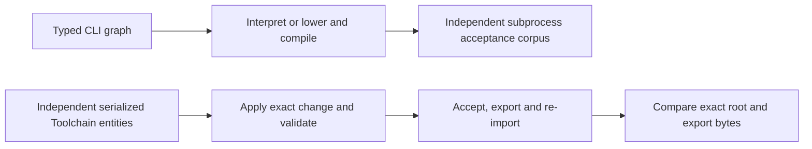

# RT-01 executable end-to-end research examples

Two executable examples cover the hosted program path and the Toolchain change lifecycle. Their original runners and fixtures remain independently replayable. A small evidence check binds both archived receipts and verifies their coverage.

| Example | Workflow | Checked result |
| --- | --- | --- |
| Typed CLI | Admit one typed graph, execute Hello, Echo and Calculator through the interpreter and generated Rust, and compare independent C and Python references | Five routes pass all 34 cases for 170 observations. The direct comparisons preserve required stdout, stderr and process outcomes. Independent mutations test floor division, empty argument handling and diagnostic output. |
| Toolchain round trip | Import independently serialized entities, apply a typed change, validate, accept, export and re-import in a fresh instance | All 864 runs match exact roots and exported bytes. Controls distinguish semantic admission, stale validation, external destination edits and damaged imports. |



The CLI example represents command-line behavior with byte input and checked arithmetic. The Toolchain example represents an editable contract and implementation under a small admitted domain. The fixtures cover different user paths. They do not establish production frontend completeness, native target generality, adoption outcomes or participant performance. [CLI runner and original evidence](RT-01-TYPED-CLI-VERTICAL-SLICE-2026-11-25.md) · [Toolchain runner and original evidence](../../toolchain-and-collaboration/RT-19/RT-19-TOOLCHAIN-ROUNDTRIP-2026-11-25.md)

## Reproduce the evidence check

CPython 3.12.14 with hash seeds 37 and 71 yields evidence SHA-256 `fbed91f05eaf4bcdd0ba1f8c4413a3d15ad40a6763ea728f04f07db1138756ed`. [Evidence ledger](END-TO-END-EXAMPLES-01/evidence.json)

```sh
LC_ALL=C PYTHONHASHSEED=37 PYTHONDONTWRITEBYTECODE=1 \
  python research/language-design/RT-01/END-TO-END-EXAMPLES-01/check.py > /tmp/rt01-e2e.json
```
