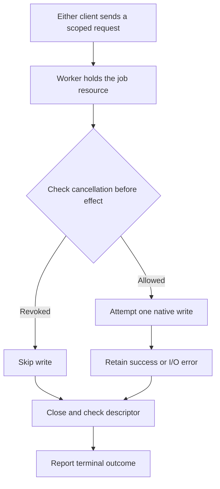

# Cancel and settle a native resource-owning worker

This RT-01/04 experiment provides a shared resource-owning worker workload with two clients, I/O failure, cross-client cancellation and ordered resource release. It distinguishes accepting a cancellation request from preventing its next effect and from reporting a terminal outcome. It compares two independent host implementations on the same controlled schedules. [Reference workloads](RT-01-REFERENCE-WORKLOADS.md) · [Cancellation accounting](../../runtime-and-systems/RT-26/RT-26-CANCELLATION-ACCOUNTING.md)

## Worker and policies

Two client threads forward commands to a dedicated worker over bounded channels. The worker owns two possible Linux file handles. It can acquire a handle, attempt a one-byte write, accept a cancellation request or settle a request. File handles and writes are real. A read-only handle supplies a real `EBADF` failure. The harness observes final file contents separately and checks descriptor existence and closure through `/proc/self/fd` in both implementations.

Commands carry their originating client and target job. Cancellation can come from the other client in this fixture. The driver waits for each response to enforce a declared order of handoffs. The schedule covers cancellation before acquisition and before or after write, observed I/O failure, repeated cancellation and normal settlement. The authored expected result is a terminal status and exact bytes for each job.



The guarded route checks cancellation before writing and preserves a committed success or known I/O failure when a later cancellation arrives. It reports terminal status after releasing the handle. The admission-only route opens a valid resource but continues to attempt a write after later revocation. The early-terminal route acknowledges cancellation as a terminal result even while a handle remains open and can replace an already known result.

## Results

Eight schedules cross three policies and three host configurations, giving 72 worker processes and 504 observed handoffs. CPython and Rust O0/O3 produce identical per-step events, handle counts and final file contents within each scenario. The table counts eight schedules per configuration. A repeated terminal event counts again when it is sent to a client.

| Cancellation policy | Acquired / released | Writes attempted after revocation | Terminal with live handle | Wrong outcomes | Wrong file effects |
|---|---:|---:|---:|---:|---:|
| Guarded write and terminal settlement | 15/15 | 0 | 0 | 0 | 0 |
| Admission check only | 15/15 | 3 | 0 | 0 | 2 |
| Terminate at cancel request | 15/15 | 0 | 6 | 2 | 0 |

The guarded route matches all authored outcomes and file effects, and all 15 acquired handles are observed closed. The admission-only route attempts three revoked writes. Two succeed and leave unexpected bytes. The other reaches a read-only descriptor and fails after revocation. The early-terminal route issues six terminal messages while a descriptor remains open and changes two known outcomes to cancellation. Eventual descriptor balance does not repair an earlier inaccurate terminal report or undo a visible write.

## Limits and replay

The fixture makes the command order explicit and checks process-local descriptor closure on Linux. It leaves uncontrolled scheduling, interruption during a system call, durability, service authorization, multiple worker processes, deadlines and generalized language semantics open. The observed results support a checked commit boundary and a separate post-release terminal boundary for this workload. Human and model authoring comparisons and independent review remain open.

Use CPython 3.12.14 and Rust 1.85.1 on the recorded Linux kernel. The initial LLMLang baseline is `a86c28b0ab08f38bbb307d7391ea8d3b1d4122a6`. The ledger pins both implementation sources, the exact runner, and all observed events and byte outcomes. Replay from the repository root.

```bash
fixture=research/language-design/RT-01/RESOURCE-WORKER-01
PYTHONHASHSEED=1 python3 -B "$fixture/run.py" > /tmp/llmlang-rt01-worker.json
cmp "$fixture/evidence.json" /tmp/llmlang-rt01-worker.json
python3 "$fixture/chart.py"
```

See the [schedule runner](RESOURCE-WORKER-01/run.py), [Python worker](RESOURCE-WORKER-01/worker.py), [Rust worker](RESOURCE-WORKER-01/worker.rs), [measured ledger](RESOURCE-WORKER-01/evidence.json), and [table generator](RESOURCE-WORKER-01/chart.py).
