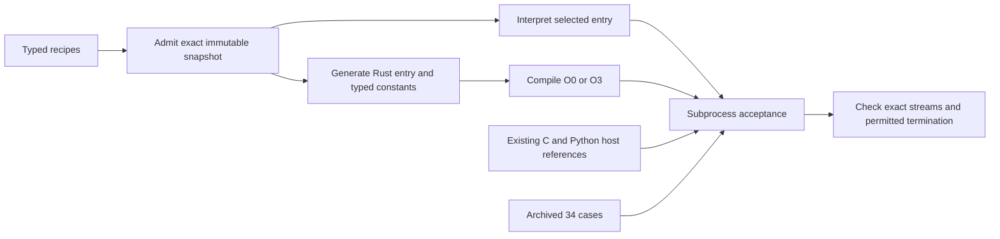

# Execute the RT-01 CLI workload from one typed recipe graph

This RT-01/17 study provides an end-to-end test of recipe admission, interpretation, native generation and subprocess acceptance. It exercises the existing Hello, Echo and Calculator workload with one exact graph. The comparison asks which behavior must stay in the shared semantic input even when parsing, arithmetic and I/O are implemented differently. [Reference workloads](RT-01-REFERENCE-WORKLOADS.md)

## Recipes and execution paths

The admitted schema has three entry kinds. Hello writes an exact UTF-8 literal. Echo joins POSIX argument bytes while controlling empty positions, the separator and line suffix. Calculator reads one LF-or-EOF record, splits on selected byte separators, parses signed 64-bit operands, checks arithmetic range, and emits success or a diagnostic to the declared stream. The division recipe distinguishes truncation toward zero from a floor-division control. The schema rejects entry effects outside the supported set.

The loader creates immutable content-addressed entry artifacts and one semantic snapshot selecting them. The Python process confirms the expected snapshot before executing the chosen body. In the Rust route the lowering consumes that same body and snapshot and emits the entry, typed arithmetic operations and runtime constants. The Rust runtime performs POSIX byte I/O and checked `i64` operations. The interpreted route uses a byte regex and unbounded Python arithmetic with explicit bounds.



The existing acceptance cases supply the expectations and subprocess interface. The environment deliberately removes the reader from stdout in two cases. The checks accept the documented failure exit or SIGPIPE for those cases and preserve the corpus's unspecified stream evidence. Required streams elsewhere are compared as raw bytes.

## Results

All five routes pass every case for 170 accepted subprocess observations. The two Rust settings confirm agreement within the tested compiler on the same selected source and three generated entry programs.

| Route | Accepted cases |
|---|---:|
| Existing Python host reference | 34/34 |
| Existing C host reference | 34/34 |
| Typed recipe interpreter | 34/34 |
| Generated Rust O0 | 34/34 |
| Generated Rust O3 | 34/34 |

| Semantic mutation | Cases rejected in each candidate route |
|---|---:|
| Floor division | 2 |
| Drop empty argument | 2 |
| Diagnostics on stdout | 15 |

Floor division changes both negative quotient cases. Removing empty argument positions changes both positional-emptiness checks. Routing diagnostics to stdout causes all 15 error cases to fail their expected stream checks. Both candidate routes reject the same case IDs for each change. Each mutation changes only its exact entry and the enclosing snapshot. The interpreter rejects a mutated graph when presented with the old snapshot root. The unsupported-effect control fails admission before launching an entry.

## Limits and replay

The graph is a closed typed recipe for three programs with a shared hosted runtime. It supplies neither a general surface frontend nor a general SPG optimizer. The run covers known acceptance cases, finite runtime behavior, and one Linux target. The staged workload leaves stream framing beyond the first LF, arbitrary errors, richer input facilities, broader native targets, and general LLMLang source correspondence open. Human review and model authoring effectiveness require separate participant evidence. The study establishes a common execution and acceptance interface for future controlled evaluations.

Use CPython 3.12.14, Debian GCC 14.2.0-19 and Rust 1.85.1 on x86-64 Linux. The initial LLMLang baseline is `f8e644a8e8ca8fab6e3ca8dcefaca0dccee150a3`. The ledger records source hashes, the exact selected entry and snapshot addresses, generated source and binary hashes, and observed stdout/stderr bytes and status. Replay from the repository root.

```bash
fixture=research/language-design/RT-01/TYPED-CLI-01
PYTHONHASHSEED=1 python3 -B "$fixture/run.py" > /tmp/llmlang-rt01-cli.json
cmp "$fixture/evidence.json" /tmp/llmlang-rt01-cli.json
python3 "$fixture/chart.py"
```

See the [typed recipes](TYPED-CLI-01/programs.json), [interpreter](TYPED-CLI-01/model.py), [native runtime](TYPED-CLI-01/runtime.rs), [lowering and replay](TYPED-CLI-01/run.py), [measured ledger](TYPED-CLI-01/evidence.json), and [table generator](TYPED-CLI-01/chart.py).
