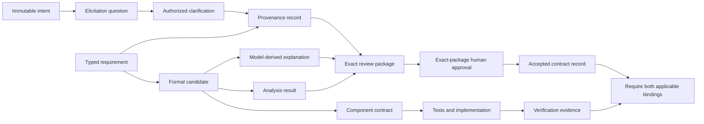

# RT-02 — Bind review and implementation evidence across the requirement lifecycle

## Question and scope

Which artifacts should change when a requirement is rephrased, a source reference changes, or the implementation is replaced? The [RT-02 worked lifecycle](RT-02-REQUIREMENT-RECONSTRUCTION-AND-HUMAN-VALIDATION.md) identifies intent, formal correctness and implementation correctness as separate questions. This exploratory model tests the corresponding identity boundaries before Stage 1 exit decisions. It reuses the existing content store and Scenario 18 semantic requirement values. The baseline is `9cf8f91dae50e40ff9af8fb9bb7c8869d20ce08e` on `research/all`. [Scenario 15](RESEARCH-SCENARIO-15-BUSINESS-INTENT-TO-FORMAL-CONTRACT.md) · [Scenario 17](RESEARCH-SCENARIO-17-TYPED-REQUIREMENT-IR.md) · [Scenario 18](RESEARCH-SCENARIO-18-REQUIREMENT-EVOLUTION-AND-SEMANTIC-IMPACT.md)

## Candidate boundaries

The immutable intent records a source statement. An elicitation question identifies that exact intent. A clarification references the question and records the fixture authority and selected answer. The typed requirement is a separate semantic value. A provenance record links the intent, clarification and typed requirement, so that changing a source locator can preserve the semantic identity. The formal candidate names the typed requirement and its interpretation profile. The explanation reads the deadline from the formal candidate's typed requirement. The analysis and explanation each reference exactly the formal candidate they describe.

A review package collects the candidate, its analysis and explanation, and the provenance for its typed requirement. The approval records the package, actor and decision. The fixture creates an accepted contract record only when the selected package has complete provenance, a consistent analysis disposition and an exact authorized `ACCEPT`. Candidate component, test and implementation records can be prepared separately. The verification record binds the component contract, tests and implementation, with the fixture's verification settings fixed.



The prototype compares approval based on formal identity alone, exact-package approval with package-bound verification reuse, and exact-package approval with evidence scoped independently to the execution tuple. The first accepts a previous review of a different presentation or provenance package. The second couples evidence reuse to the reviewed wording even when the component contract, tests and implementation stay identical. The third preserves the review boundary and checks the evidence's own inputs. In this fixture, fresh applicability requires both the approval and verification bindings to match.

## Results

| Controlled change | Semantic-only approval | Exact-package approval | Execution receipt still applicable |
|---|---|---|---|
| Same package and execution inputs | Accepts | Accepts | Yes |
| Presentation only | Accepts prior review | Requires a fresh review of the package | Yes |
| Source locator only | Accepts prior review | Requires a fresh review of the package | Yes |
| Deadline changes from five to six seconds | Requires fresh approval | Requires fresh approval | No |
| Implementation revision only | Accepts | Accepts | No |
| Tests revision only | Accepts | Accepts | No |
| Exact approval with analyzer `UNKNOWN` or incomplete provenance | Refuses | Refuses | Prior receipt still matches execution inputs |
| `REVISE`, `CLARIFY`, `REJECT`, or acceptance by proposal agent | Refuses | Refuses | Prior receipt still matches execution inputs |

The twelve cases exercise the disposition groups above. Binding approval by formal identity would reuse two approvals beyond their exact reviewed packages. Binding verification reuse to the package would discard applicable execution evidence in both change cases. The typed graph also refuses six malformed chains, including dangling and wrong-kind parents, mixed formal or requirement versions, stale approvals and mixed component versions. [Runner](REQUIREMENT-LIFECYCLE-01/run.py) · [Case ledger](REQUIREMENT-LIFECYCLE-01/evidence.json)

The independent binding scheme separates a request for renewed stakeholder review from a requirement to rerun implementation verification. This distinction holds only when the exact evidence inputs and its policy, obligations and assumptions still apply. At the model boundary, the status, authorization and execution evidence are synthetic control inputs. Real proof checking, provenance completeness and reviewer authorization are independent research obligations. The model covers one deadline clause and omits partial approval, multiple reviewers, signatures and revocation, transaction concurrency and human fidelity measurements. [RT-02 tracking](https://github.com/aivibeflow/LLMLang/issues/287)

## Reproduction

The standard-library runner uses CPython 3.12.14. The ledger preserves exact file SHA-256 values for the runner, requirement evolution model and content store. The output matched with Python hash seeds 1 and 2. The Mermaid source was checked without local rendering.

```bash
fixture=research/language-design/RT-02/REQUIREMENT-LIFECYCLE-01
LC_ALL=C PYTHONHASHSEED=1 python3 -B "$fixture/run.py" > /tmp/llmlang-rt02-lifecycle.json
cmp "$fixture/evidence.json" /tmp/llmlang-rt02-lifecycle.json
```
